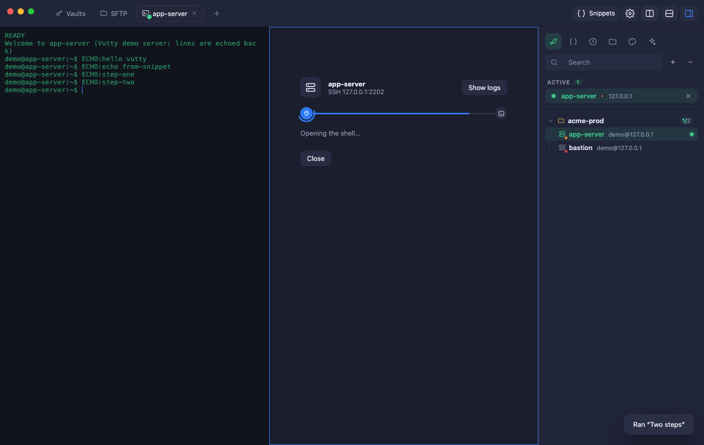
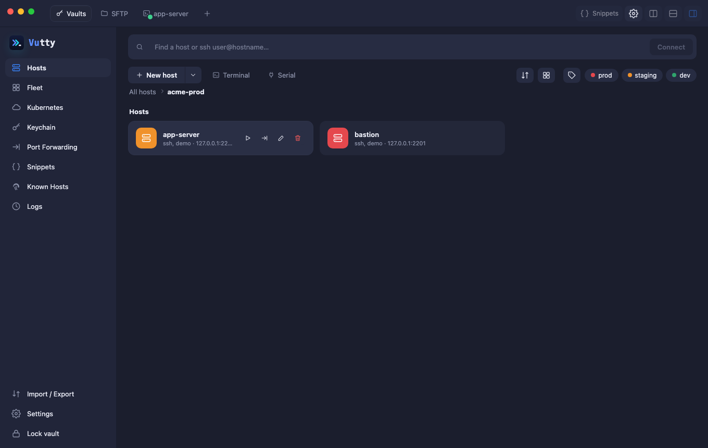
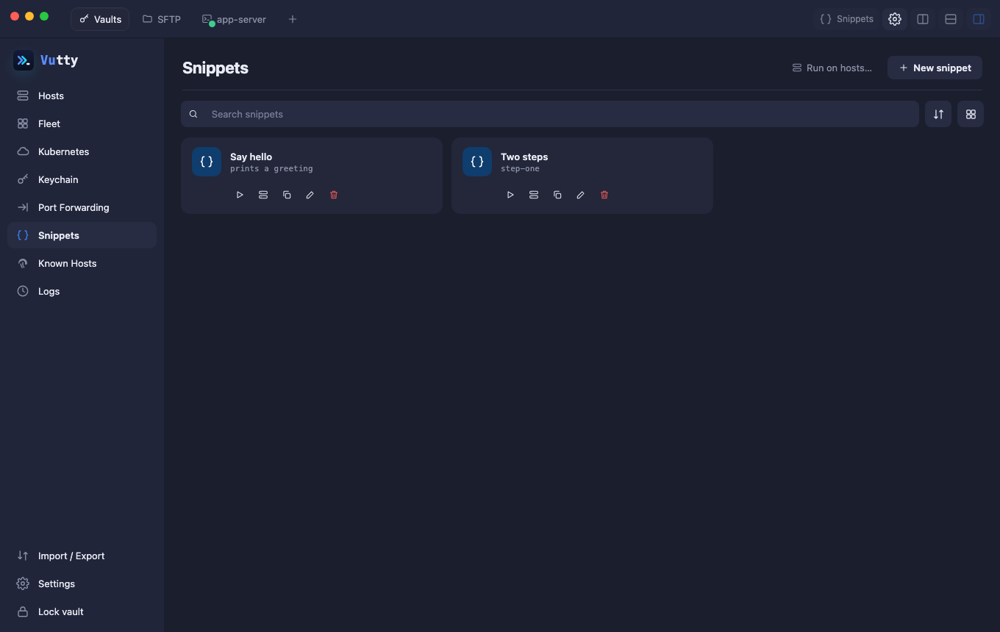
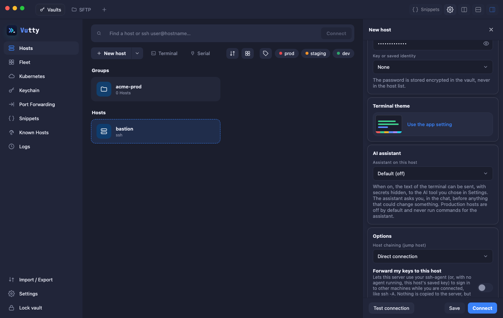
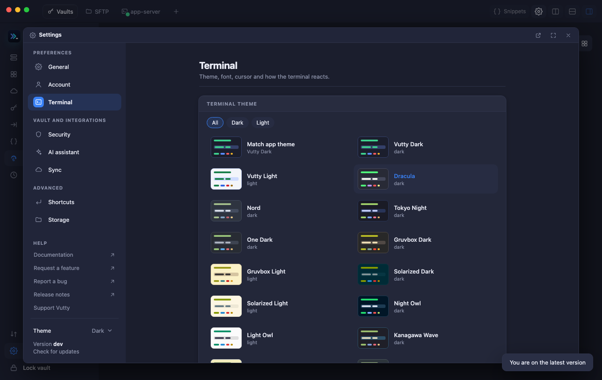

<p align="center"></p>

<p align="center">
  <b>Vutty is a free, open-source SSH client for macOS, Windows and Linux that keeps your hosts, keys and passwords in an encrypted vault that you own.</b>
</p>

<p align="center">
  <a href="https://github.com/vunguyenvu35/vutty/releases/latest"></a>
</p>

<p align="center"><sub>macOS says the app "can't be opened"? Beta builds are not notarized yet: <a href="docs/getting-started/install-macos.md"><b>how to open it in three clicks</b></a>. · <a href="docs/evaluation/comparison.md">Vutty vs Termius, Tabby and WindTerm</a></sub></p>

<p align="center"></p>

## Why Vutty

- **Your data stays yours.** Hosts, keys and passwords live in one encrypted vault on your computer (AES-256-GCM, a key from your master password). Export to standard formats at any time, and sync between your computers through a private Git repository or a cloud folder you control. Nothing goes to a server of ours, and there is no account.
- **Everything an SSH client needs, in one app.** Tabs and split panes, jump hosts, port forwards, serial, Telnet and Mosh, FTP and FTPS next to SFTP (with a transfer queue that resumes, syncs folders and saves your edits back), and Remote Desktop (RDP, in your own client) and VNC (in a tab).
- **Careful with secrets.** Private keys and passwords never reach the interface. A changed server key blocks the connection with no override. The optional AI assistant only ever sees the screen with secrets replaced, and only suggests commands: you decide what runs.
- **In your language.** The whole interface, the menu bar included, is available in English, Tiếng Việt, 日本語 and 中文: pick one in *Settings → General → Language*, or let it follow your system.
- **Free and open source.** No licence tiers, nothing to sign up for.

## What you can do

- **Add hosts the easy way.** A docked form (no popups) with **Test connection**, so you know the address, credentials and jump host work before you save, and **Connect** that saves and opens the terminal in one step.
- **Organise hosts** in groups, with tags and a colour per environment (prod / staging / dev). Find anything from one search box, or type `ssh user@host` to connect right away.
- **Keep secrets safe.** Private keys and passwords are encrypted with your master password. The interface never sees them.
- **Work in tabs and split panes**, through one or more jump hosts, with keep-alive and one-key reconnect. Drag tabs to order them, drag a tab onto a pane to split it (sessions keep running), open a host in a **new window**, and see at a glance which tabs are connected.
- **Run one command on several hosts** at once, each on its own connection, with the exit code and output of every host, a timeout and *Cancel*. Snippets can have blanks (`{{name}}`, `{{name|default}}`) that are asked for when they run.
- **Careful with production.** Hosts marked *prod* get a red frame and a PROD badge, and Vutty asks before text with a line break is pasted there or a snippet is run. Servers that ask for more than a password (a verification code, Duo) are answered in a *Sign in* box over the terminal.
- **A sidebar beside every terminal**: your hosts as a tree like a file manager's (groups with a count, one line per host, a dot on the ones you have open, *Expand all* and the arrow keys), snippets (run or paste), command history, and terminal themes and font.
- **More than SSH**: a shell on this computer, serial ports, Telnet (with its own login), Mosh, FTP and FTPS, RDP and VNC, a *Choose protocol* and connecting screen, Known Hosts and Logs pages.
- **Browse and transfer files with SFTP** in a tab of its own (and in the terminal sidebar): two panes, several files and folders at once, drag and drop, and a **transfer queue** with pause, resume (a copy is continued from the bytes already sent, also after a lost connection), cancel and retry. Compare and **sync folders** (nothing is ever deleted), **edit a remote file** and have it saved back when you save, and a right-click menu with permissions. A copy keeps the modification time of its source, and nothing is replaced without asking.
- **Run a Linux server from a tab with Panel.** A dashboard with no terminal and nothing installed on the server: CPU, memory, disk and what needs attention, processes, systemd services, Docker (Compose stacks, images, volumes), logs that follow live and an **Incident** view of what happened at a past time, certificates and sites of nginx or Caddy, firewall, users and SSH keys, security checks, updates and cron. **Fleet** shows every host on one page, with alerts. Every change asks first. See [Panel](docs/user-guide/08-panel.md).
- **Look after Kubernetes clusters** through a host that has `kubectl`, or from a kubeconfig with nothing installed: pods, workloads, Helm releases, any resource, logs of all the pods of a workload, a shell in a pod, edit YAML with a preview, drain a node. See [Kubernetes](docs/user-guide/09-kubernetes.md).
- **Ask an AI about your terminal** with the official CLI you already use (Claude Code, Codex CLI, Gemini CLI; Antigravity CLI is experimental): the screen is sent with every secret replaced by `*******`, the assistant only suggests commands, and you decide what runs. Add MCP servers for extra tools. See the [user guide](docs/user-guide/10-ai-assistant.md) and the [design](docs/design/ai-assistant.md).
- **Save snippets** of commands you run often and type them into any terminal with a click.
- **Make it yours**: four languages, 26 terminal colour themes, light / dark / auto appearance, font, cursor and scrollback, interface zoom, your own keyboard shortcuts, all in a Settings popup (⌘/Ctrl + ,) like VS Code's: move it by its title bar, resize it by its edges, or turn it into a tab.
- **Forward ports**: local, remote and SOCKS5 proxy.
- **Stay in control.** Import and export your `~/.ssh/config`, import hosts from a listing you made with `aws`, `gcloud` or `ansible-inventory` (or a CSV; Vutty never contacts a cloud), share a host list without secrets, make encrypted backups, or sync between your computers through a private Git repository. The vault locks by itself when the computer sleeps.
- **Heavy output stays smooth.** Output waits for the terminal to draw it, so `cat` of a huge file or a busy `tail -f` slows down instead of freezing the window ([measurements](docs/evaluation/assessment.md#terminal-performance-with-heavy-output-g4)).

<table>
  <tr>
    <td width="50%"><br><sub>Hosts and groups</sub></td>
    <td width="50%"><br><sub>Snippets</sub></td>
  </tr>
  <tr>
    <td><br><sub>New host: Test connection, Save or Connect</sub></td>
    <td><br><sub>Settings and terminal themes</sub></td>
  </tr>
</table>

## Try it

**Requirements:** macOS, Windows (64-bit) or Linux (64-bit). Vutty is currently a beta; macOS is the most tested, Windows and Linux builds are new.

### 1. Install

- **From a release (recommended):** download the file for your system from the [Releases](../../releases) page:

  | System | Download (always the newest release) | How to install |
  | --- | --- | --- |
  | macOS | [`vutty-macos.dmg`](https://github.com/vunguyenvu35/vutty/releases/latest/download/vutty-macos.dmg) (or [`.zip`](https://github.com/vunguyenvu35/vutty/releases/latest/download/vutty-macos.zip)) | open the DMG and drag **vutty.app** to *Applications* |
  | Windows | [`vutty-windows-amd64.exe`](https://github.com/vunguyenvu35/vutty/releases/latest/download/vutty-windows-amd64.exe) | run it, no installer needed |
  | Linux | [`vutty-linux-amd64.tar.gz`](https://github.com/vunguyenvu35/vutty/releases/latest/download/vutty-linux-amd64.tar.gz) | `tar xzf` it and run `./vutty` (needs GTK 3 and WebKitGTK 4.0, for example `libgtk-3-0` and `libwebkit2gtk-4.0-37` on Ubuntu 22.04) |

  The links always point to the newest release. A release also has the same files with the version in their name (`vutty-<version>-macos.dmg`), for an older version, and lists `SHA256SUMS` so you can check your download.
- **macOS with Homebrew:** `brew install --cask vunguyenvu35/vutty/vutty` (the first run adds the tap `vunguyenvu35/vutty`; update later with `brew upgrade --cask vutty`). The cask clears the quarantine flag for you, so the first-launch warning below does not apply.
- **From source:** see the [Development guide](docs/development/development.md) (three commands).

> **First launch.** Beta builds are not signed with a developer certificate yet. On macOS, open the app, then **System Settings → Privacy & Security → Open Anyway** (or run `xattr -dr com.apple.quarantine /Applications/vutty.app`); step by step in [Installing on macOS](docs/getting-started/install-macos.md). On Windows, SmartScreen may warn: choose **More info → Run anyway**.

**Updates:** **Help → About → Check for updates** tells you when a newer release is out. On a Mac with Apple silicon, **Install and restart** downloads it, checks that the release's checksum list is signed with the project's key and that the file matches, replaces the app and restarts it ([how](docs/development/release-signing.md)); version 1.3.0 has to be installed by hand once, as earlier versions do not carry the key. On Windows, Linux and Intel Macs the release page opens: replace the old app with the new one and your data is kept. Once a day, when the app opens, Vutty asks GitHub for the latest release (a plain request that sends nothing about you or your data); switch it off in **Settings → General → Check for updates automatically**.

### 2. First five minutes

1. **Create your vault.** Choose a master password (12+ characters). It cannot be recovered, so keep it safe.
2. **Add a credential** in **Keychain**: generate a new key (copy the public key to your server's `~/.ssh/authorized_keys`), import an existing key, or save a password.
3. **Add a host** with **New host**: address, username and a password (or the key you just made). Press **Test connection** to check it, then **Connect** to save and open it. Optionally pick a group, an environment colour or a jump host.
4. **Connect**: double-click a saved host any time. The first time, check the server fingerprint and choose *Trust and connect*.
5. **Make it yours**: save a **Snippet**, split the pane, open **Port Forwarding**, import your existing `~/.ssh/config` from **Import / Export**, or open **Settings** (⌘/Ctrl + ,) to pick a terminal theme.

The [User guide](docs/user-guide/README.md) walks through every screen with screenshots.

### No server to test with?

Start two throw-away demo SSH servers on your Mac (needs Docker):

```bash
docker compose --profile dev up -d
```

Add hosts `127.0.0.1` port `2201` (bastion) and `2202`, username `demo`, password `demo-password`. They echo whatever you type, which is enough to try tabs, jump hosts, snippets and forwards. Stop them with `docker compose --profile dev down`.

## Your data and your security

| | |
| --- | --- |
| **Where it lives** | `~/Library/Application Support/vutty/` (one SQLite database plus a `known_hosts` file) |
| **What is encrypted** | Keys and passwords: AES-256-GCM, with a key derived from your master password (Argon2id) |
| **What leaves your Mac** | No telemetry, no analytics, no account. Only what you turn on: Git or cloud-folder sync (encrypted data, to *your* repository or folder) and the AI assistant (redacted terminal text goes to the provider of the CLI you enabled). The one automatic request is the update check below |
| **Unknown servers** | You confirm the fingerprint once. If a known server's key ever changes, the connection is **blocked with no override** |
| **Forwards** | Listen on `127.0.0.1` only, unless you explicitly allow more |
| **Auto-lock** | The vault locks after 15 idle minutes (configurable) |

Back up regularly with **Import / Export → Encrypted backup**.

**Forgot your master password?** It cannot be recovered. On the unlock screen choose *Forgot password?* to reset the vault: saved keys and passwords are erased, while hosts, groups, snippets and port forwards are kept. If you have an encrypted backup, restore it afterwards.

## Known limitations of this beta

- The translations (Tiếng Việt, 日本語, 中文) were written with an AI model and have not been read by native speakers yet: please report what sounds wrong. What servers and the backend say (error messages from a connection, for example) stays in English.
- Windows and Linux builds are new and less tested than macOS. On Windows the **terminal on this computer** is not available yet (SSH, SFTP and the rest work). Touch ID and the macOS-specific window features exist only on a Mac.
- "Keychain unlock" stores the vault key in the macOS Keychain. Since this version Vutty asks macOS for an item that guards itself with Touch ID (a new fingerprint set makes it unreadable), but macOS only allows that for an app signed with a Developer ID and the keychain entitlement. The builds published here are ad hoc signed, so they cannot make such an item: they keep the older behaviour, where Vutty asks for Touch ID (or your Mac password) before it reads an ordinary Keychain item, and another program that can read your login keychain is not stopped by Touch ID. Nothing is lost either way: the master password always works.
- Locking the vault when the computer sleeps works on a Mac as the system announces it (and when the screen is locked); on Windows and Linux it locks when the computer wakes up, and a sleep of a few seconds is not noticed.
- Settings is a popup of the main window: it cannot be dragged out of it or put on a second screen. It was checked in a browser and with component tests, not yet in the packaged app, and its screenshots here are from the older Settings window.
- Git sync was tested with local repositories, not yet with every hosting provider.
- `ProxyCommand` and `Match` blocks in `~/.ssh/config` are reported as warnings on import and skipped.

The full list is in the [release notes](RELEASE_NOTES.md).

## Feedback and bug reports

Your feedback is the point of this beta. Please [open an issue](../../issues/new) and include:

- what you did, what you expected and what happened (a screenshot helps);
- your Vutty version and macOS version;
- **never** paste passwords, private keys or your vault file.

## Support Vutty

<p align="center">
  Vutty is free and open source, built and maintained in spare time.<br>
  If it saves you time, you can help keep it going.
</p>

<table align="center">
  <tr>
    <td align="center" width="200"><h2>☕</h2><b>$3</b><br><sub>a cup of coffee</sub></td>
    <td align="center" width="200"><h2>🍜</h2><b>$10</b><br><sub>a lunch</sub></td>
    <td align="center" width="200"><h2>🚀</h2><b>$25</b><br><sub>fuel new features</sub></td>
  </tr>
</table>

<p align="center">
  <a href="https://ko-fi.com/vunguyenvu"></a>
</p>

<!-- CRYPTO-DONATE: hidden for now. To show it again, remove this comment line and the matching end line.
<p align="center"><b>Prefer crypto?</b> Scan a code or copy an address, and check the network before you send.</p>

<table align="center">
  <tr>
    <td align="center" width="300">
      <br><br>
      <br>
      <sub><code>TMXXHRNG7qauoFWJKYbqEbd4FGgt3DgjBK</code></sub>
    </td>
    <td align="center" width="300">
      <br><br>
      <br>
      <sub><code>0x4bdfd1d6456c28d06e3f8456ddac59e6168e5153</code></sub>
    </td>
  </tr>
</table>

<details>
<summary>Copy an address</summary>

```
TMXXHRNG7qauoFWJKYbqEbd4FGgt3DgjBK
```

```
0x4bdfd1d6456c28d06e3f8456ddac59e6168e5153
```

</details>
CRYPTO-DONATE end -->

<p align="center"><sub>Stars, bug reports and pull requests help just as much. Thank you!</sub></p>

## Documentation

Start at the [documentation index](docs/README.md).

| | |
| --- | --- |
| [User guide](docs/user-guide/README.md) | every feature, chapter by chapter, with screenshots |
| [Installing on macOS](docs/getting-started/install-macos.md) | opening a beta that is not notarized (Gatekeeper) |
| [Release notes](RELEASE_NOTES.md) | what is new, quality results, known issues |
| [Development guide](docs/development/development.md) | build, test, Docker, deploy |
| [Release signing](docs/development/release-signing.md) | how updates are signed, and how the app installs them itself |
| [Architecture](docs/design/clean-architecture.md) | layers, decisions, technical debt |
| [Comparison](docs/evaluation/comparison.md) | short table against Termius, Tabby and WindTerm |
| [Assessment](docs/evaluation/assessment.md) | honest comparison with the original design |

## License

See [LICENSE](LICENSE). The open-source libraries Vutty is built on, with their licences, are listed in [THIRD_PARTY_NOTICES.md](THIRD_PARTY_NOTICES.md); every download carries a copy.

Vutty is not affiliated with or endorsed by Anthropic, OpenAI or Google. Claude Code, Codex, Gemini and Antigravity are trademarks of their owners; Vutty only runs the CLI you installed, and its use is governed by that provider's terms. The open-source libraries Vutty is built on, with their licences, are listed in [THIRD_PARTY_NOTICES.md](THIRD_PARTY_NOTICES.md); every download carries a copy.
