

# Vutty user guide

A step-by-step guide to every screen of Vutty, from creating your vault to connecting, transferring files and getting help. The screenshots show the app as it looks today.

## Contents

1. [Create and unlock the vault](#1-create-and-unlock-the-vault)
2. [The main window](#2-the-main-window)
3. [Keychain: keys and passwords](#3-keychain-keys-and-passwords)
4. [Add a host: test, save, connect](#4-add-a-host-test-save-connect)
5. [Hosts and groups](#5-hosts-and-groups)
6. [Connect](#6-connect)
7. [Snippets](#7-snippets)
8. [Split panes and search](#8-split-panes-and-search)
9. [SFTP: browse and transfer files](#9-sftp-browse-and-transfer-files)
10. [Port forwarding](#10-port-forwarding)
11. [Import and export](#11-import-and-export)
12. [Settings](#12-settings)
13. [Sync between Macs](#13-sync-between-macs)
14. [Forgot your master password](#14-forgot-your-master-password)
15. [When something goes wrong](#15-when-something-goes-wrong)
16. [Where your data lives](#16-where-your-data-lives)
17. [Connecting: protocol, progress and errors](#17-connecting-protocol-progress-and-errors)
18. [Tabs: order, split, new window](#18-tabs-order-split-new-window)
19. [The terminal sidebar](#19-the-terminal-sidebar)
20. [This computer, Telnet and serial ports](#20-this-computer-telnet-and-serial-ports)
21. [Known Hosts and Logs](#21-known-hosts-and-logs)
22. [AI assistant](#22-ai-assistant)
23. [Shortcuts at a glance](#23-shortcuts-at-a-glance)

## 1. Create and unlock the vault

On first launch choose a master password (at least 12 characters). It protects your keys and passwords and **cannot be recovered** (see [section 13](#13-forgot-your-master-password) for what you can do if you lose it).

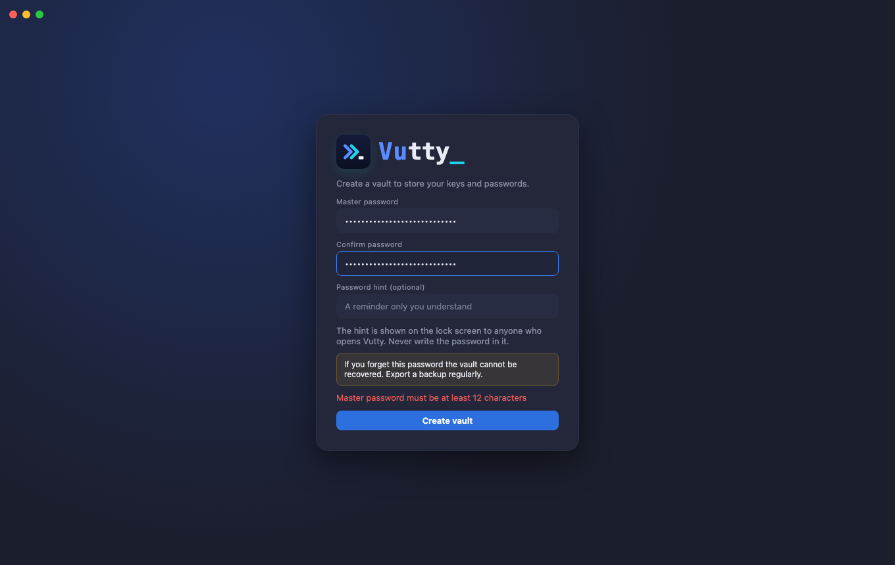

Next time, or after auto-lock, enter it to unlock. A wrong password never unlocks anything.

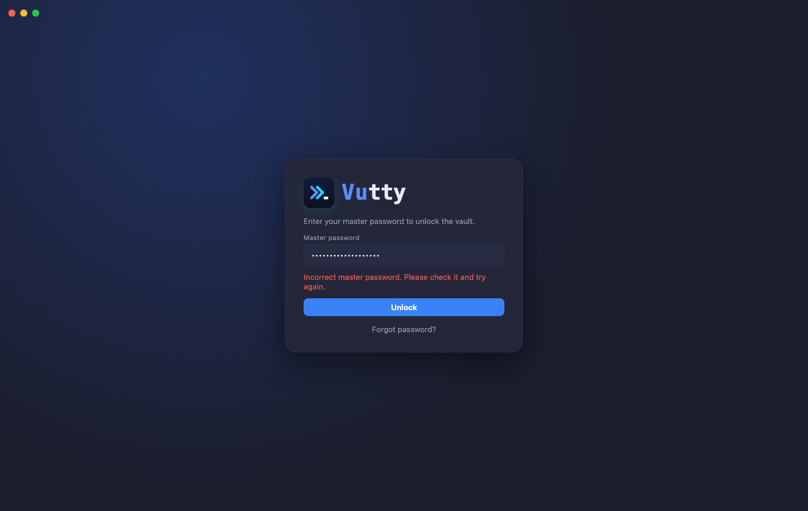

## 2. The main window

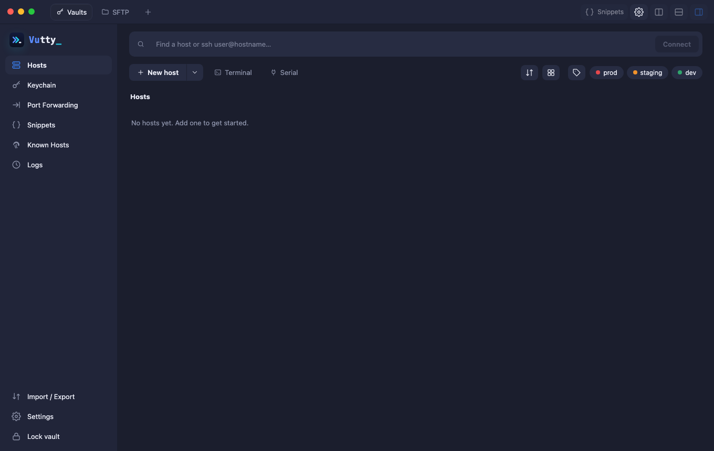

- **Title bar:** the **Vaults** tab is home; every terminal you open becomes a tab. **+** returns home to find a host. At the right: the **Settings** gear, **Snippets** and the split buttons (active inside a terminal). Drag the bar to move the window.
- **Navigation:** Hosts, Keychain, Port Forwarding, Snippets; at the bottom Import / Export, Settings and Lock vault. In a narrow window the navigation shrinks to icons.

## 3. Keychain: keys and passwords

**Keychain** holds identities. Pick a tab:

- **Generate key**: creates an ed25519 key pair. Only the public key is shown. Copy it into `~/.ssh/authorized_keys` on your servers.
- **Import key**: from a file or pasted text; give the passphrase if the key is encrypted.
- **Add password** or **ssh-agent** identity.

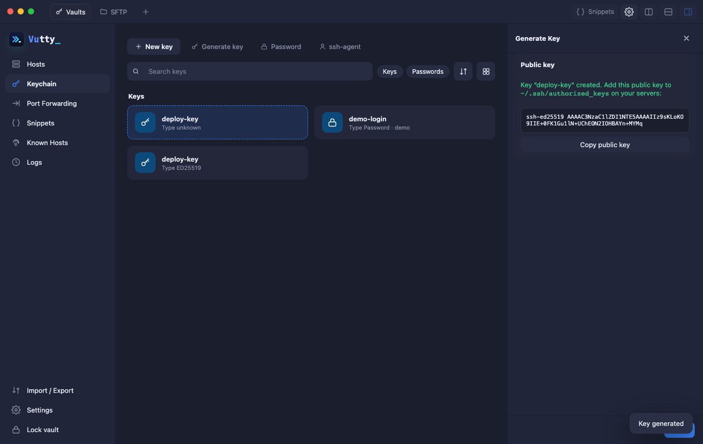

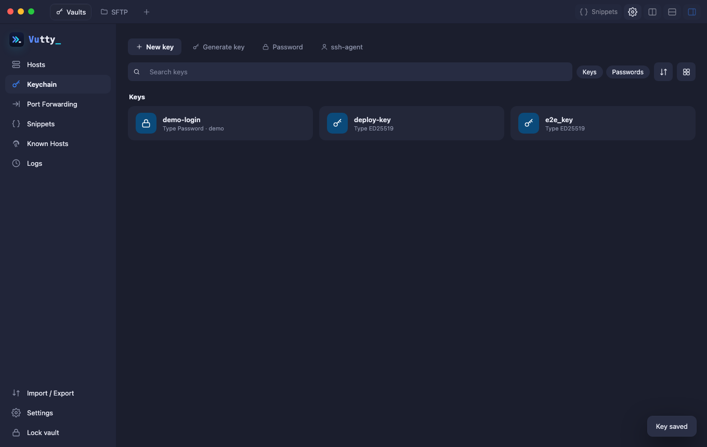

**Hardware keys (FIDO2, YubiKey).** Vutty cannot talk to a security key itself, and it has not been tried with one. For an **ssh-agent** identity it asks your ssh-agent to sign, so a hardware key can only work if your agent can use it (load it with `ssh-add`; whether the agent supports security keys depends on your OpenSSH). The touch the key asks for is up to the agent. Please report what you find.

Private keys and passwords never leave the vault: the interface only shows names and public keys. A password you type in the host form is saved here automatically as an identity.

**Edit** (or double-click) changes a key, password or ssh-agent identity where it is, so the hosts that use it keep using it: rename it, change its user name, type a new password or replace the private key.

**Items that cannot be read.** Each time the list opens, Vutty checks that the vault's key opens every saved secret. A secret that was sealed with another key (it happened with a leftover quick-unlock key in older versions) is marked **Can't be read**, with a notice at the top that says how many there are. A host that uses one fails with *the saved secret of … cannot be read with this vault's key* instead of a bare cipher error. The secret itself cannot be recovered from the vault: **Edit** it and enter the password, or import the private key, again, and the mark goes away. Do this before you sync, or the unreadable copy is passed on to your other machines.

## 4. Add a host: test, save, connect

**New host** opens a form **docked next to the host list** (no popup), with a draft card showing what you are typing. If you move to another screen the form closes.

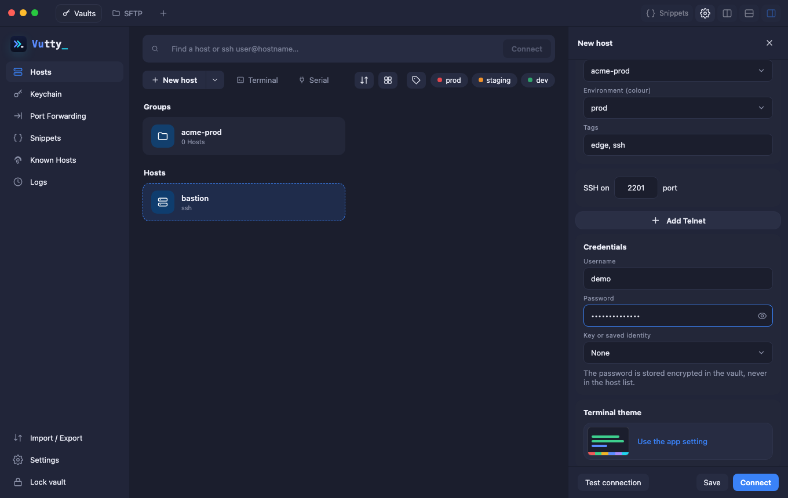

The form follows one flow, top to bottom:

1. **Address** (IP or hostname).
2. **General**: label, parent group, environment colour, tags.
3. **SSH on … port**.
4. **Credentials**: username and password, or choose a saved key/identity. The eye shows or hides the password.
5. **Options**: host chaining (jump host) and keepalive.

Dropdowns open a custom menu with hints and keyboard support (arrows, Enter, Esc, type to jump):

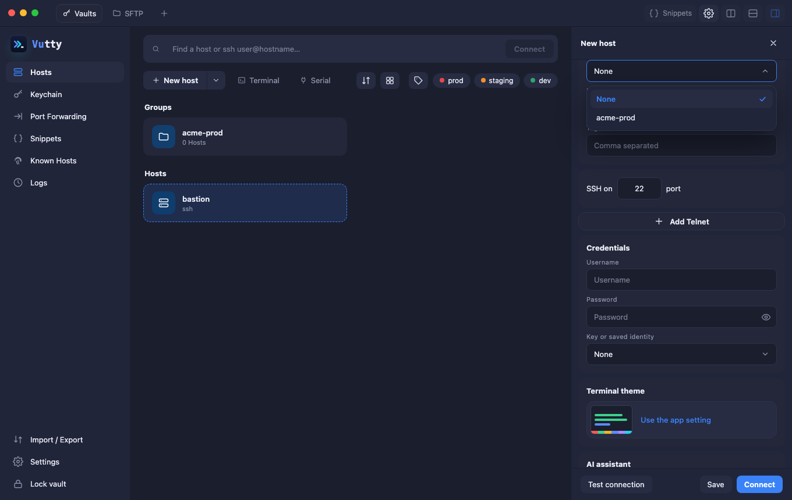

**Forward my keys to this host** (under *Options*) is `ssh -A`: while you are connected the server can ask your keys to sign in to other machines, so you can `git pull` or `ssh` onward from it without leaving a key there. Vutty forwards your running **ssh-agent** when there is one; with no agent it offers the saved key of this host's own identity, from a small agent that exists only for that connection and goes away with it. Nothing is copied to the server, but anyone with root on it can use your keys until you disconnect, so turn it on only for servers you trust (a **jump host** reaches the machines behind it without exposing your keys at all). It is off by default, applies to terminals only (not SFTP, forwards or *Run on hosts*), and a server that does not allow it simply opens without it. If it cannot be set up (no agent and no saved key), the terminal still opens and the Logs say why. `ForwardAgent` is read from and written to an ssh config on import and export, and an imported host that has it comes with a warning.

At the bottom:

- **Test connection** checks what you typed (including the jump host) **without saving anything**. For an unknown server you confirm its fingerprint right in the form.
- **Save** stores the host.
- **Connect** saves it and opens a terminal.

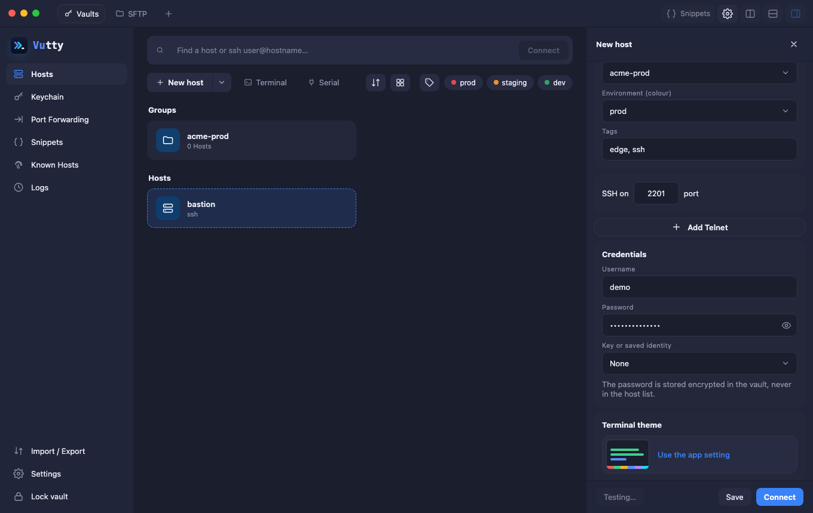

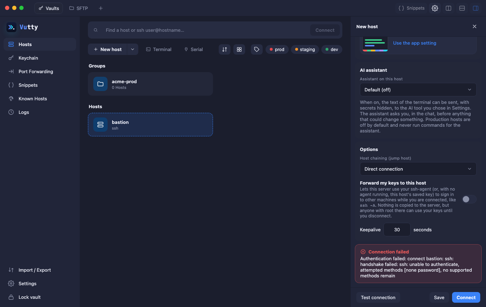

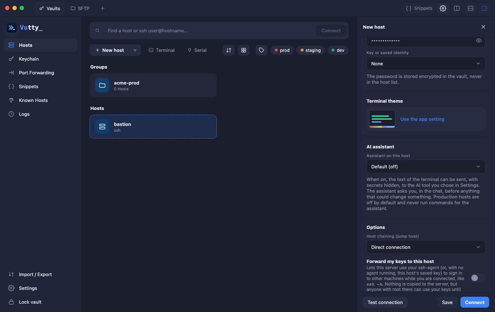

A failed test explains why (wrong password, host unreachable, key not trusted) and never shows the password.

## 5. Hosts and groups

Groups appear as cards with their host count. Click one to open it (a breadcrumb takes you back).

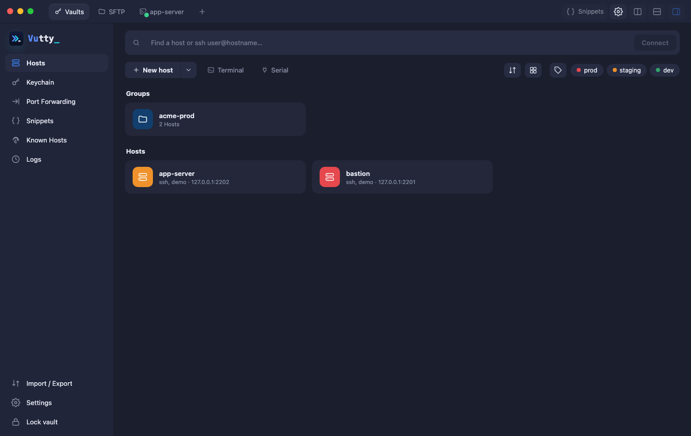

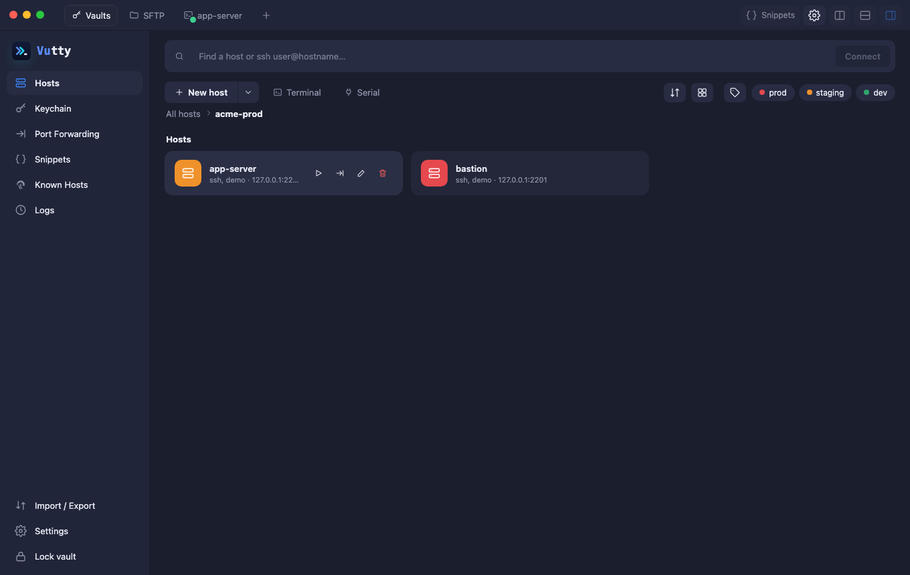

**Search** matches label, hostname, user and tags across all groups; the environment chips filter further.

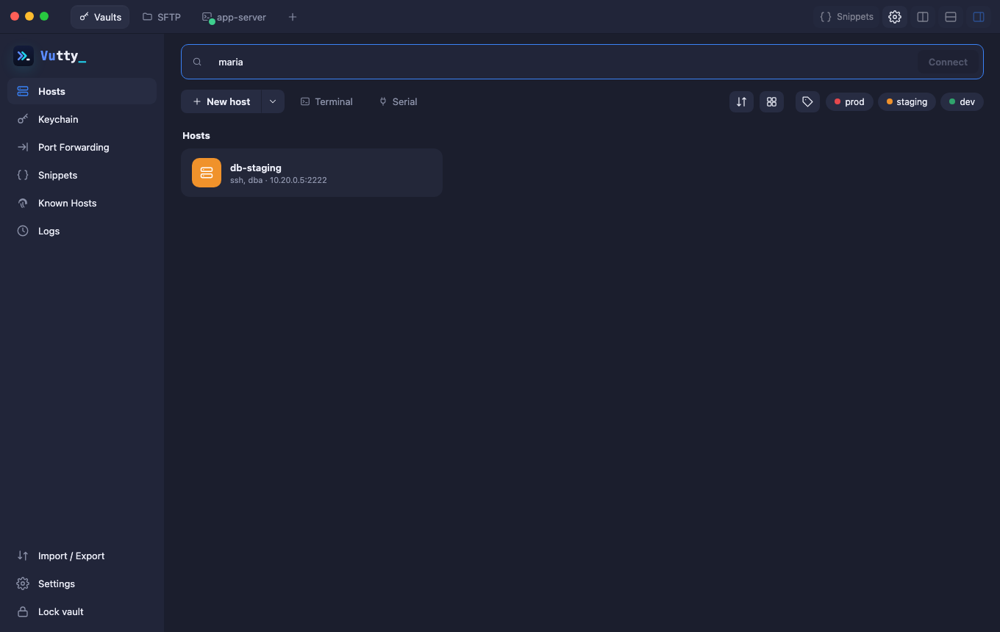

**Deleting a group deletes what is in it.** The confirmation says how many hosts and groups below it go with it (their port forwards too). Move the hosts you want to keep to another group first.

**Quick connect:** type `ssh user@host:port` and press Enter. If it matches a saved host you connect; otherwise *New host* opens pre-filled so you can save it.

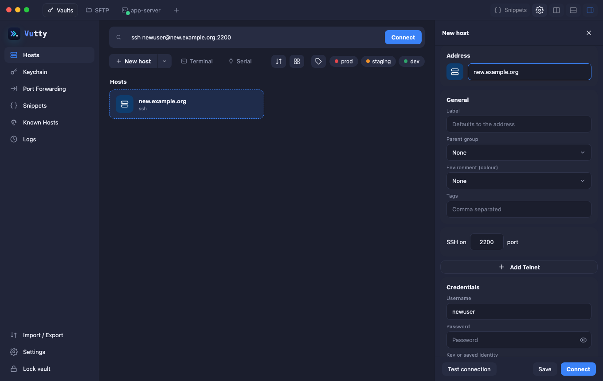

## 6. Connect

Double-click a host card (or press ▶), or use **Connect** in the New host form. The first time, Vutty shows the server fingerprint. Verify it out of band, then choose **Trust and connect**. With a jump host you confirm each machine once.

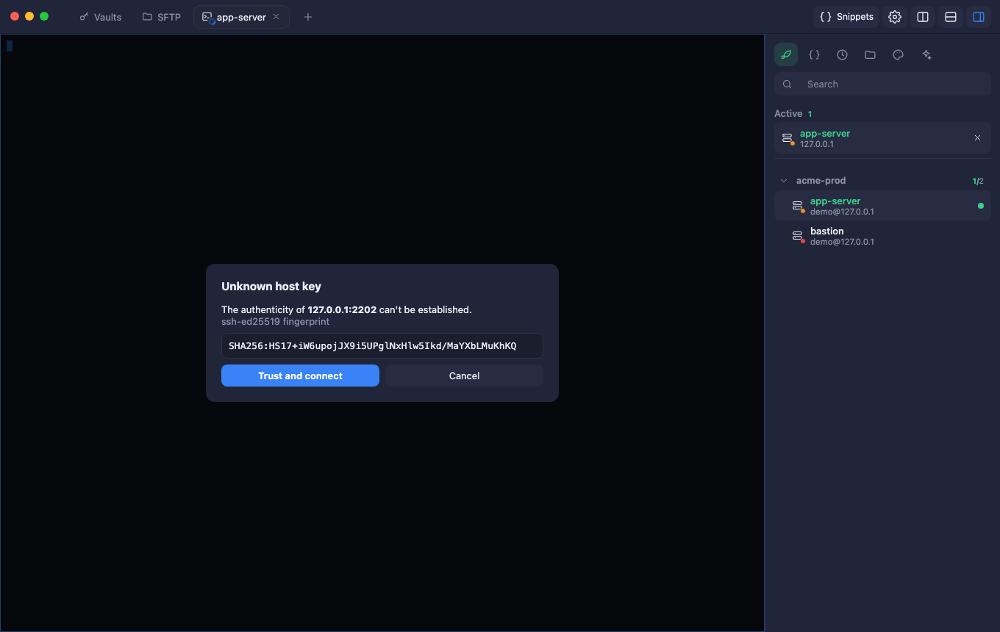

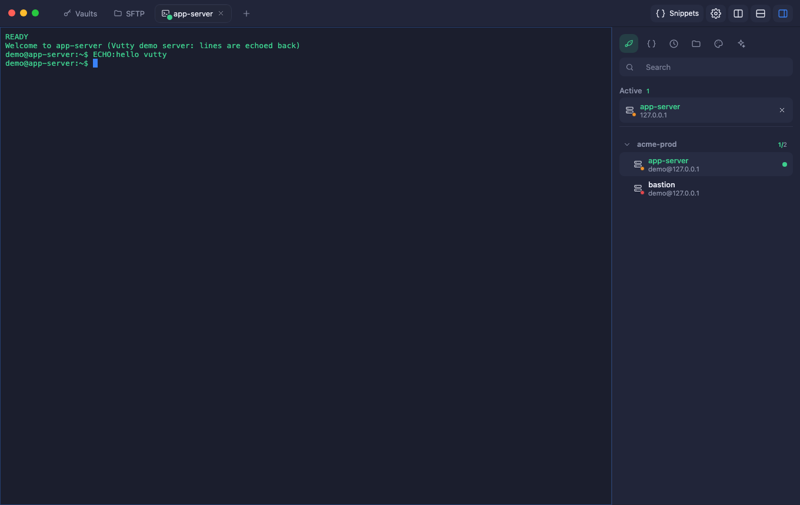

Trusted keys go to `known_hosts` (OpenSSH format) and are not asked again.

## 7. Snippets

Snippets are commands you reuse. **Snippets → New snippet**: a label, an optional description and the script (one or more lines).

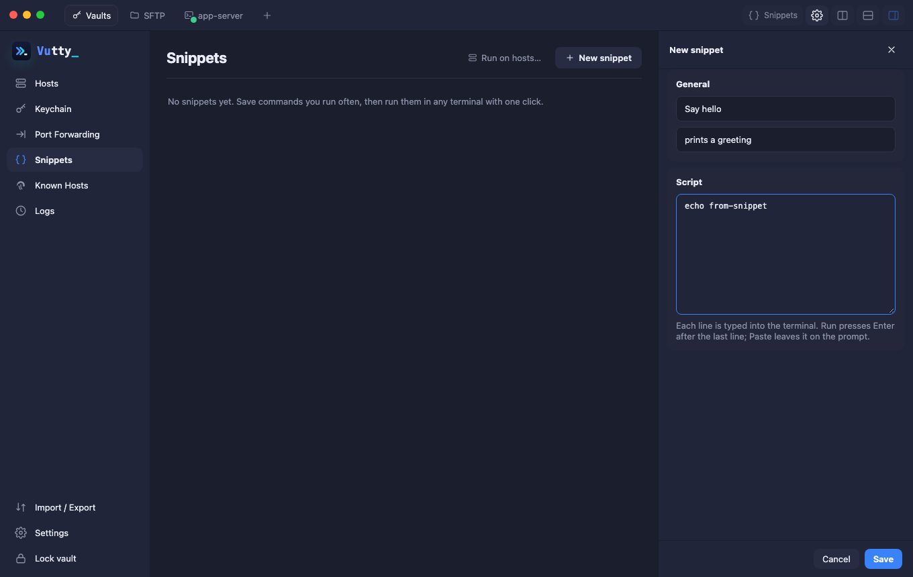

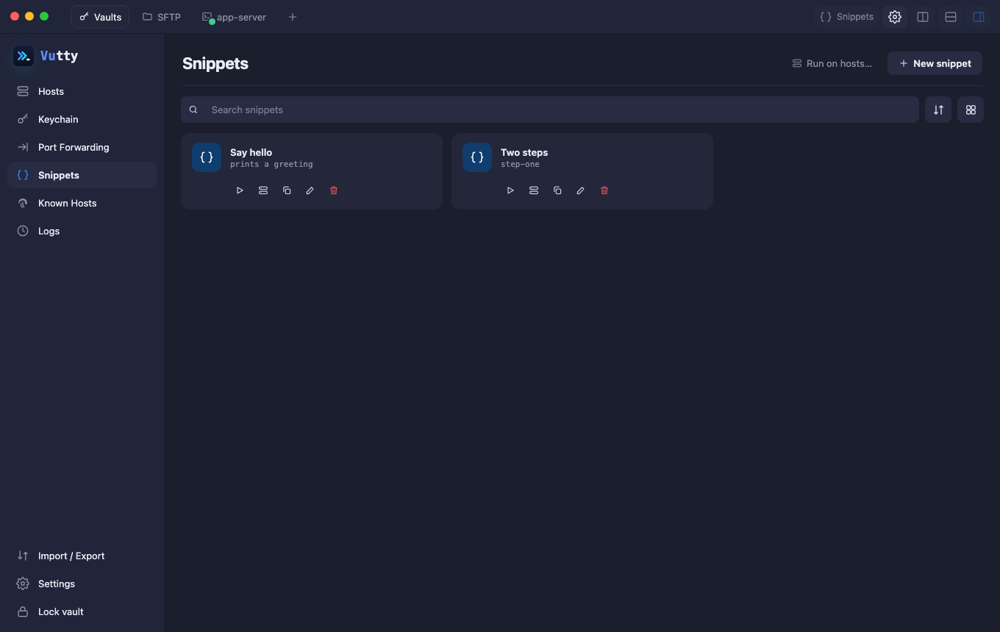

**Blanks.** Write `{{name}}` in a script where a value changes, or `{{name|default}}` to give it a default. When you Run or Paste the snippet, a box asks for each blank (an empty box uses the default) and the answers are put in as plain text; **Use as written** types the script untouched, for text that only looks like a blank. Go-template text such as `{{.Names}}` is not a blank.

**Run on hosts.** **Snippets → Run on hosts…** (or the server button on a snippet) runs one command on several hosts at once. Choose the hosts (search, or **All shown**), write the command or start from a snippet, fill in its blanks, and choose how long to wait for each host. Then **Run**: every host gets its own connection and **no terminal**, five at a time, and the page lists each host as it finishes, with its exit code, how long it took and what it printed (a failed host opens by itself; the first 64 KB of the output are kept). **Cancel the run** disconnects the hosts that are running and skips the rest, **Copy all output** puts everything on the clipboard, and **Run again…** goes back to the form with your command and hosts. In the command, `{{host}}`, `{{hostname}}` and `{{user}}` become each host's own label, address and user name (a value with spaces or other shell characters is put in quotes). If any chosen host is marked **prod**, you are asked to confirm first. Nothing is asked while it runs: a host whose key you never trusted, or that asks for a verification code, fails with a message that says so; open it once in a terminal tab first. The command and the output are not written to the Logs (only that a command ran on the host, and its exit code), and a finished run is forgotten when you close the window.

- **Run** (▶) types the script and presses Enter in the focused pane of your terminal and switches to it.
- **Paste** types it *without* Enter, so you can read or edit it first.
- Inside a terminal, the **Snippets** menu in the title bar does the same without going back home.

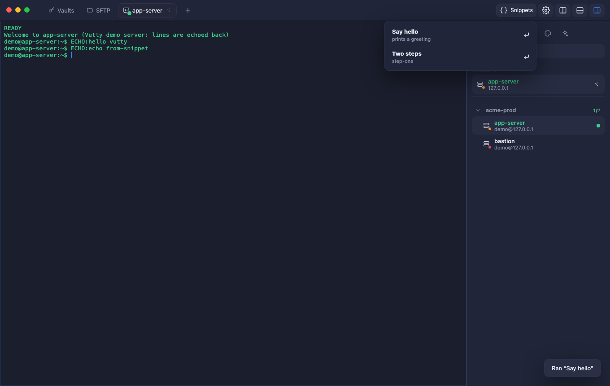

A terminal must be open and connected. Snippets sync with Git and are included in backups.

**Command suggestions.** While you type in a terminal, a **list** of the commands you used before that match appears under the cursor, each row marked *typed*, *snippet* or *host*: **↓ ↑** choose a row, then **Enter** or **Tab** put it on the line (it is never run for you), **Esc** closes the list until the next line. A row is only taken when you chose it with the arrows: until then Enter runs what you typed, **Tab** is the shell's own completion and the arrows go to the shell, as always. **⌘⇧J** (Ctrl+Shift+J on Windows and Linux; changeable in Settings → Shortcuts) opens the list by hand, also for an empty line; with nothing to show it says "No matching commands". **Ctrl/⌘+Shift+G** turns suggestions off and on at once and tells you which. Both are also in the **View** menu (*Command Suggestions* and *Show Suggestions*), which shows their keys.

- The suggestions come from the commands you ran **at the same host** in Vutty (the command that ran, as the screen shows it: a line completed with Tab or finished with the shell's own suggestion is kept whole). Each host has its own list, so a command typed on this computer is never offered at a server, and the other way round, the shell history of this computer (`~/.zsh_history` and `~/.bash_history`) in the **local** terminal, your Snippets of **one line** (a snippet of several lines is never suggested, because its first lines would run at once; a snippet is also found by its name) and, if you turn it on, the shell history of an SSH server.
- **Settings → Terminal → Suggest commands** switches it all off. **Suggest from the host's shell history** is off by default and is about SSH servers: it reads the last 3000 commands of `~/.bash_history` and `~/.zsh_history` over the open SSH connection when the terminal opens, keeps them in memory only, and leaves out any command that holds a secret.
- A suggestion is only offered when Vutty is sure what is on the line and the screen shows it at the cursor: not in vim or htop, not at a password prompt, and not while the shell is changing the line (after Tab or an arrow key the line is read from the screen again). A line that looks like a password, token or key is never suggested.

## 8. Split panes and search

Use the two buttons at the top right to split the focused pane right or down. Every pane is its own session to the same host. **Ctrl/Cmd+F** searches the scrollback. When a shell exits (`exit`) its pane closes; closing the last pane closes the tab.

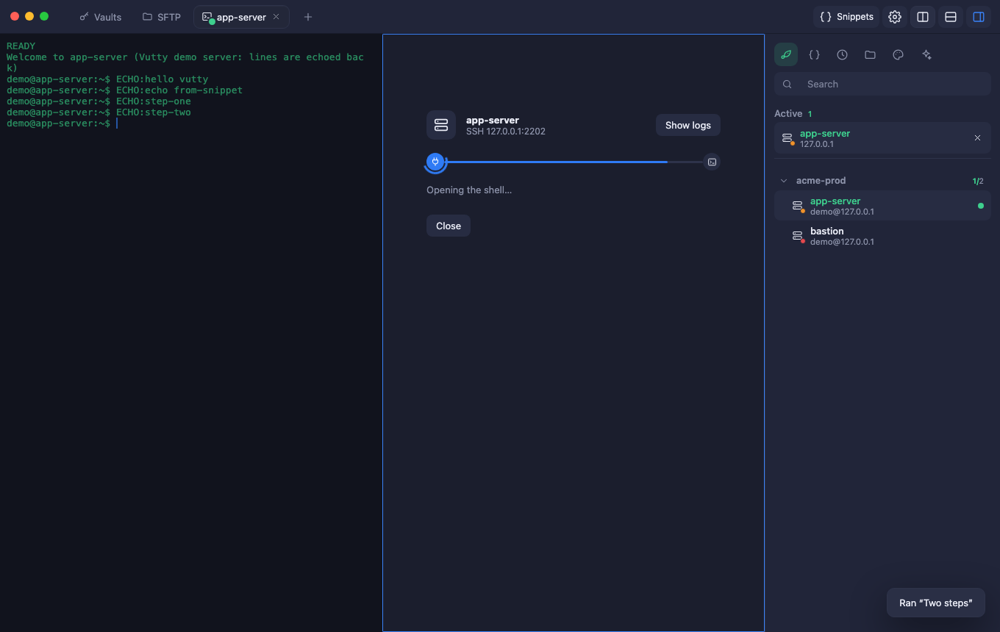

## 9. SFTP: browse and transfer files

Use the **folder button** on a host card to open a file browser in its own tab (the tab has a folder icon). Vutty opens a separate SSH connection, through the jump hosts if the host has any, so you do not need an open terminal. The first time you connect to an unknown server you are asked to trust its key, exactly as for a terminal.

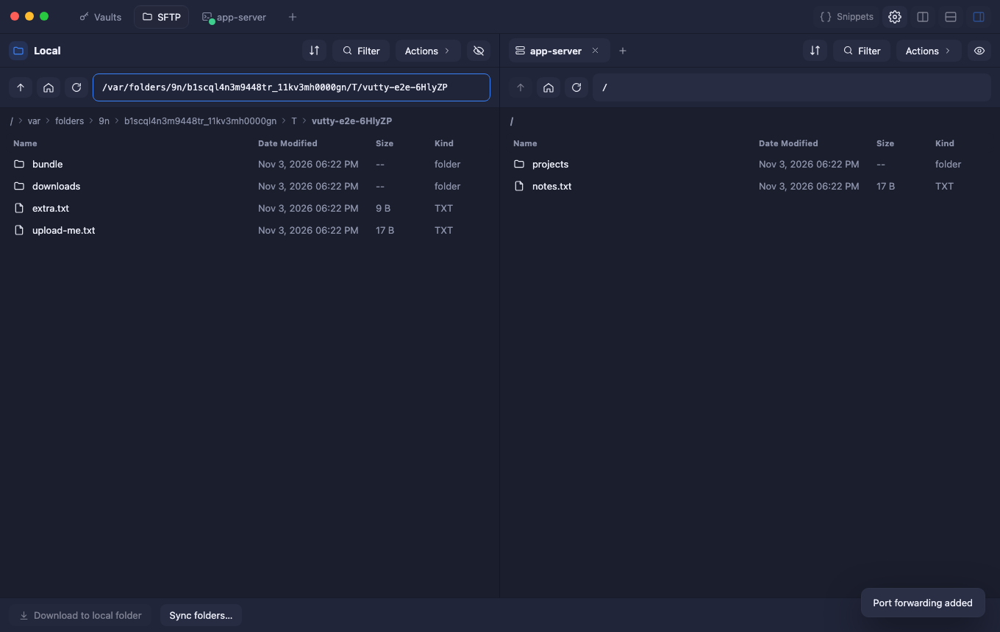

- **Browse:** double-click a folder (or press Enter), use the arrows, breadcrumbs, *Up*, *Home*, *Refresh* or type a path in the box.
- **Upload** into the current folder, **Download** the selection, **New folder**, **Rename**, **Delete** (folders are deleted with everything inside, after a confirmation). Select several files and folders (Cmd/Ctrl-click, Shift-click) and drag them across, or use the buttons: folders go with everything inside.
- Nothing is overwritten silently. If some of what you send already exists at the other side, you are asked **once** for the whole batch whether to replace those files; answer no and they are left as they were.

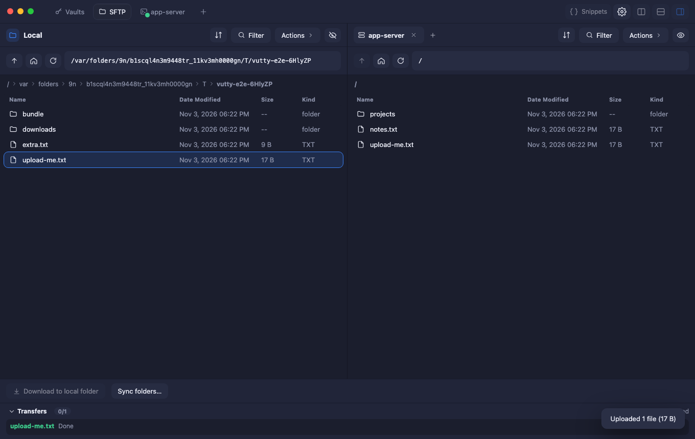

### The transfer queue

Transfers run **in the background**, two at a time, and are listed in the **Transfers** panel at the bottom (it collapses to a badge with the overall progress). Keep browsing, or start more transfers, while they run.

- **Pause** stops a transfer where it is and **Resume** continues it **from the bytes already copied**, not from the start. A transfer that fails (the network drops, the disk is full) keeps what it had: **Retry** continues it. The same holds if you close and reopen the connection: send the file again and the partial copy is continued, as long as the file has not changed in between.
- **Cancel** ends a transfer for good and deletes the partial file it left.
- **Clear finished** removes the done, failed and cancelled lines.
- A partial copy is a hidden file next to the target (`.vutty-part-…`) until the transfer is complete; then it is renamed into place, so a half-written file never has the real name.

### Sync folders

**Sync folders…** (at the bottom) compares a folder on this computer with one on the server, in the direction you pick (*Local → Remote* or *Remote → Local*), starting from the folders open in the two panes. **Compare** shows what would be copied: files that are **new**, files that **changed** (another size, or newer at the source), how many are identical, and the files that exist only at the target. **Sync** puts the copies in the queue.

A sync **never deletes anything**: files that only the target has are listed and left alone.

### Edit a remote file

Right-click a file on the server and choose **Edit and save back**. Vutty downloads it, opens it in the program your computer uses for that kind of file, and **uploads it again every time you save**, keeping the permissions the file had. If the file on the server changed since you opened it, nothing is overwritten: you are asked whether to replace the server's copy with yours. (A change is noticed by size and by time to the second, so two edits in the same second that leave the size unchanged are not told apart.)

### Files in the terminal sidebar

The sidebar of a terminal has a **Files (SFTP)** section for the host of the focused pane: browse its folders, upload files or a folder, download, with the same queue. It opens its own connection when you open the section and closes it when you leave. It is not offered for a terminal on this computer, a serial port or Telnet.

- If the connection drops, a banner offers **Reconnect**.
- **Limits:** transfers do not preserve the modification time of the files; stale `.vutty-part-…` files from a transfer you abandoned are not cleaned up by themselves (delete them by hand); no drag and drop of files from Finder into the window (use the buttons). Closing an SFTP tab asks first (see *Confirm before closing a tab*).

### Panel: a server dashboard in a tab

When a host asks which protocol to use (the **Ask which protocol to use** setting, or a host that also has Telnet), **Panel** is the fourth choice. It turns the tab into a dashboard of the Linux server, with no terminal: **Overview** (CPU with a short history, load, memory, swap, the root disk, network speed, and what needs attention), **Processes** (the busiest first, with a filter), **Services** (systemd, failed ones first), **Docker** (containers), **Logs** (the last 300 lines of the system journal, one service or one container; filter by text or by errors and warnings) and **Ports & firewall** (what listens, and what ufw says about it). Overview and Processes refresh every 5 seconds while the tab is shown; the others when you press refresh.

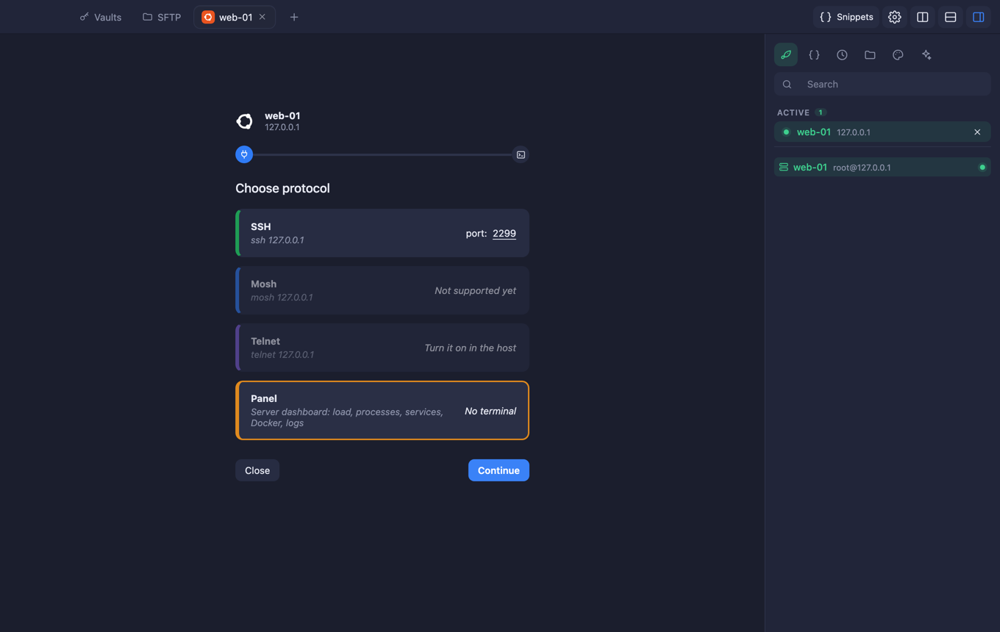

**Overview** shows the load and what needs attention (a failed service, a disk that is filling up). **Access host**, at the top right, opens a terminal on the same host in a new tab.

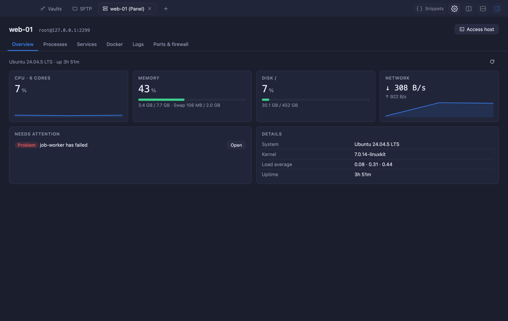

**Services** and **Docker** list what runs, failed ones first. Every change asks first.

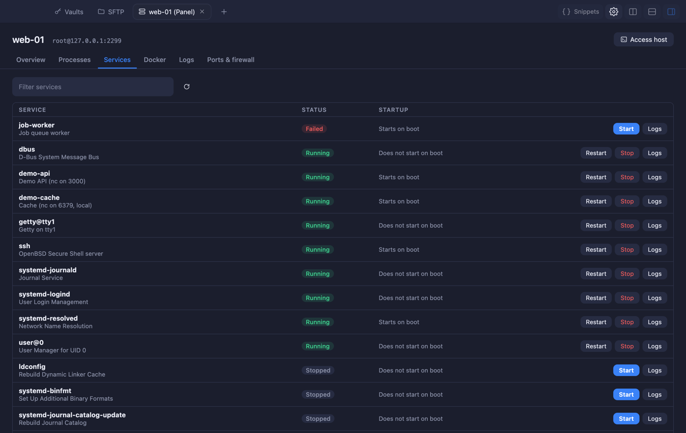

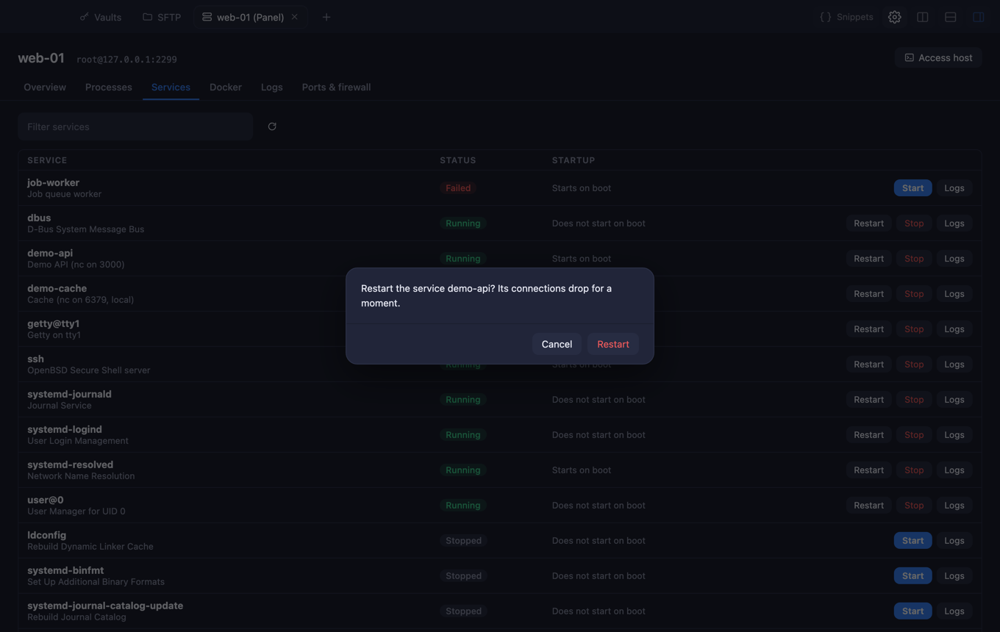

**Processes**, **Logs** and **Ports & firewall** (read only):

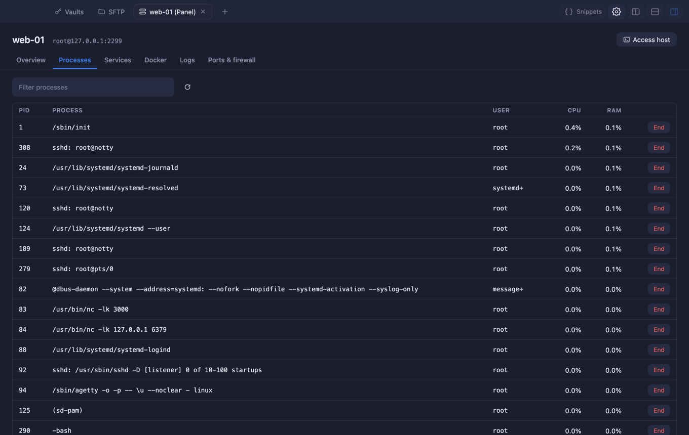

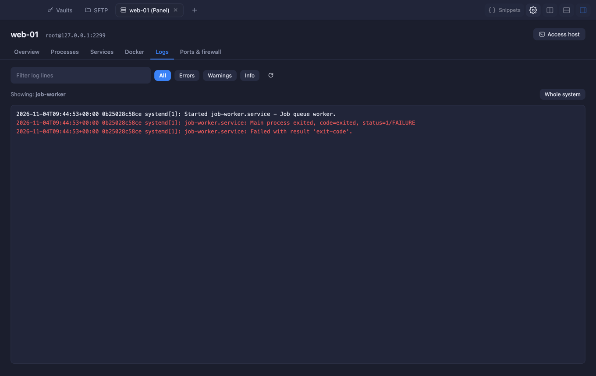

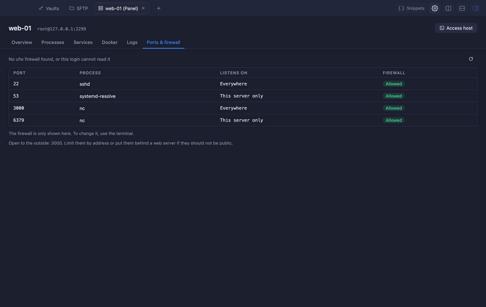

**Access host** opens SSH straight away, without asking for the protocol again:

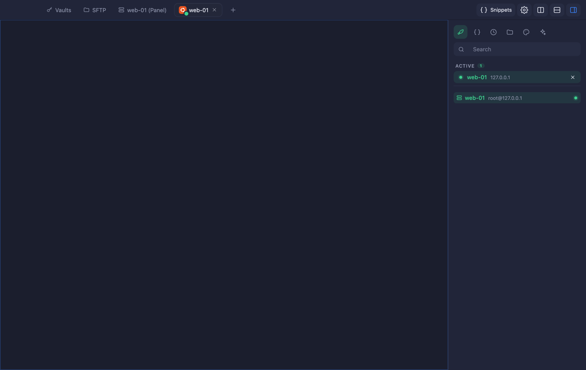

- It runs fixed commands (`/proc`, `ps`, `systemctl`, `docker`, `journalctl`, `ss`, `ufw status`) over a connection of its own and installs nothing on the server. A name from the screen is checked before it goes into a command, and a process is only ever ended by number.
- **Every change asks first**: ending a process, and starting, restarting or stopping a service or a container. The firewall is only shown: the panel never changes it.
- Changes use `sudo -n` unless you log in as root, so a login that needs a password for sudo gets the server's own error.
- Process command lines and logs can hold secrets: take care before sharing a screenshot.
- Linux with systemd is the target; on another system the parts that do not apply show the server's message.

## 10. Port forwarding

Open **Port Forwarding**, pick *New forward for host…*, and add one:

| Type | Meaning |
| --- | --- |
| Local (-L) | listen on your Mac, connect to a destination through the host |
| Remote (-R) | listen on the server, connect back to a destination on your Mac |
| Dynamic (-D) | local SOCKS5 proxy through the host |

Forwards listen on `127.0.0.1`; other addresses need an explicit checkbox. *Start automatically* brings the forward up with the terminal.

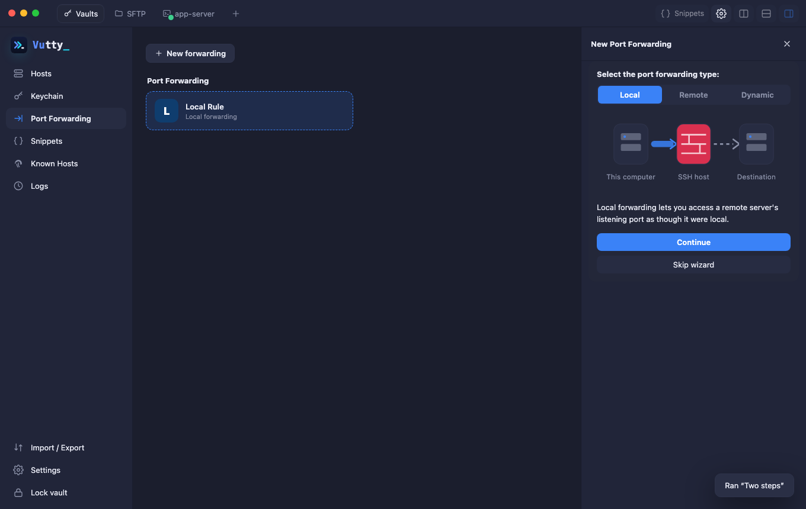

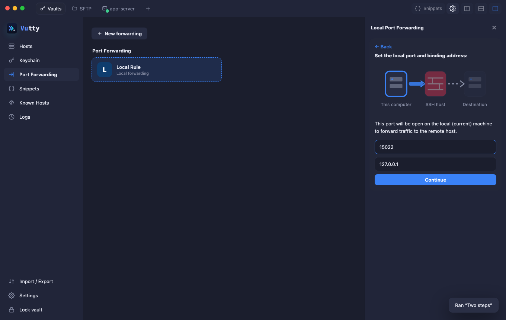

The page lists every forward with its host and state.

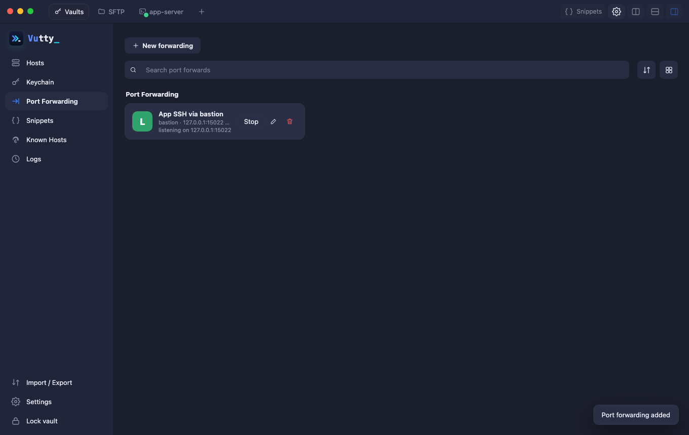

## 11. Import and export

**Import / Export** in the navigation.

- **Import `~/.ssh/config`**: follows `Include`; the file name inside `config.d/` becomes the group; `ProxyJump` becomes a jump host; forwards and `IdentityFile` keys come along (vault must be unlocked). Choose what to do when a name already exists: skip, overwrite or create a copy.
- **Cloud and inventory** (the second choice at the top of the **Import** tab): adds the servers of a listing that you make with your own tools. Vutty never contacts a cloud and never sees its credentials; it only reads the file. It recognises, by what is inside:
  - **AWS**: `aws ec2 describe-instances --output json > aws.json` (the `--query` shapes `Reservations[]` and `Reservations[].Instances[]` too). The `Name` tag is the host's name (the instance id when there is none, and a second instance with the same name gets its id added), an `Environment` / `env` / `Stage` tag of prod, staging or dev sets the environment, the other short tags become tags (`key=value`), and the hosts go into a group (`aws`, or the name you give). The listing does not say which user an image uses: set **User name for the hosts** (`ec2-user` when empty). Instances that are not running are skipped unless you tick **Include stopped instances**. The key pair of the instances is named in a note: add that key in Keychain and pick it on the hosts.
  - **Google Cloud**: `gcloud compute instances list --format=json > gcp.json`, the same way (labels instead of tags, group `gcp`).
  - **Ansible**: `ansible-inventory -i inventory --list > inventory.json` (this also covers what the cloud plugins, such as `aws_ec2`, produce), or an INI inventory as it is. Ansible's groups become groups (a host that is in several goes into the first by name), `ansible_host`, `ansible_user` and `ansible_port` are read, ranges such as `web[01:03]` are expanded, and hosts that do not use SSH (`ansible_connection`) are skipped.
  - **CSV**: a header line with `hostname` (or `address`) and, if you like, `label`, `user`, `port`, `group`, `env` and `tags` (separated by `;`).

  **Address of a cloud instance** is the public one (the private one when an instance has none) or private only, for servers you reach through a VPN or a jump host. A host whose address or user name could not be used (a space, a shell character) is skipped and counted in the notes under the result, which also says which format was read. The same choice as for an ssh config applies when a host with the same name exists: skip, overwrite or create a copy, so the listing can be imported again to bring in new servers. No vault is needed: nothing in a listing is a secret.
- **Export ssh config**: one file per group; private keys only if you tick the checkbox (a warning is shown, files get mode `0600`).
- **Export host list (JSON)**: no secrets, safe to share.
- **Encrypted backup**: everything, protected by a *separate* password (8+ characters).

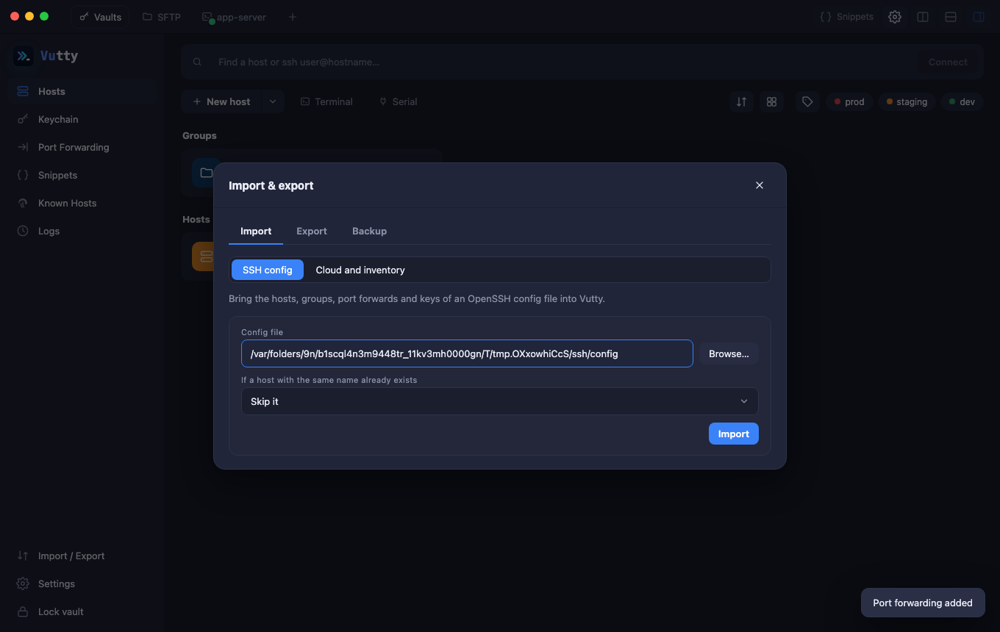

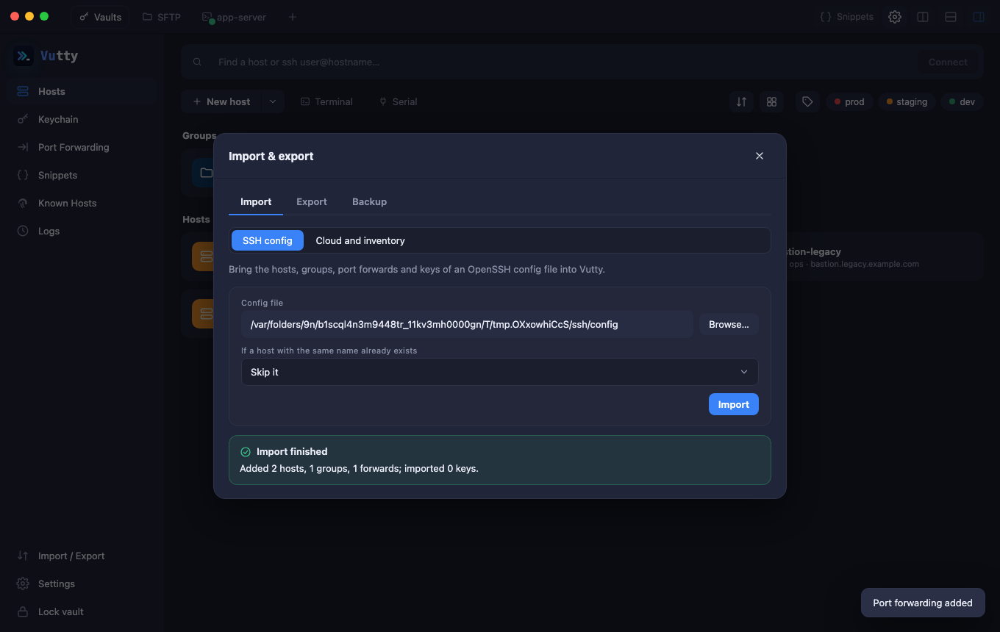

Anything unsupported (for example `ProxyCommand`) is listed as a warning instead of being dropped silently.

## 12. Settings

Open **Settings** from the navigation, the gear in the title bar, or **⌘/Ctrl + ,** (it works from a terminal tab too). It opens as **a window of its own** (with the usual red, yellow and green buttons): move it anywhere, resize it, or use the green button for macOS full screen. Opening it again brings the existing window to the front, and it closes when you quit Vutty. (Screenshots below show the same content in the in-app variant that the test run uses.)

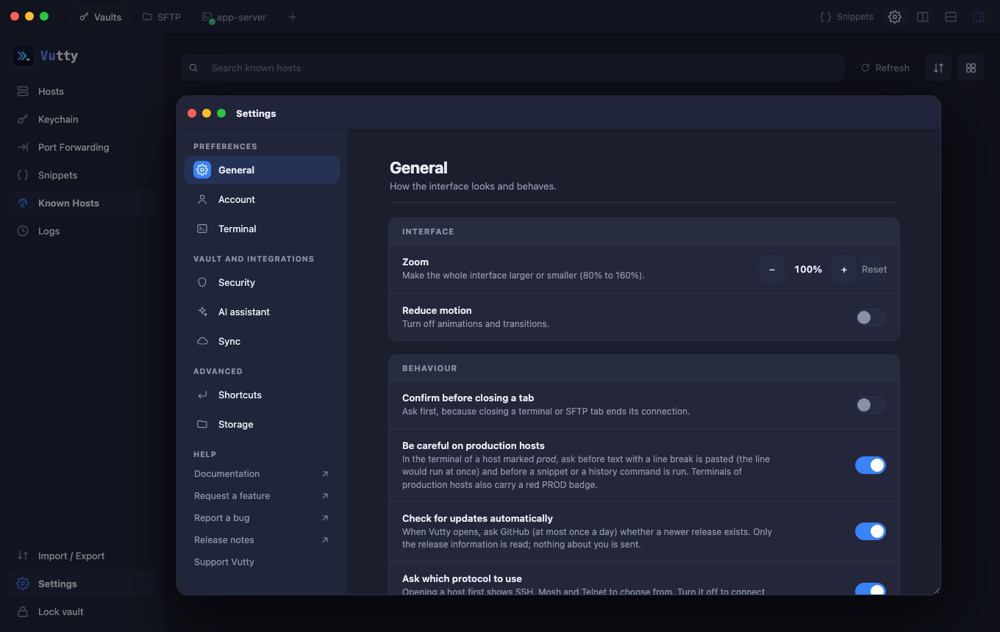

The menu on the left has **General, Account, Terminal, Security, AI assistant, Sync, Shortcuts, Storage**, then **Theme**, help links (documentation, feature requests, bug reports, release notes, Ko-fi) and the **version**. Changes apply immediately.

**Language.** **General → Interface → Language** sets the language of the whole interface, the menus of the title bar included: **Automatic** (the language of the system, English when Vutty has none of it), **English**, **Tiếng Việt**, **日本語** or **中文**. It changes at once, in every window. What a server or the backend itself says (an error message from the connection, for example) and the names of products and protocols stay as they are.

**Updates.** **Check for updates** (under the help links) asks GitHub for the latest release and compares it with your version. If there is a newer one, **Version X is available** appears: click it to open the release page and download the build for your system (macOS `.dmg` or `.zip`, Windows `.exe`, Linux `.tar.gz`). To update by hand, quit Vutty and replace the old app with the new one; your data is kept outside the app, so nothing is lost. **On a Mac with Apple silicon, Vutty can install the update for you:** open **Help → About → Check for updates**, and when a newer version is found choose **Install and restart**. It downloads the update itself, checks that its checksum list is signed with the project's key and that the download matches it (an update that fails either check is not installed, and says so), puts the new copy in place and starts it; the old copy stays next to it as `vutty.app.previous` for the first half minute. This needs Vutty to be in a folder you can write to (your Applications folder), not running from the disk image; if it is not, About says why. Releases that were not signed, and Windows and Linux copies, use the release page as before. How releases are signed is in [Release signing](ReleaseSigning.md). The check only runs when you click it, and only the release information is read: nothing about you is sent. A pre-release is not offered as an update.

When Vutty opens it also looks by itself, at most once a day (switch it off with **Check for updates automatically** in General). If a newer release exists, an **Update** chip appears in the top right corner; click it to see the news.

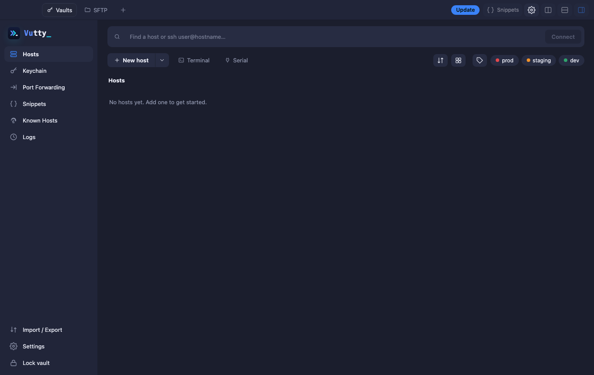

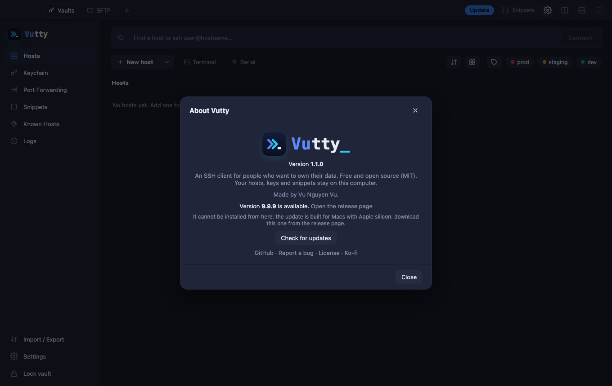

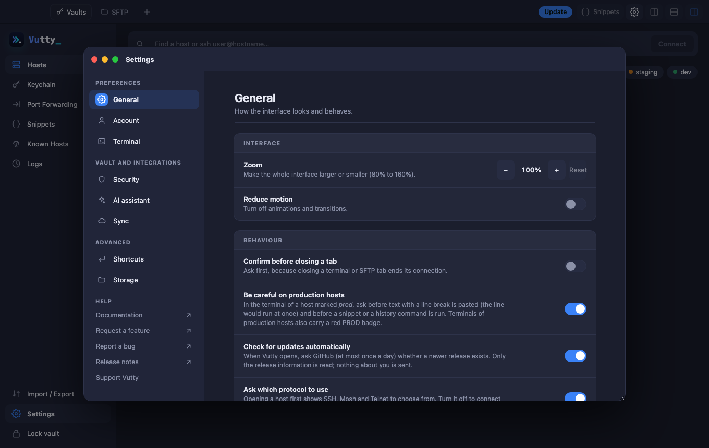

**Help → About Vutty** and **Help → Check for Updates…** open the same window, also while the vault is locked.

- **General:** **Zoom** makes the whole interface larger or smaller (80 % to 160 %, also with the zoom shortcuts), **Reduce motion** turns animations off, **Confirm before closing a tab** asks before ending a terminal or SFTP connection, and **Be careful on production hosts** (on by default) is described in [section 17](#17-connecting-protocol-progress-and-errors).
- **Account:** a local profile (display name and email, stored only in your settings file), your plan, and a disabled **Sign in** for the cloud features planned for later. Nothing is sent anywhere. The **Donate** card links to Ko-fi if you want to support the project.

<!-- CRYPTO-DONATE: screenshot shows the USDT addresses, hidden for now
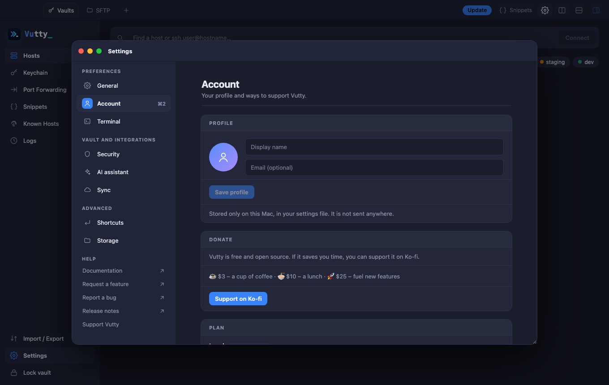
-->

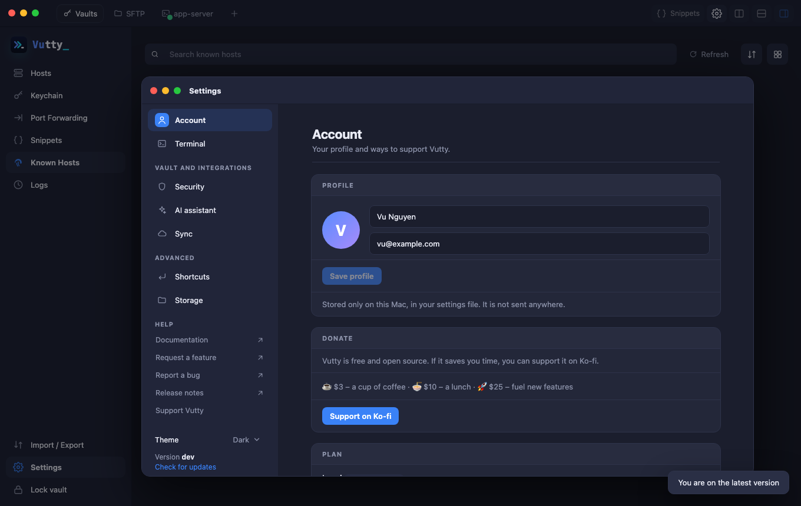

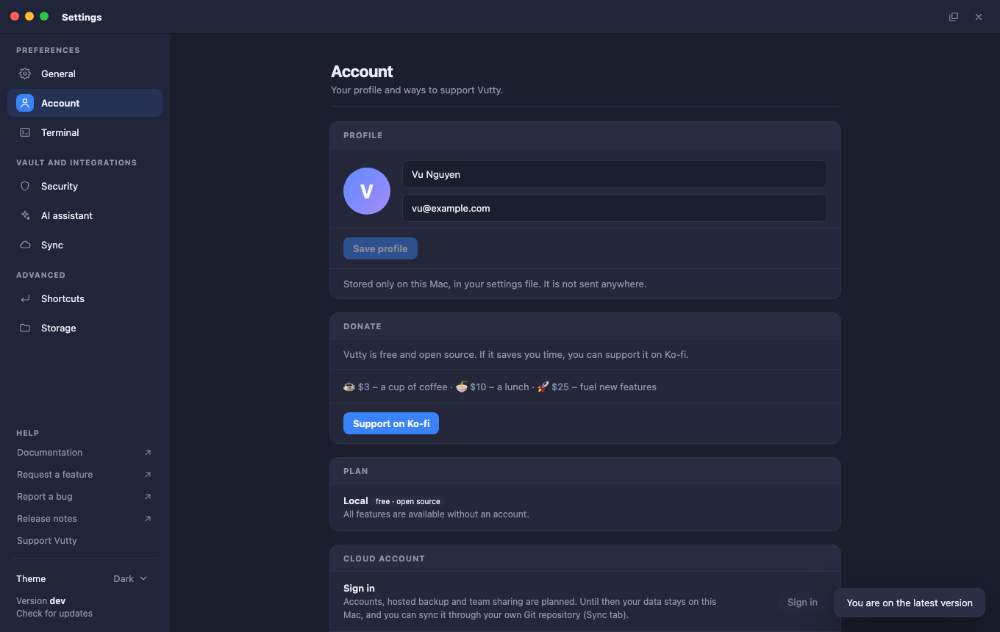

- **Shortcuts:** every action has a default, shown as key caps (⇧ ⌘ T). Click it, press the new combination and it is saved. To make a **two-step shortcut** such as ⌘K then M, press the first combination and, within about a second, the second key (it needs no modifier); wait instead and it stays a one-step shortcut. While a two-step shortcut is running, a small note at the bottom says it is waiting for the next key; Esc cancels it. Two-step shortcuts have no key hint in the menu bar. One shortcut cannot be both a one-step shortcut and the first step of another. A combination already in use is refused and tells you which action owns it; plain keys are refused (add Ctrl, Alt or ⌘; F-keys are allowed). *Reset* returns one action to its default, *Reset all* all of them. Esc and a few terminal keys are fixed and listed below the table.
- **Storage:** **Clear cache** removes files Vutty can make again and what it remembers about your AI tools (they are looked up again; it reports what it removed). **Reset settings** puts appearance, terminal, general options, shortcuts and auto-lock back to their defaults after you confirm. Your profile, sync target, hosts, keys and the vault are never touched.

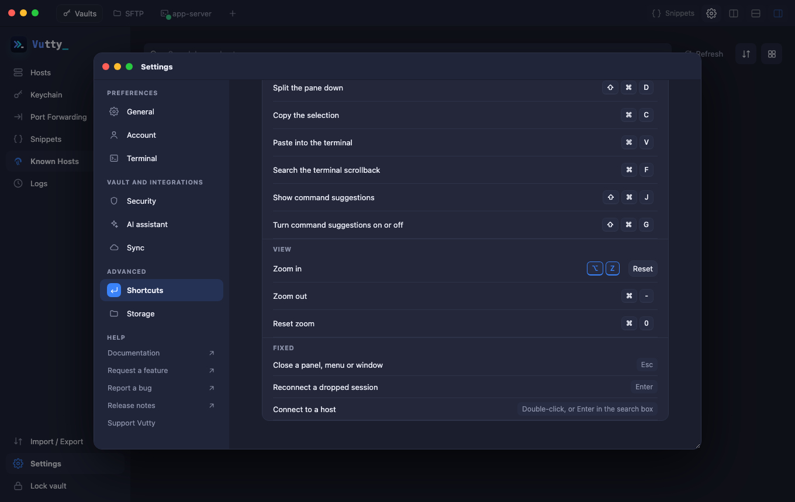

- **Terminal theme:** 26 colour themes with live swatches (Dracula, Nord, Tokyo Night, Solarized, Gruvbox, Kanagawa, Rosé Pine…), filterable by dark/light, or *Match app theme*. A preview shows your font, size, cursor and colours.
- **Font, size, cursor** (block, bar, underline), blinking, **scrollback**.
- **Session logs:** **Off** (the default), **Production hosts only** or **All sessions**. A log is one text file for each session (SSH, Telnet, serial and this computer), written line by line with the time each line ended, in the folder you choose (**Choose…**; **Open** shows it in the Finder; by default `session-logs` inside the data folder). It starts with the host and the time and ends with the time and why the session ended. It holds what the host **printed**, with colours, window titles and cursor moves taken out and a redrawn line (a progress bar, a shell prompt) kept as the one line it ended up as. What you type is **not** recorded, except what the host echoes back, so a password typed at a hidden prompt never reaches it. But everything that is shown on screen is in it, a password in a file you displayed included: the files are readable only by you, so keep the folder private. A file stops at 50 MB, and a connection that never printed anything leaves none. The Logs page notes where each log went, and if a file cannot be written the terminal goes on and the Logs say why. Logs are never deleted by Vutty.

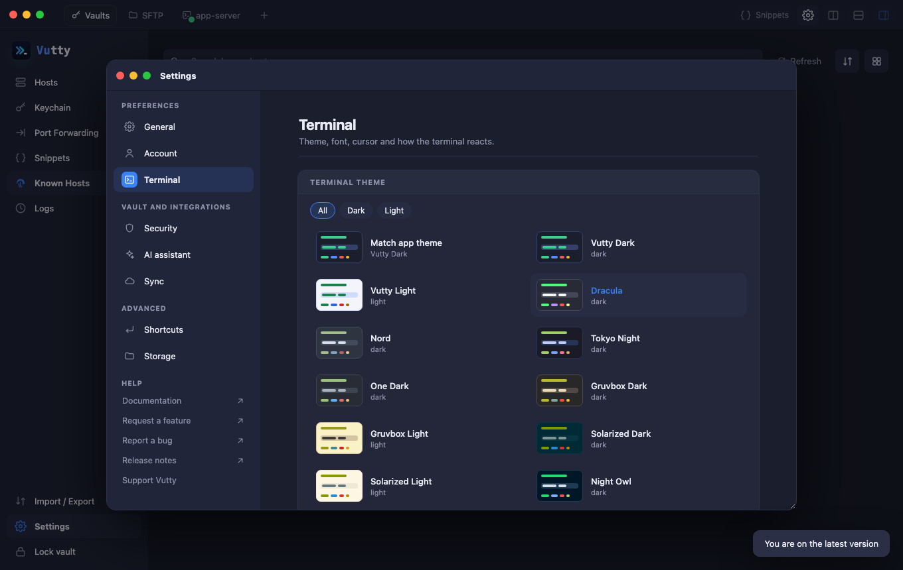

- **Theme (sidebar):** *Auto* follows your Mac's light/dark mode, or force *Light* or *Dark*.

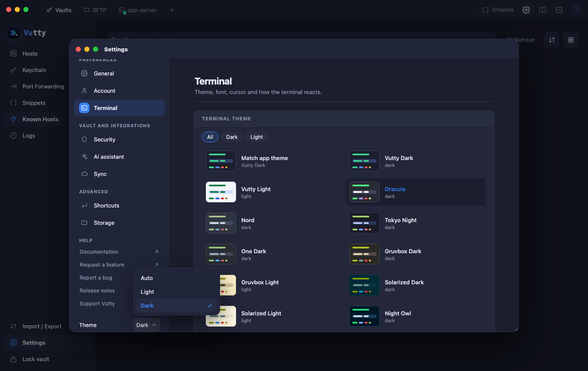

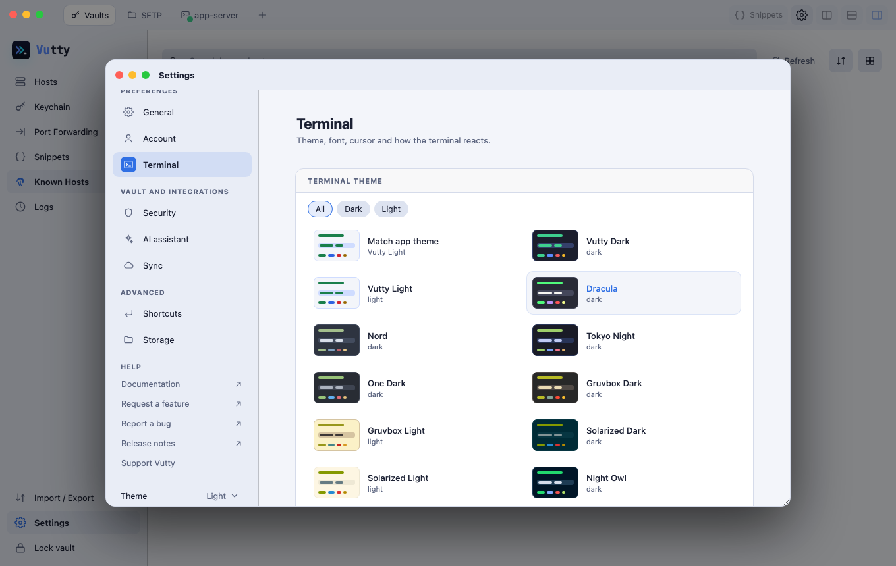

- **Security:** auto-lock after N idle minutes (default 15; the key is wiped from memory), **Lock when the computer sleeps** (on by default: the vault locks as a Mac goes to sleep and when its screen is locked, so whoever opens the lid finds it locked; open terminals stay connected; where the system does not announce a sleep, as on Windows and Linux, it locks when the computer wakes up, and only after a sleep of more than about 40 seconds; the Logs say *Vault locked: the computer went to sleep*), a password hint (a reminder shown on the lock screen, never the password itself), unlock with **Touch ID** on a Mac that has it (the vault key stays in your Keychain and each unlock asks for your fingerprint, Apple Watch or Mac password) or with **Windows Hello** on Windows (fingerprint, face or PIN; the key stays in Windows Credential Manager), or with the plain system keychain where neither exists, change the master password.

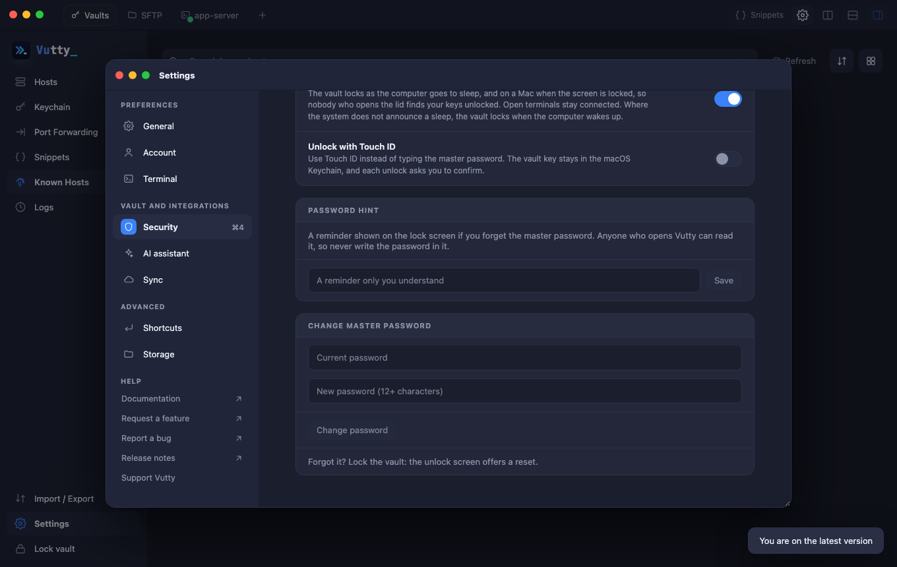

## 13. Sync between Macs

Open **Settings → Sync**.

**What is synced.** Under **What to sync** (the same page, folded or opened with its header) you tick what is kept in step between your machines. Under **Data**: **Hosts and groups**, **Keys and passwords**, **Port forwards** (they point at hosts, so they need Hosts and groups) and **Snippets**. Under **Preferences**: **Appearance** (theme and terminal theme), **Terminal** (font, cursor, scrollback), **Language**, **Keyboard shortcuts** (the ones you changed), **Behaviour** (Highlight output, Suggest commands) and **Account** (name and email). Everything is ticked by default. It all goes inside the same encrypted bundle and the newest change of each item wins. **What you untick is neither sent nor taken:** this machine keeps what it has, and the repository keeps what the other machines put there. Take care with *Keys and passwords* alone: a host that uses a saved key will not find it on a machine that does not sync keys (the page says so). A group of preferences that was never changed, and a new Mac that joins, do not outvote the others with their defaults. Zoom, folders, auto-lock, Touch ID, *Fast drawing* and the other settings of one machine never leave it. A copy of Vutty from before this feature ignores the preferences and, when it syncs, drops them from the repository until a newer copy puts them back.

1. Create an empty **private** Git repository and make sure `git` can push to it (ssh-agent or a credential helper).
2. **Repository URL → Save repository → Sync now.**
3. On a new Mac open **Settings → Sync**, enter the URL, and choose **Restore from repository** with the master password of the synced vault (only before a local vault exists).

**No Git? Use a cloud folder instead.** Choose **Cloud folder**, then **Browse…** and pick a folder that Google Drive for Desktop, iCloud Drive, Dropbox or OneDrive keeps in step (for example `~/Google Drive/Vutty`), then **Use this folder → Sync now**. There is no sign-in and no token: Vutty only writes `bundle.enc` and `vault-header.json` into that folder and the cloud client uploads them. On a new Mac, pick the same folder, wait until the files have downloaded, and choose **Restore from folder**. If two Macs save at the same moment, the cloud client may keep an extra copy such as `bundle (1).enc`; the next sync merges every copy per record and deletes the extra ones. A copy that is still downloading or belongs to another vault is left alone.

**A new Mac where you already created a vault, but put nothing in it?** Then there is nothing to merge: the box that appears after a plain **Sync now** says *Use the vault of this repository*. Enter the master password of the synced vault and choose **Use the repository's vault**: its hosts, keys and snippets come here and that master password is the one to use from now on.

**A vault that sends nothing it cannot open.** Before each sync Vutty checks that the vault is open with its own key. If it is not (a key left over from another vault), the sync stops with *nothing was sent* and the repository is not touched: lock the vault, unlock it with the master password, and try again.

**This Mac already has its own vault, and the repository belongs to another one?** The two vaults have different keys, so a plain **Sync now** stops with *encrypted with a different vault key*. A box then appears under the status line: enter the **master password of the vault that made the repository** and choose **Join this vault and sync**. This Mac keeps its own hosts, groups, snippets and saved keys, merges them with what the repository holds, and syncs. From then on this Mac uses that vault's master password (the old one no longer opens it). A copy of what this Mac had is saved first in the `backups/before-joining-…` folder of the app's data folder. A wrong password changes nothing.

**Nobody can open the repository any more** (its vault's password is lost, or its bundle was written with a key that does not match its header: *that repository cannot be joined*)? Open *The password does not work…* in the same box, type `REPLACE` and choose **Replace the repository with this Mac's data**. The repository then holds only this vault's data; the two files that were there are first copied to the `backups/replaced-remote-…` folder of the app's data folder. Other machines then use **Restore from repository** with this vault's master password. Vutty refuses to replace a repository that this vault can read.

The repository (or folder) only holds `bundle.enc` and `vault-header.json`, both encrypted: hostnames and IPs are not visible. Conflicts are merged per record (newest edit wins; a newer edit beats an older delete and the reverse).

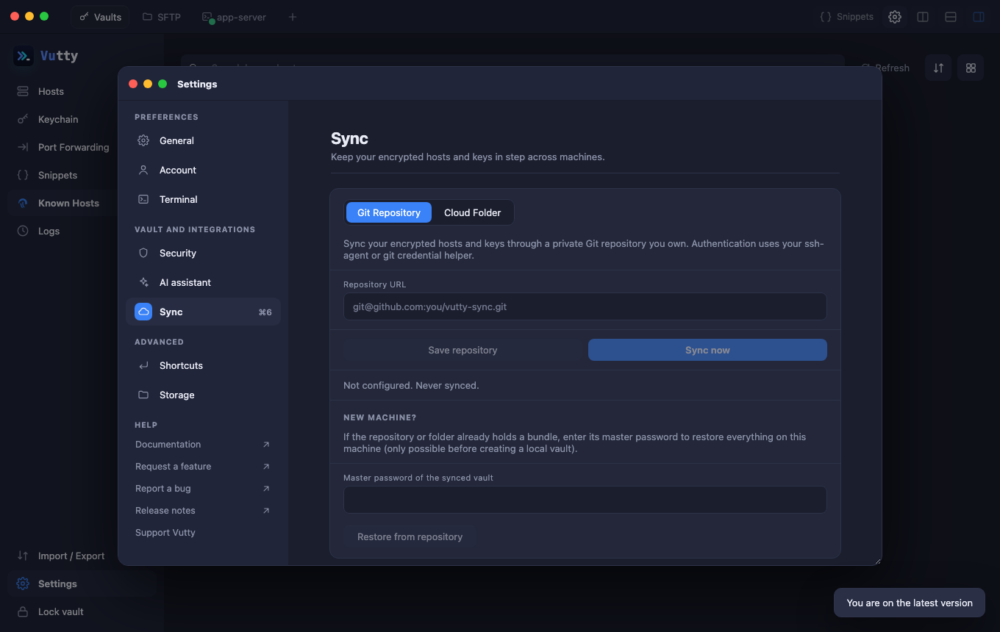

## 14. Forgot your master password

**It cannot be recovered.** The password never leaves your Mac, so nobody can reset it for you. On the unlock screen choose **Forgot password?**:

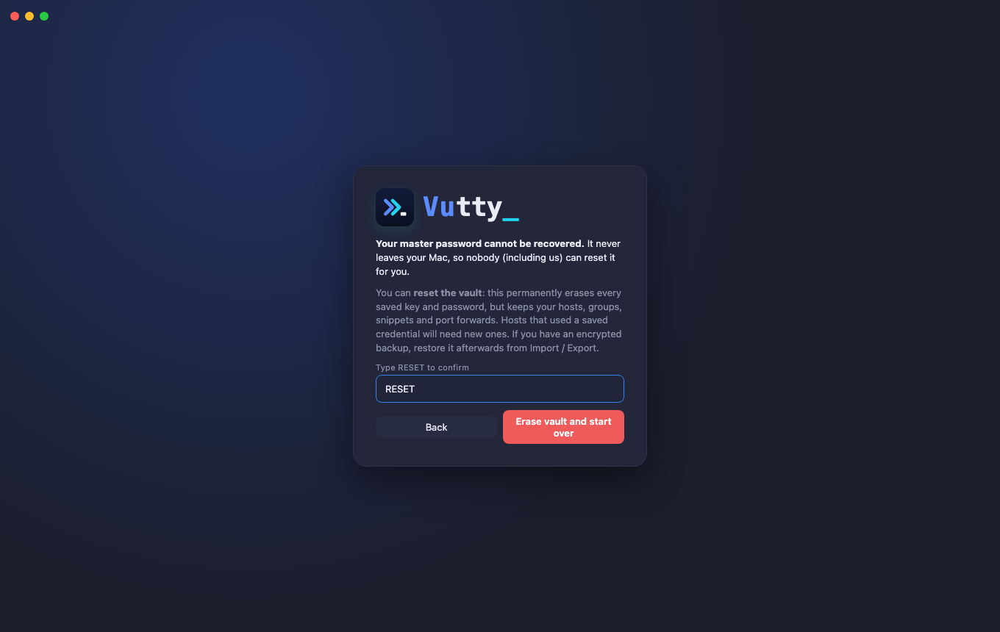

You can **reset the vault**. Type `RESET` to confirm. This permanently erases every saved key and password, and **keeps** your hosts, groups, snippets and port forwards. Hosts that used a saved credential need new ones. Then create a new master password:

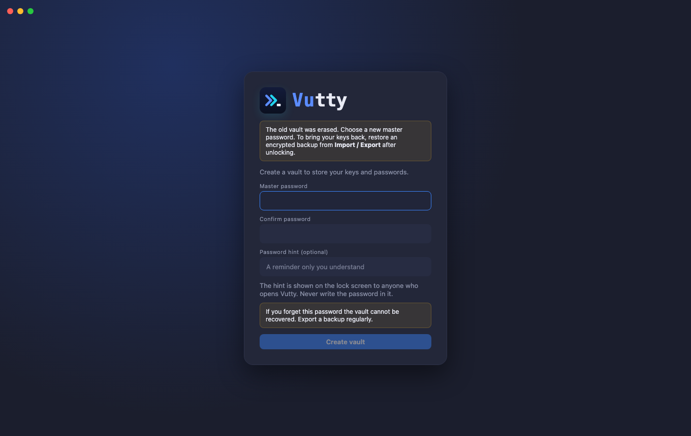

If you have an **encrypted backup**, restore it from **Import / Export** after unlocking the new vault to bring your keys back. If you synced with Git, the repository still holds the *old* vault: use a new repository for the new vault.

## 15. When something goes wrong

| Symptom | What it means / what to do |
| --- | --- |
| Red banner *connection lost… Press Enter to reconnect* | The link dropped. Vutty never reconnects by itself so commands are not replayed by surprise: press Enter in the pane. |
| *HOST KEY CHANGED* | The server shows a different key than the one you trusted. The connection is blocked with no override. Check with the server's owner; if the change is legitimate, remove the old line from `known_hosts` by hand. |
| *vault is locked* | Unlock the vault and retry. |
| *identity is used by host …* | Detach the identity from its hosts before deleting it. |
| Snippet: *Open a terminal first* / *not connected yet* | Open a host, wait for the prompt, then run the snippet. |
| *Test connection* fails with *Authentication failed* | Wrong password, key not accepted, or the user does not exist on the server. |
| Sync error *encrypted with a different vault key* | The repository was made by another vault (this Mac has its own). In **Settings → Sync** a box appears: enter the master password of the vault that made the repository and choose **Join this vault and sync**. See *Joining the vault of a repository* in section 13. |
| Old icon in the Dock | macOS caches icons. Restart the Dock (`killall Dock`) or move the app to refresh it. |

In a narrow window the layout adapts: the navigation becomes icons and the New host panel floats over the list instead of squeezing it.

## 16. Where your data lives

| Item | macOS path (`~/Library/Application Support/vutty/`) |
| --- | --- |
| Hosts, groups, identities (metadata), forwards, snippets, encrypted vault | `data/vutty.db` (SQLite) |
| Trusted host keys | `data/known_hosts` |
| Appearance, terminal theme, auto-lock, sync URL | `data/settings.json` |
| Git working copy (ciphertext only) | `sync/` |

Set `VUTTY_DATA_DIR` to relocate everything. Back up with **Import / Export → Encrypted backup**; losing the master password without a backup means losing the vault.

## 17. Connecting: protocol, progress and errors

Opening a host first asks **which protocol** to use (SSH, Mosh, Telnet). SSH is chosen for you: press **Continue** (or double-click it). Mosh is shown but not supported yet; Telnet can be picked once the host has Telnet turned on (see [section 20](#20-this-computer-telnet-and-serial-ports)). Turn the question off in **Settings → Terminal → Ask which protocol to use**; a host that has Telnet still asks.

Then the **connecting screen** shows who you are connecting to and a line from the plug to the terminal. The line moves **smoothly**: slowly while the server answers, further once the login is done, and to the end when the shell is open, and only then does the terminal show. If it fails, the line stops where it got to and turns red, with the reason and **Retry**, **Show logs** (opens the Logs page) and **Close**.

**Servers that ask for a code.** A bastion or a company server often wants a second step after the password or the key: a verification code from an authenticator app, a Duo choice, a one-time password. When the server asks, a **Sign in to <host>** box appears over the terminal (or in the SFTP pane, the sidebar, the port forward and the host form's **Test connection**) with the server's own questions: type the code and press **Continue**, or **Cancel** to stop. A box that asks for a code hides what you type, unless the server says it may be shown. A saved password answers the question that asks for the password by itself, so you are only asked for what is left. Nothing you type here is saved or written to the logs, and you have three minutes to answer. If a host asks for a code, a connection that starts by itself (a port forward that starts with the app) has nobody to answer it: it waits the three minutes and then fails; start it from the Port Forwarding page instead.

The state of every tab is a small badge on its icon: a spinner while connecting, a **green** dot while connected, a **red** dot when the connection is lost (press Enter in the pane, or Retry, to reconnect: Vutty never reconnects by itself).

### Production hosts

A host whose environment is **prod** is marked in its terminal: a red frame and a red **PROD** badge, so you know where you are typing. With **Settings → General → Be careful on production hosts** on (the default), Vutty also asks before:

- **pasting text with a line break** into that terminal (the line would run as soon as it arrives; a single line that ends with Enter counts, a line without one does not), whether you paste with the keyboard, the right click or the menu;
- **running a snippet** or a command from the history there, and **pasting a snippet that has several lines**, since all its lines but the last run as they are typed;
- **running a command on several hosts** when one of them is prod (see *Run on hosts* in [section 7](#7-snippets)): that question is always asked.

Say no and nothing is typed. Turn the setting off if you would rather not be asked; the red mark stays.

### ssh:// links

Vutty can open `ssh://[user@]host[:port]` links (on macOS it is registered for them: the first time you click one, macOS may ask which app should open it, and you can pick Vutty). On Windows and Linux the link is passed to the app as an argument when the system is set up to do so. **A link never connects by itself.** Vutty first says what the link points to and asks:

- a link to a **saved host** (same address, same port, and the same user name if the link has one) asks *Connect?*;
- a link to an **address you do not have** only opens the **New host** form, filled in; nothing happens until you press Connect, and an unknown server key is asked about as always.

A password in the link is ignored, and so is anything after the address (a path, a query), because a link from a web page or a chat must not carry a secret in or a command. A link that has no usable host name is ignored. If the vault is locked, the link waits and is asked about right after you unlock. The same `ssh://user@host:2222` written in the search box of the Hosts page works like `ssh user@host:2222`.

## 18. Tabs: order, split, new window

- **The + button** opens a **New Tab**: a search box for hosts and open tabs (⌘/Ctrl + K), **Local Terminal** on its own, and your **Recent connections**. Pick one and the tab becomes that connection.
- **Drag a tab left or right** to put your tabs in order. SFTP always stays first.
- **Drag a tab onto a pane** to split it: the side nearest to the pointer lights up (left / right: side by side, top / bottom: one above the other). The dragged tab joins as a split and its sessions **keep running**, nothing reconnects.
- **Which pane has the keyboard**: in a split the focused pane has a blue frame and a dot by its name; the other panes are dimmed. Click a pane to give it the keyboard.
- **Drag a pane by its header** (the bar with the host name that shows when you hover over a pane of a split): onto a side of another pane to move it there (in the same tab or in another one); **up onto the tab bar** to make it a tab of its own; onto another terminal tab to join that tab. The pane keeps its session: nothing reconnects.
- **Take a pane back out**: hover over a pane of a split and press **Move pane to its own tab**.
- **Right-click a tab**: Duplicate, **Duplicate in new window**, Rename, Split right, Split down, Close. Double-click a tab to rename it.
- **Many tabs** shrink like in a browser; the active tab always shows its whole name, and a hovered one shows its close button.
- **Duplicate in new window** opens the whole app in a second window (Vaults, SFTP, tabs, sidebar) with that host open in its first tab. Both windows share the same data and the same unlocked vault, and the sessions opened in the new window end when you close it. It runs as a second process, so it has its own Dock icon.

## 19. The terminal sidebar

The panel on the right of every terminal (the last button of the title bar shows or hides it):

| Tab | What it does |
| --- | --- |
| Hosts | Search your hosts and open one in a new tab. |
| Snippets | One line each; click one to see the whole script with **Run** and **Paste**. |
| History | The commands you typed **at the host of the focused terminal**, newest first, searchable (each host has its own list). Click to type one again, double-click to run it. Only lines the terminal echoed are kept, so what you type at a password prompt never is. |
| Themes and font | Pick the terminal theme from pictures, change the font and the text size. |

## 20. This computer, Telnet and serial ports

- **Terminal** (button beside New host, or ⌘/Ctrl + Shift + T) opens a real shell on this computer. **Serial** opens a serial port at a baud rate.
- **Telnet**: in the host form press **Add Telnet** for its port, its own user name and password (kept in the vault) and the encoding (UTF-8 or ISO-8859-1). Telnet is **not encrypted**: use it only on networks you trust, for devices that offer nothing else.
- **Terminal theme per host**: a card with a picture of the theme; pick *Use the app setting* to follow Settings.
- **Highlighting**: errors, IP addresses, paths and URLs are coloured (switch in Settings → Terminal). **Copy on select**, right-click to paste (or a menu, or nothing) and the copy / paste keys are configurable.

## 21. Known Hosts and Logs

- **Known Hosts** lists every server key you trusted (type and fingerprint) and lets you **forget** one so the next connection asks again. Keys stored hashed in an existing `known_hosts` cannot be forgotten from here.
- **Logs** is a filterable, searchable list of what happened, newest first: connections, transfers, forwards, host-key decisions, unlocks, sync. It never contains a password or key.

## 22. AI assistant

Ask an AI about what is on a terminal. Vutty runs the official AI command-line tool you installed and signed in to (Claude Code, Codex CLI, Gemini CLI, or a command you add); no key is stored in Vutty. The use of each tool is governed by its provider's terms, and Vutty is not affiliated with Anthropic, OpenAI or Google. **Antigravity CLI** is marked *Experimental*: Google does not document running it from another app, so check Google's terms for your account before you switch it on.

**Claude Code through a gateway.** If your `~/.claude/settings.json` points Claude Code at a gateway (`ANTHROPIC_BASE_URL`, for example LiteLLM), Vutty reads the gateway address and the key you set there (or in your environment) (`ANTHROPIC_AUTH_TOKEN` or `ANTHROPIC_API_KEY`) only to ask that same gateway for its model list (`GET /v1/models`). The key is sent nowhere else, never stored by Vutty and never shown. Without a gateway, Vutty reads no Claude credential at all.

1. **Settings → AI assistant** lists the tools Vutty found. Switch one on. It stays off until you do, and it must pass a short isolation test (the tool is asked to run a command and must be unable to). If a tool says *Needs sign-in*, run the command shown next to it in a terminal first.
2. Pick the model for each tool. The list is read from the tool itself; you choose from that list. A tool that cannot list its models uses its default one.
3. Open a terminal, then the sparkle icon in the sidebar. Choose the provider and model from the chip under the message box, type a question, press Enter. **Ask about selection** sends only the text you selected. To change the model without the mouse, press **⌘ ⇧ M** (Ctrl Shift M elsewhere): it moves to the next model of the provider, wrapping round at the end, and shows the name in a short message.
4. The assistant only *suggests* commands. **Insert** puts one on the prompt without pressing Enter. **Run** sends a command that only reads at once; a command that can change something shows **Run…** and asks in its card first (and the word `run` for a risky one). A command that contains a hidden value cannot be run from the panel.

**Files and screenshots.** Drag a log, a config file or a screenshot onto the panel, paste a screenshot, or use the paperclip. Text files are redacted like the screen. A picture cannot be redacted, so Vutty asks you to confirm each time and only sends pictures to tools that take them (Claude Code, Codex CLI).

**Your secrets.** Before anything is sent, keys, tokens, passwords and anything saved in your vault are replaced by `*******`; the same happens to every answer before you see it. **What will be sent** shows the exact text first. This cannot be switched off, and it is best-effort: a password written in an ordinary sentence cannot always be recognised.

**Per host.** On a host's form, *AI assistant* is Off, Ask first (in the chat), or On. The default is On, and Off on a production host, where the assistant also never runs commands. Reading the screen to answer a question needs no confirmation; the assistant asks you, in the chat, only before something that could change things.

**MCP servers** (Settings → AI assistant) give the assistant extra tools. Add a server (a command or an HTTP address), test it, then choose a mode for each tool: Allow, Ask each time or Off. New tools stay off until you review them, a secret in a tool's arguments blocks the call, and results are redacted. Environment values and headers are kept in the vault and are never shown again.

**Reading needs no confirmation.** The assistant runs commands that only look (`ls`, `df`, `which`, `pgrep`, `brew list`, `systemctl status`, `git status`… also joined with `;`, `&&`, `||` or a pipe) by itself and reads the output; anything that could change something asks first, in the chat. This is **Settings → AI assistant → Run read-only commands by itself** (on by default; never on production hosts).

## 23. Shortcuts at a glance

All of them can be changed in **Settings → Shortcuts**. ⌘ on a Mac is Ctrl elsewhere.

| Keys | Action |
| --- | --- |
| ⌘ N | New host |
| ⌘ T | New tab (search hosts or tabs) |
| ⌘ Shift T | Terminal on this computer |
| ⌘ ⇧ H | Back to Vaults (the home screen), on the page you left |
| ⌘ ⇧ S | Open SFTP |
| ⌘ 1 … 6 | Hosts, Keychain, Port Forwarding, Snippets, Known Hosts, Logs (shown at the right of the navigation item when you point at it) |
| ⌘ , | Settings |
| ⌘ L | Lock the vault |
| ⌘ W / ⌘ Shift W | Close the tab / the pane |
| ⌘ D / ⌘ Shift D | Split right / down |
| ⌘ B | Broadcast input to every pane of the tab |
| ⌘ F | Search the terminal's scrollback |
| ↓ then Enter or Tab | Put a row of the suggestion list on the line |
| ⌘ ⇧ J | Open the list of command suggestions |
| ⌘ ⇧ G | Turn command suggestions off or on |
| ⌘ ⇧ M | Switch the AI assistant to its next model |

The SFTP file lists have a **right-click menu**: Open, Open with…, Copy to target directory, Rename, Delete, Refresh, New Folder and **Edit Permissions** (a grid of read / write / execute, or the octal number).

