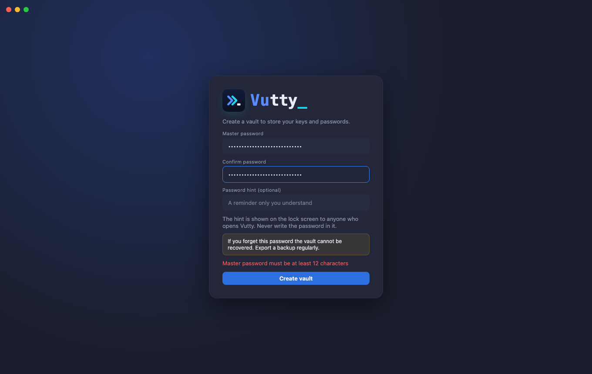
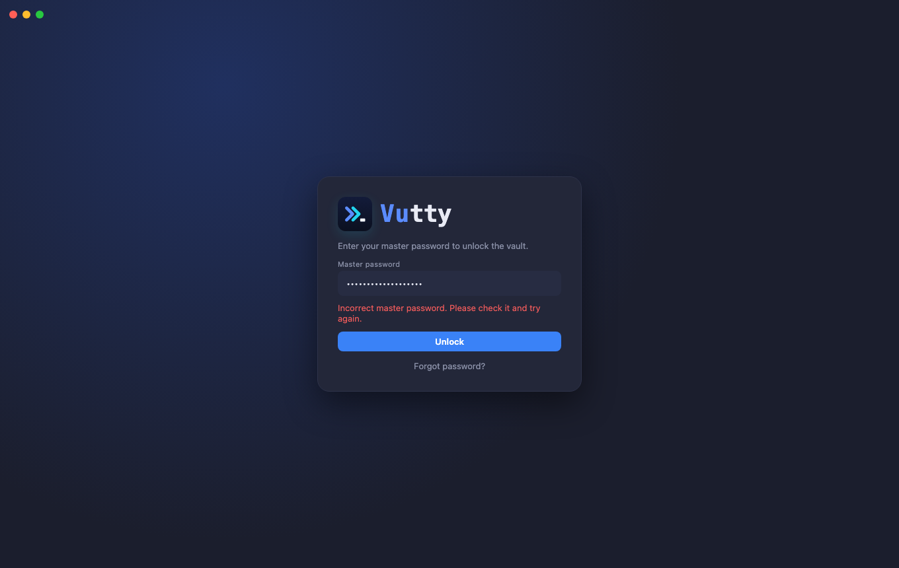
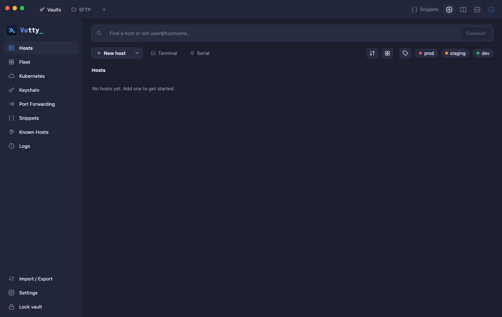

# Getting started

Vutty is a terminal and server manager for your desktop: SSH, Mosh, Telnet, serial, SFTP and FTP, RDP and VNC, port forwarding, a server dashboard (Panel), Kubernetes and an AI assistant, with your hosts and secrets kept in an encrypted vault on your own computer. This chapter takes you from the first launch to the main window.

## Contents

- [Install](#install)
- [Create and unlock the vault](#create-and-unlock-the-vault)
- [The main window](#the-main-window)
- [Your first connection in five steps](#your-first-connection-in-five-steps)

## Install

Download Vutty from the [releases page](https://github.com/vunguyenvu35/vutty/releases). Beta builds are not signed with a developer certificate yet: on macOS see [Installing on macOS](../getting-started/install-macos.md) for how to open the app in three clicks.

## Create and unlock the vault

On first launch choose a master password (at least 12 characters). It protects your keys and passwords and **cannot be recovered** (see [Forgot your master password](11-settings-and-security.md#forgot-your-master-password) for what you can do if you lose it).

Next time, or after auto-lock, enter it to unlock. A wrong password never unlocks anything.

## The main window

- **Title bar:** the **Vaults** tab is home; every terminal you open becomes a tab. **+** returns home to find a host. At the right: the **Settings** gear, **Snippets** and the split buttons (active inside a terminal). Drag the bar to move the window.
- **Navigation:** Hosts, Keychain, Port Forwarding, Snippets; at the bottom Import / Export, Settings and Lock vault. In a narrow window the navigation shrinks to icons.

## Your first connection in five steps

1. **Create the vault** with a master password.
2. Open **Hosts** and press **New host**. Type the address, a user name and a password (or pick a key from [Keychain](02-keychain.md)).
3. Press **Test connection** to check what you typed without saving anything, then **Connect**.
4. The first time, check the server fingerprint and choose **Trust and connect**.
5. Press **Continue** on the protocol screen. A terminal opens in a new tab.

Details: [Hosts](03-hosts.md#add-a-host-test-save-connect) and [Connecting](04-connecting.md).
