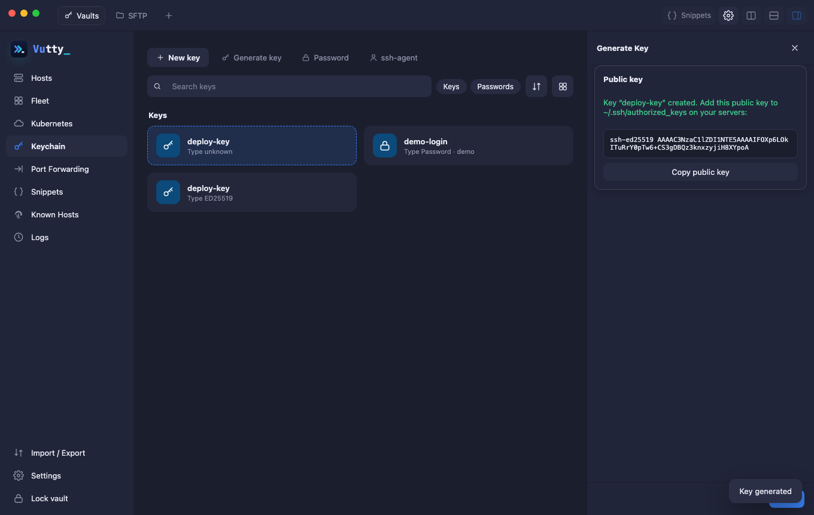

# Keychain: keys and passwords

The vault holds your SSH keys and passwords as **identities** that hosts use. **Keychain** holds identities. Pick a tab:

- **Generate key**: creates an ed25519 key pair. Only the public key is shown. Copy it into `~/.ssh/authorized_keys` on your servers.
- **Import key**: from a file or pasted text; give the passphrase if the key is encrypted.
- **Add password** or **ssh-agent** identity.

## Hardware keys (FIDO2, YubiKey)

Vutty cannot talk to a security key itself, and it has not been tried with one. For an **ssh-agent** identity it asks your ssh-agent to sign, so a hardware key can only work if your agent can use it (load it with `ssh-add`; whether the agent supports security keys depends on your OpenSSH). The touch the key asks for is up to the agent. Please report what you find.

## Editing identities

Private keys and passwords never leave the vault: the interface only shows names and public keys. A password you type in the host form is saved here automatically as an identity.

**Edit** (or double-click) changes a key, password or ssh-agent identity where it is, so the hosts that use it keep using it: rename it, change its user name, type a new password or replace the private key.

## Items that cannot be read

Each time the list opens, Vutty checks that the vault's key opens every saved secret. A secret that was sealed with another key (it happened with a leftover quick-unlock key in older versions) is marked **Can't be read**, with a notice at the top that says how many there are. A host that uses one fails with *the saved secret of … cannot be read with this vault's key* instead of a bare cipher error. The secret itself cannot be recovered from the vault: **Edit** it and enter the password, or import the private key, again, and the mark goes away. Do this before you sync, or the unreadable copy is passed on to your other machines.
