# Hosts, groups and import

Everything about the list of servers: adding a host, organising hosts in groups, and bringing them in from (or sending them out to) other tools.

## Contents

- [Add a host: test, save, connect](#add-a-host-test-save-connect)
- [Hosts and groups](#hosts-and-groups)
- [Import and export](#import-and-export)

## Add a host: test, save, connect

**New host** opens a form **docked next to the host list** (no popup), with a draft card showing what you are typing. If you move to another screen the form closes.

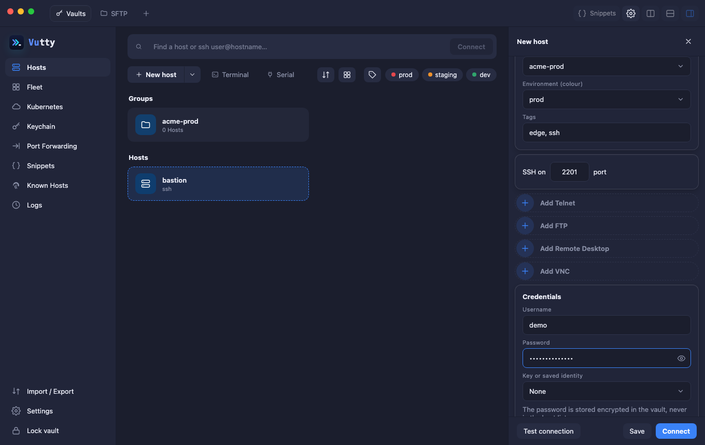

The form follows one flow, top to bottom:

1. **Address** (IP or hostname).
2. **General**: label, parent group, environment colour, tags.
3. **SSH on … port**.
4. **Credentials**: username and password, or choose a saved key/identity. The eye shows or hides the password.
5. **Options**: host chaining (jump host), keepalive, key forwarding and the AI assistant setting of this host.
6. **More protocols**: **Add Mosh**, **Add Telnet**, **Add FTP**, **Add Remote Desktop** and **Add VNC** give the host another way to open. Each is explained where it is used: [Telnet](04-connecting.md#telnet-serial-ports-and-this-computer), [FTP](06-files.md#ftp-and-ftps), [RDP](04-connecting.md#rdp) and [VNC](04-connecting.md#vnc).

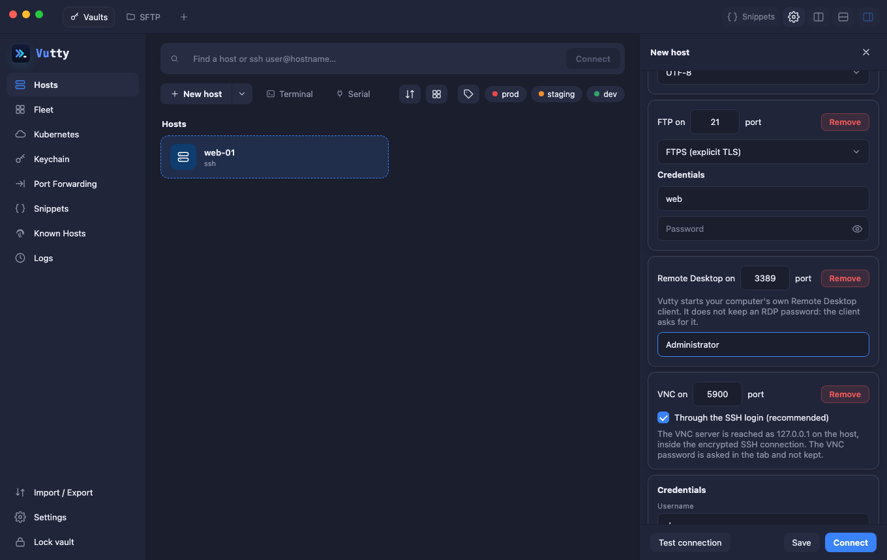

Dropdowns open a custom menu with hints and keyboard support (arrows, Enter, Esc, type to jump):

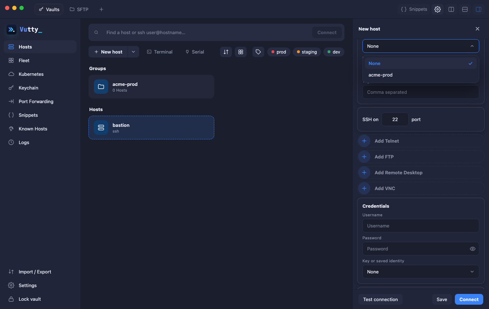

**Forward my keys to this host** (under *Options*) is `ssh -A`: while you are connected the server can ask your keys to sign in to other machines, so you can `git pull` or `ssh` onward from it without leaving a key there. Vutty forwards your running **ssh-agent** when there is one; with no agent it offers the saved key of this host's own identity, from a small agent that exists only for that connection and goes away with it. Nothing is copied to the server, but anyone with root on it can use your keys until you disconnect, so turn it on only for servers you trust (a **jump host** reaches the machines behind it without exposing your keys at all). It is off by default, applies to terminals only (not SFTP, forwards or *Run on hosts*), and a server that does not allow it simply opens without it. If it cannot be set up (no agent and no saved key), the terminal still opens and the Logs say why. `ForwardAgent` is read from and written to an ssh config on import and export, and an imported host that has it comes with a warning.

At the bottom:

- **Test connection** checks what you typed (including the jump host) **without saving anything**. For an unknown server you confirm its fingerprint right in the form.
- **Save** stores the host.
- **Connect** saves it and opens a terminal.

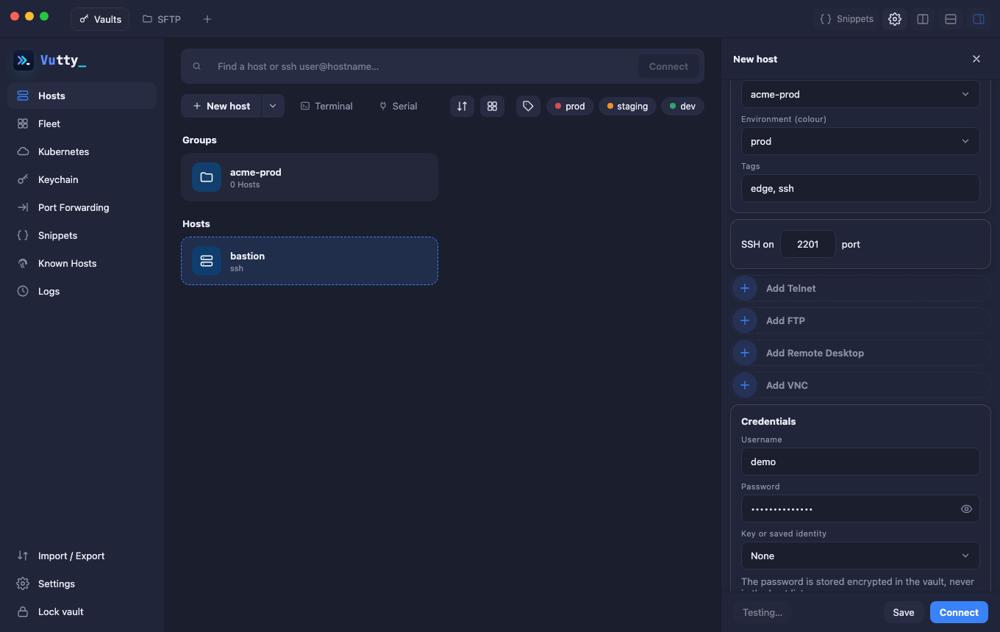

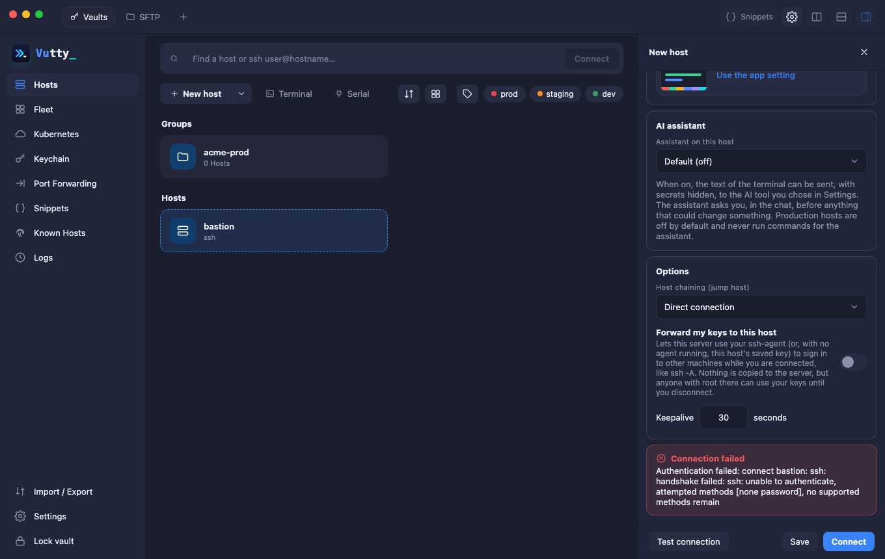

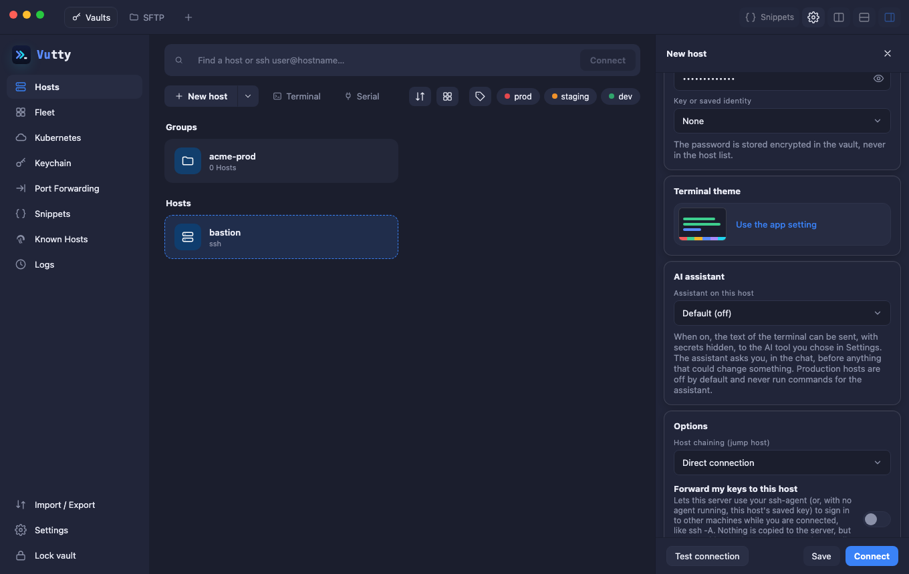

A failed test explains why (wrong password, host unreachable, key not trusted) and never shows the password.

## Hosts and groups

Groups appear as cards with their host count. Click one to open it (a breadcrumb takes you back).

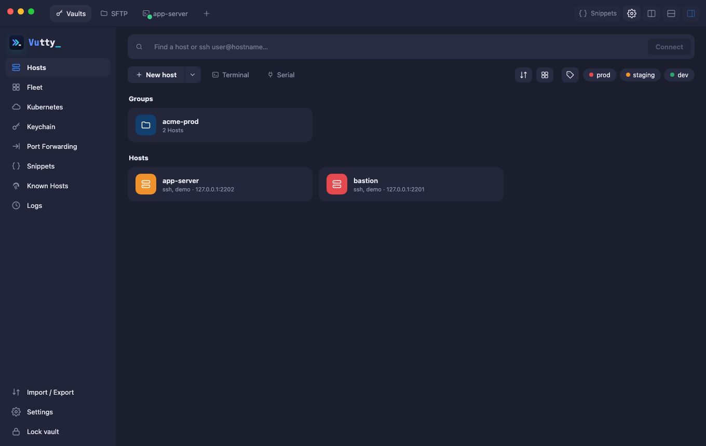

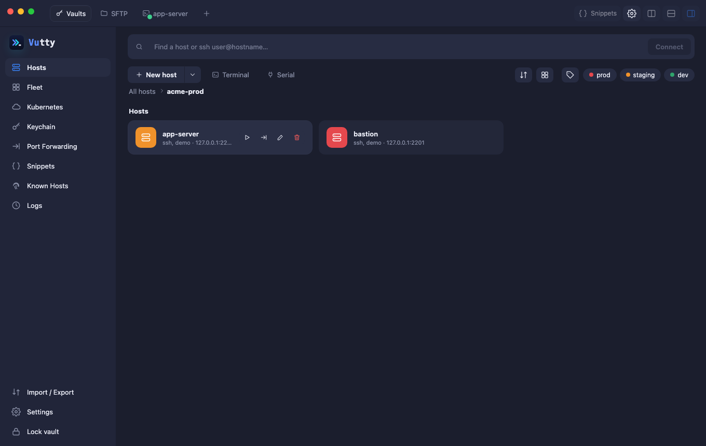

**Search** matches label, hostname, user and tags across all groups; the environment chips filter further.

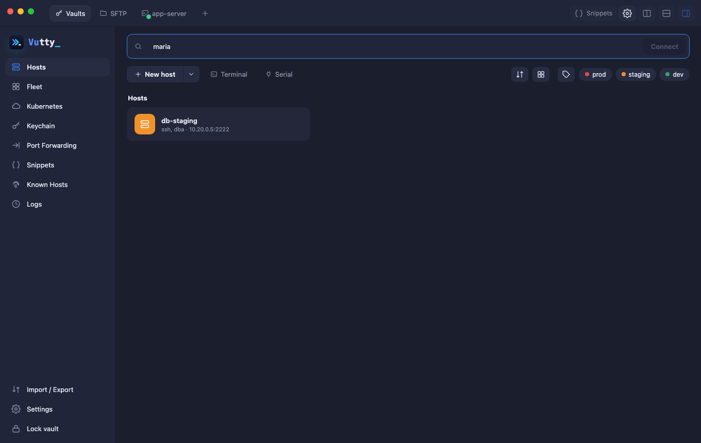

**Deleting a group deletes what is in it.** The confirmation says how many hosts and groups below it go with it (their port forwards too). Move the hosts you want to keep to another group first.

**Quick connect:** type `ssh user@host:port` and press Enter. If it matches a saved host you connect; otherwise *New host* opens pre-filled so you can save it.

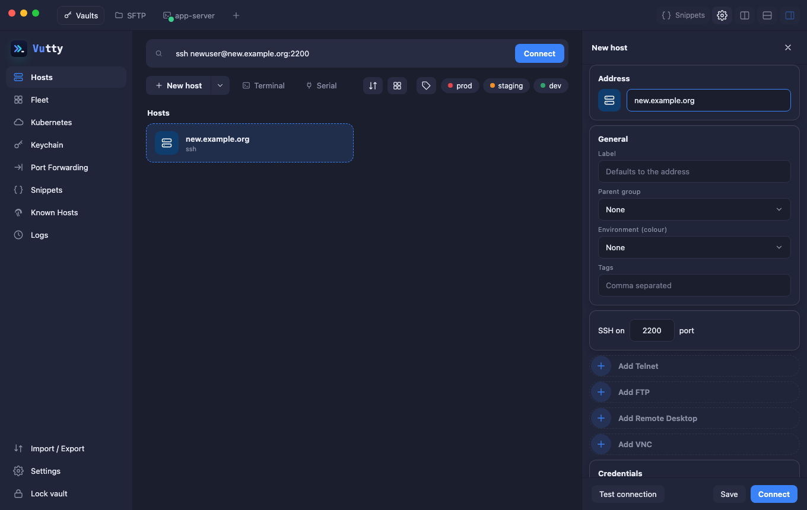

## Import and export

**Import / Export** in the navigation.

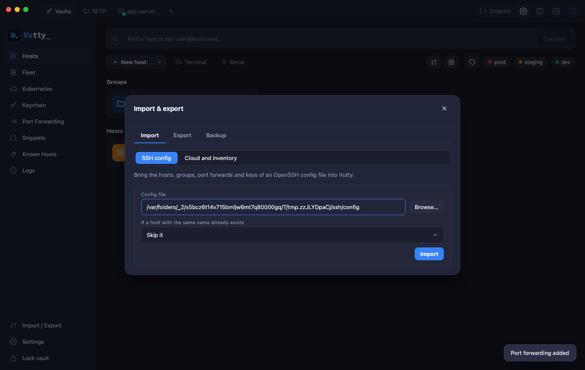

### Import an ssh config

- **Import `~/.ssh/config`**: follows `Include`; the file name inside `config.d/` becomes the group; `ProxyJump` becomes a jump host; forwards and `IdentityFile` keys come along (vault must be unlocked). Choose what to do when a name already exists: skip, overwrite or create a copy.

### Import from the cloud and from inventories

- **Cloud and inventory** (the second choice at the top of the **Import** tab): adds the servers of a listing that you make with your own tools. Vutty never contacts a cloud and never sees its credentials; it only reads the file. It recognises, by what is inside:
  - **AWS**: `aws ec2 describe-instances --output json > aws.json` (the `--query` shapes `Reservations[]` and `Reservations[].Instances[]` too). The `Name` tag is the host's name (the instance id when there is none, and a second instance with the same name gets its id added), an `Environment` / `env` / `Stage` tag of prod, staging or dev sets the environment, the other short tags become tags (`key=value`), and the hosts go into a group (`aws`, or the name you give). The listing does not say which user an image uses: set **User name for the hosts** (`ec2-user` when empty). Instances that are not running are skipped unless you tick **Include stopped instances**. The key pair of the instances is named in a note: add that key in Keychain and pick it on the hosts.
  - **Google Cloud**: `gcloud compute instances list --format=json > gcp.json`, the same way (labels instead of tags, group `gcp`).
  - **Ansible**: `ansible-inventory -i inventory --list > inventory.json` (this also covers what the cloud plugins, such as `aws_ec2`, produce), or an INI inventory as it is. Ansible's groups become groups (a host that is in several goes into the first by name), `ansible_host`, `ansible_user` and `ansible_port` are read, ranges such as `web[01:03]` are expanded, and hosts that do not use SSH (`ansible_connection`) are skipped.
  - **CSV**: a header line with `hostname` (or `address`) and, if you like, `label`, `user`, `port`, `group`, `env` and `tags` (separated by `;`).

  **Address of a cloud instance** is the public one (the private one when an instance has none) or private only, for servers you reach through a VPN or a jump host. A host whose address or user name could not be used (a space, a shell character) is skipped and counted in the notes under the result, which also says which format was read. The same choice as for an ssh config applies when a host with the same name exists: skip, overwrite or create a copy, so the listing can be imported again to bring in new servers. No vault is needed: nothing in a listing is a secret.

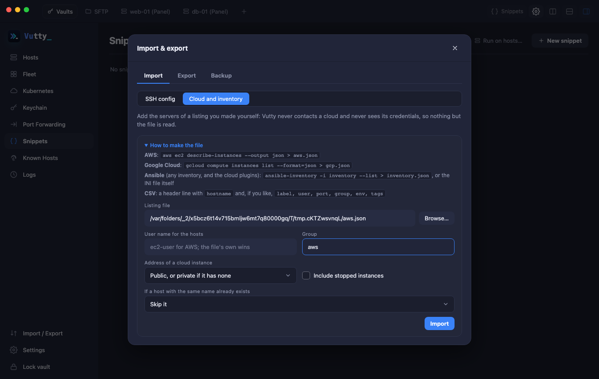

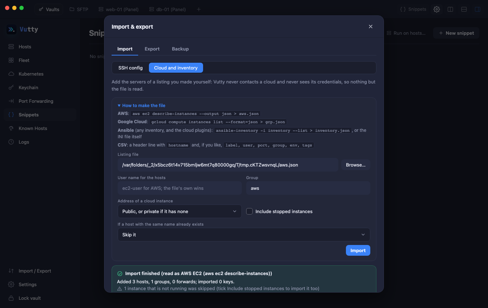

### Export and backup

- **Export ssh config**: one file per group; private keys only if you tick the checkbox (a warning is shown, files get mode `0600`).
- **Export host list (JSON)**: no secrets, safe to share.
- **Encrypted backup**: everything, protected by a *separate* password (8+ characters).

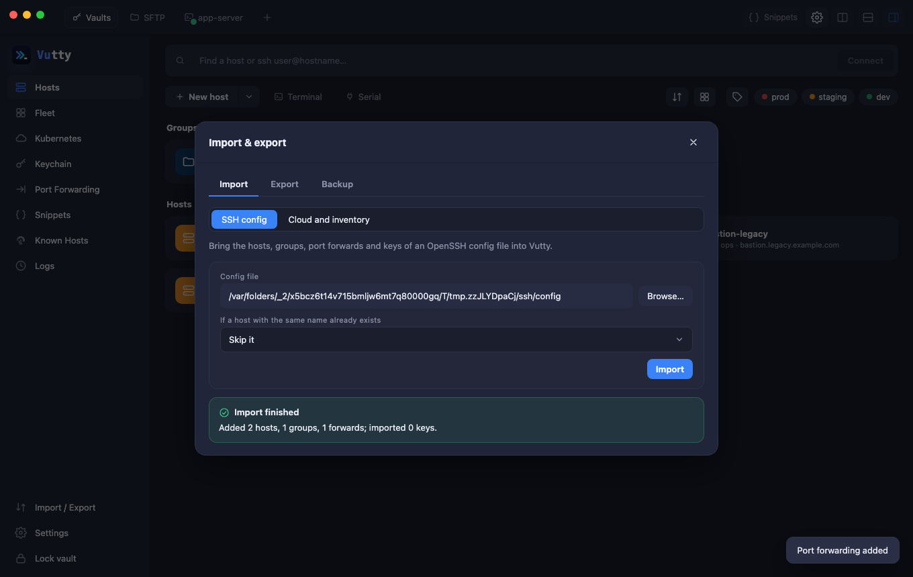

### Import report

Anything unsupported (for example `ProxyCommand`) is listed as a warning instead of being dropped silently.
