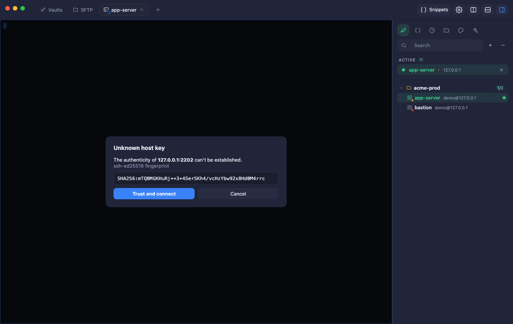
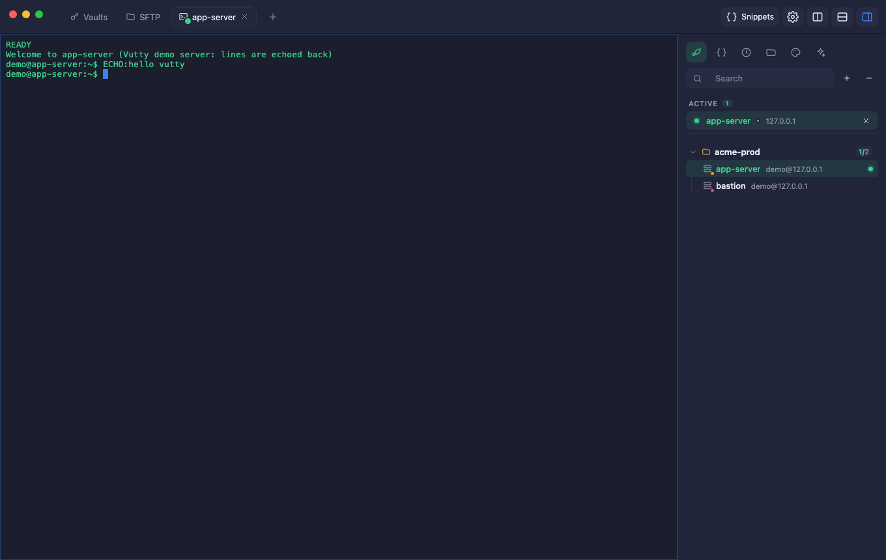
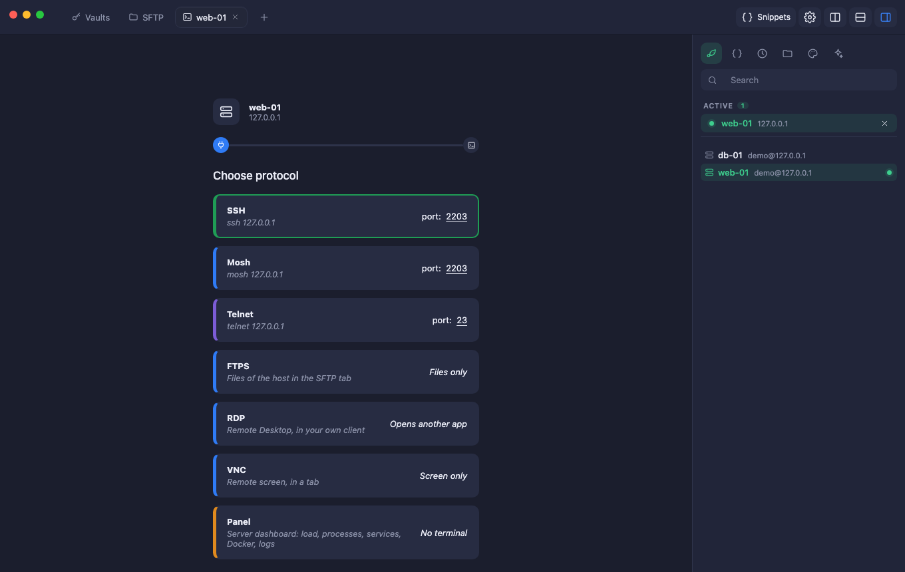
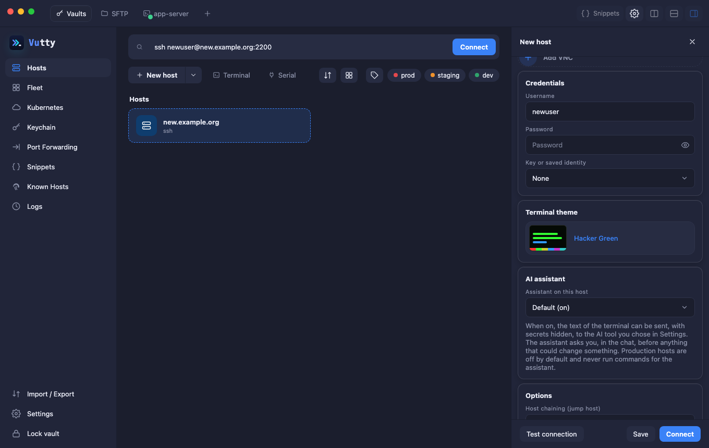
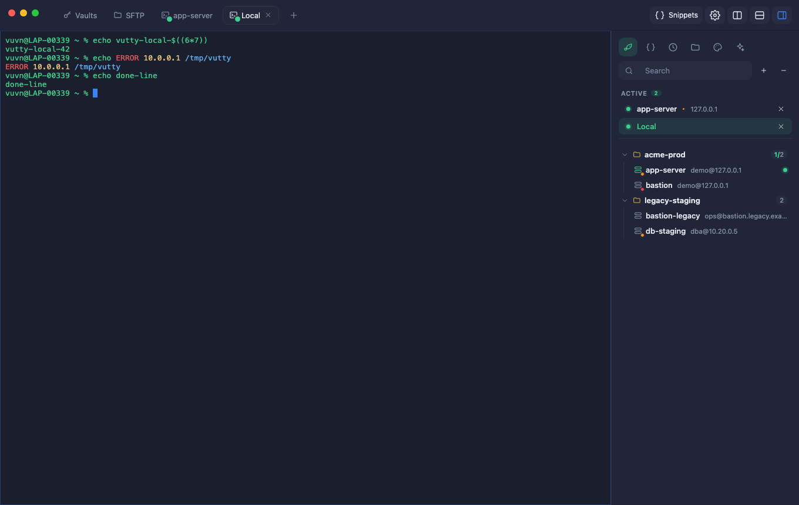

# Connecting

How a host opens: the protocol choice, the connecting screen, sign-in questions, and the extra care Vutty takes on production hosts.

## Contents

- [Open a host](#open-a-host)
- [Choose a protocol](#choose-a-protocol)
- [The connecting screen](#the-connecting-screen)
- [Servers that ask for a code](#servers-that-ask-for-a-code)
- [Mosh](#mosh)
- [VNC](#vnc)
- [RDP](#rdp)
- [Telnet, serial ports and this computer](#telnet-serial-ports-and-this-computer)
- [Production hosts](#production-hosts)
- [ssh:// links](#ssh-links)

## Open a host

Double-click a host card (or press ▶), or use **Connect** in the New host form. The first time, Vutty shows the server fingerprint. Verify it out of band, then choose **Trust and connect**. With a jump host you confirm each machine once.

Trusted keys go to `known_hosts` (OpenSSH format) and are not asked again. If a server later shows a different key, the connection is blocked (see [Troubleshooting](13-troubleshooting.md#when-something-goes-wrong)).

## Choose a protocol

Opening a host first asks **which protocol** to use. SSH is chosen for you: press **Continue** (or double-click it).

| Protocol | What you get | Needs |
| --- | --- | --- |
| **SSH** | A terminal tab. | Nothing extra. |
| **Mosh** | A terminal that survives a change of network and a sleeping laptop. | `mosh` on your computer and `mosh-server` on the host. See [Mosh](#mosh). |
| **Telnet** | A terminal over Telnet (not encrypted). | Telnet turned on in the host form. |
| **FTPS** or **FTP** | The file browser, over FTP or FTPS. | FTP turned on in the host form. See [Files](06-files.md#ftp-and-ftps). |
| **RDP** | Your computer's Remote Desktop client, started on the host. | Remote Desktop turned on in the host form. See [RDP](#rdp). |
| **VNC** | The screen of the host, drawn in a tab. | VNC turned on in the host form. See [VNC](#vnc). |
| **Panel** | A dashboard of a Linux server, with no terminal. | A Linux server with systemd. See [Panel](08-panel.md). |

Each extra protocol is added in the host form with **Add Telnet**, **Add FTP**, **Add Remote Desktop** or **Add VNC**; a protocol the host does not have is not offered. Turn the question off in **Settings → Terminal → Ask which protocol to use**; a host that has more than SSH still asks.

## The connecting screen

The **connecting screen** shows who you are connecting to and a line from the plug to the terminal. The line moves **smoothly**: slowly while the server answers, further once the login is done, and to the end when the shell is open, and only then does the terminal show. If it fails, the line stops where it got to and turns red, with the reason and **Retry**, **Show logs** (opens the Logs page) and **Close**.

The state of every tab is a small badge on its icon: a spinner while connecting, a **green** dot while connected, a **red** dot when the connection is lost (press Enter in the pane, or Retry, to reconnect: Vutty never reconnects by itself, so commands are never replayed by surprise).

## Servers that ask for a code

A bastion or a company server often wants a second step after the password or the key: a verification code from an authenticator app, a Duo choice, a one-time password. When the server asks, a **Sign in to <host>** box appears over the terminal (or in the SFTP pane, the sidebar, the port forward and the host form's **Test connection**) with the server's own questions: type the code and press **Continue**, or **Cancel** to stop.

- A box that asks for a code hides what you type, unless the server says it may be shown.
- A saved password answers the question that asks for the password by itself, so you are only asked for what is left.
- Nothing you type here is saved or written to the logs, and you have three minutes to answer.
- If a host asks for a code, a connection that starts by itself (a port forward that starts with the app) has nobody to answer it: it waits the three minutes and then fails. Start it from the Port Forwarding page instead.

## Mosh

Choose **Mosh** on the protocol screen. Vutty logs in over SSH (with the same host key and sign-in questions as a terminal), starts `mosh-server` on the host, closes the SSH connection and starts the `mosh-client` of your own computer on the port and key it printed. The key goes to the client in its environment, never on a command line, and is not logged.

Mosh keeps the session through a change of network and a sleeping laptop, and shows what you type at once on a slow link.

**Requirements**

- **`mosh` installed on your computer**: `brew install mosh` on a Mac, your package manager on Linux. Vutty also looks in `/opt/homebrew/bin` and `/usr/local/bin`.
- **`mosh-server` on the host.**
- The host's **UDP ports 60000–61000** open to you.

**Limits.** Mosh does not work on Windows, and not through a jump host (UDP needs a direct route). If the tab says `mosh-client was not found` or `mosh-server is not installed`, that is the one to install; if the screen stays blank, the firewall is closing the UDP ports.

## VNC

A host can have VNC turned on (**Add VNC** in the host form: a port, 5900 by default, and whether to go **through the SSH login**). Choosing **VNC** on the protocol screen opens a tab that draws the screen of the host. The viewer is [noVNC](https://novnc.com) (MPL-2.0).

- **Through the SSH login** (the default, and the right choice): Vutty logs in over SSH and reaches the VNC server as `127.0.0.1` on the host, so nothing crosses the network in the clear and the VNC server can listen on the host only. The jump host chain of the host works too.
- **Direct**: Vutty connects straight to the address and port, and VNC itself is **not encrypted** (the form and the protocol screen say so).
- The **VNC password is asked in the tab each time and never kept**.
- The toolbar has **Fit** (scale the screen to the tab), **View only** (look without sending keys or clicks) and **Ctrl+Alt+Del**.
- The viewer reaches the server through a path that listens on `127.0.0.1` of your computer only, behind a secret address that works for one connection, and closes with the tab.

Supported: the VNC and Apple Remote Desktop password logins that noVNC supports. Not supported: file transfer. Not yet tried against a real VNC server.

## RDP

A host can have Remote Desktop turned on (**Add Remote Desktop** in the host form: a port, 3389 by default, and a user name). Choosing **RDP** on the protocol screen starts the Remote Desktop client of your own computer on that host and closes the tab:

| System | Client |
| --- | --- |
| Windows | **mstsc** |
| macOS | **Microsoft Remote Desktop** (free in the App Store; it opens the `.rdp` file Vutty writes) |
| Linux | **FreeRDP** (`xfreerdp`) or **Remmina** |

Vutty does not draw the desktop and keeps no RDP password: the client asks for it. The `.rdp` file has no password and is deleted after two minutes. A host behind a jump host cannot be opened this way. Not yet tried on Windows or Linux.

## Telnet, serial ports and this computer

- **Terminal** (the button beside New host, or ⌘/Ctrl + Shift + T) opens a real shell on this computer. **Serial** opens a serial port at a baud rate.
- **Telnet**: in the host form press **Add Telnet** for its port, its own user name and password (kept in the vault) and the encoding (UTF-8 or ISO-8859-1). Telnet is **not encrypted**: use it only on networks you trust, for devices that offer nothing else.
- **Terminal theme per host**: a card with a picture of the theme; pick *Use the app setting* to follow Settings.
- **Highlighting**: errors, IP addresses, paths and URLs are coloured (switch in Settings → Terminal). **Copy on select**, right-click to paste (or a menu, or nothing) and the copy / paste keys are configurable.

## Production hosts

A host whose environment is **prod** is marked in its terminal: a red frame and a red **PROD** badge, so you know where you are typing. With **Settings → General → Be careful on production hosts** on (the default), Vutty also asks before:

- **pasting text with a line break** into that terminal (the line would run as soon as it arrives; a single line that ends with Enter counts, a line without one does not), whether you paste with the keyboard, the right click or the menu;
- **running a snippet** or a command from the history there, and **pasting a snippet that has several lines**, since all its lines but the last run as they are typed;
- **running a command on several hosts** when one of them is prod (see *Run on hosts* in [Snippets](05-terminal.md#run-on-hosts)): that question is always asked.

Say no and nothing is typed. Turn the setting off if you would rather not be asked; the red mark stays.

## ssh:// links

Vutty can open `ssh://[user@]host[:port]` links (on macOS it is registered for them: the first time you click one, macOS may ask which app should open it, and you can pick Vutty). On Windows and Linux the link is passed to the app as an argument when the system is set up to do so. **A link never connects by itself.** Vutty first says what the link points to and asks:

- a link to a **saved host** (same address, same port, and the same user name if the link has one) asks *Connect?*;
- a link to an **address you do not have** only opens the **New host** form, filled in; nothing happens until you press Connect, and an unknown server key is asked about as always.

A password in the link is ignored, and so is anything after the address (a path, a query), because a link from a web page or a chat must not carry a secret in or a command. A link that has no usable host name is ignored. If the vault is locked, the link waits and is asked about right after you unlock. The same `ssh://user@host:2222` written in the search box of the Hosts page works like `ssh user@host:2222`.
