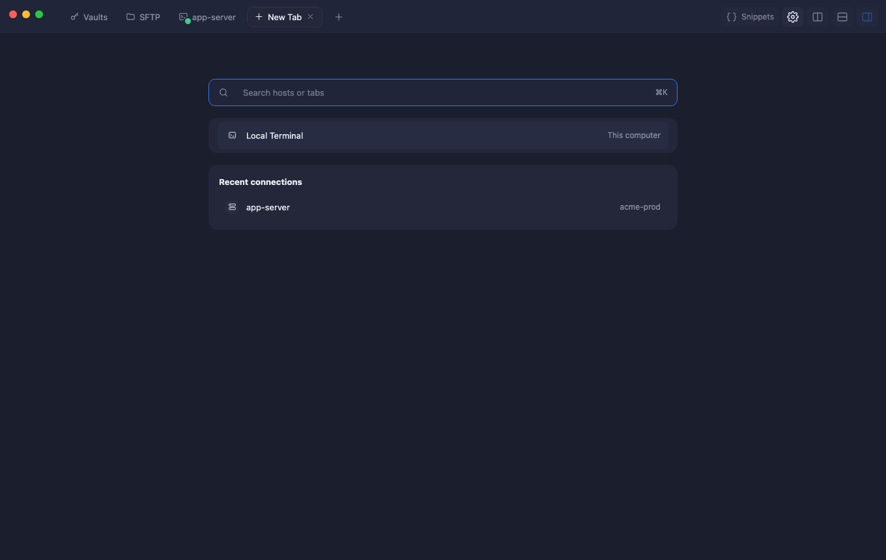
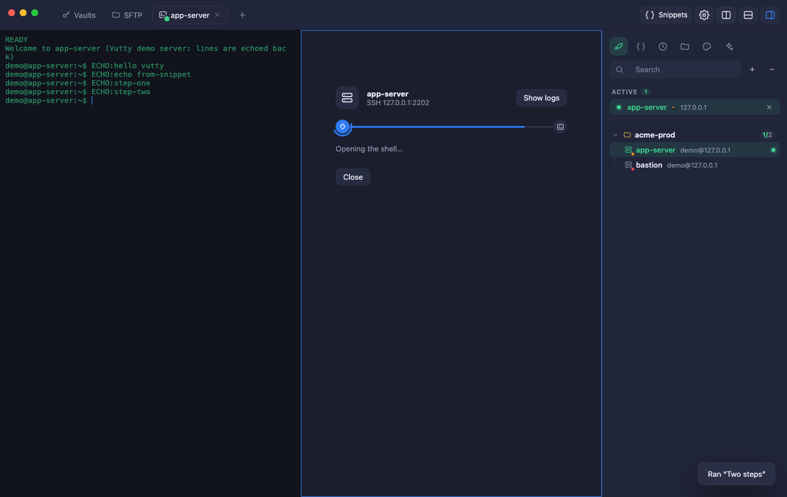
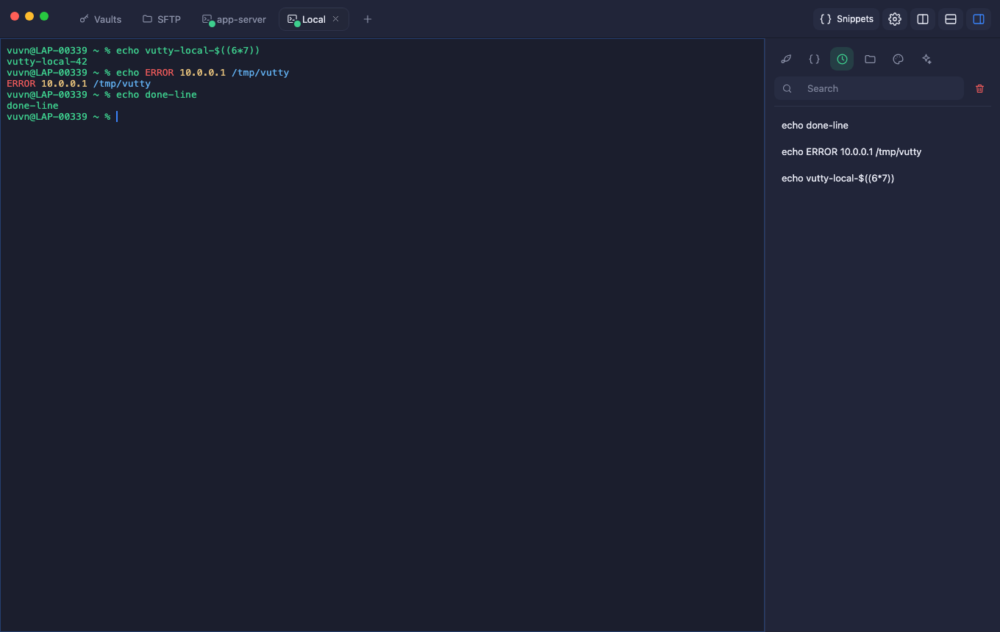
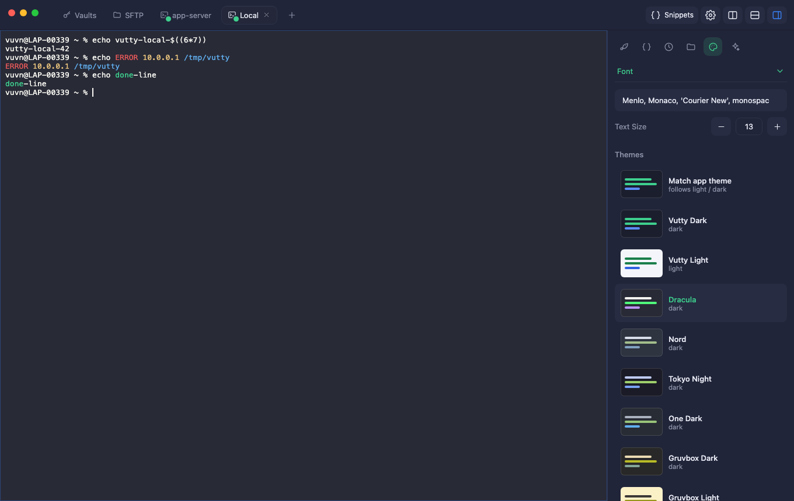
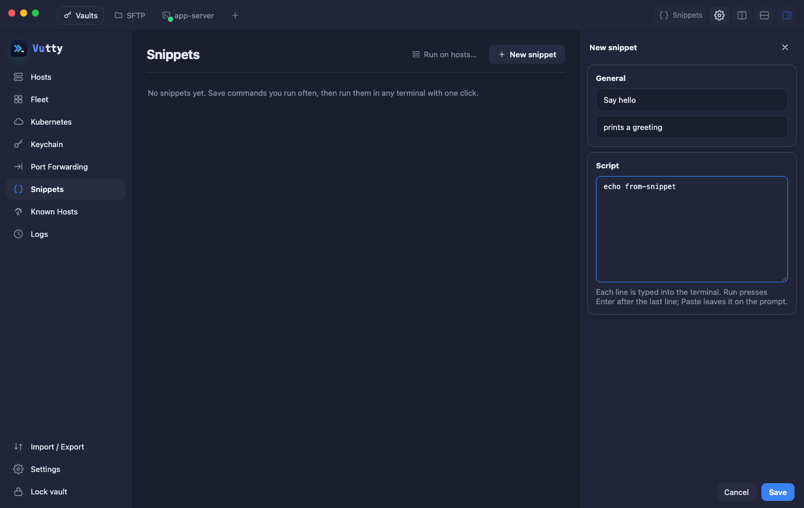
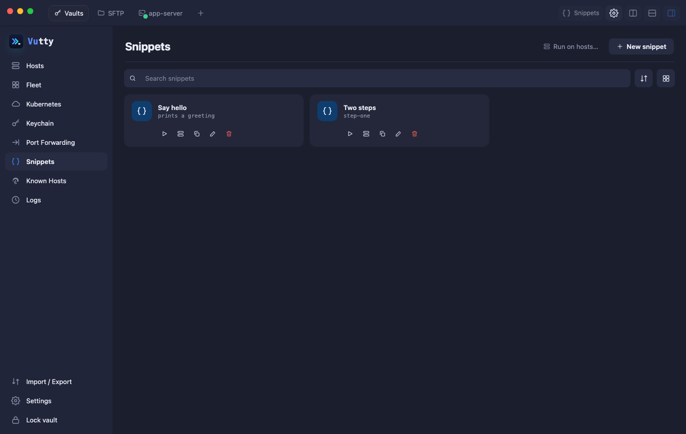
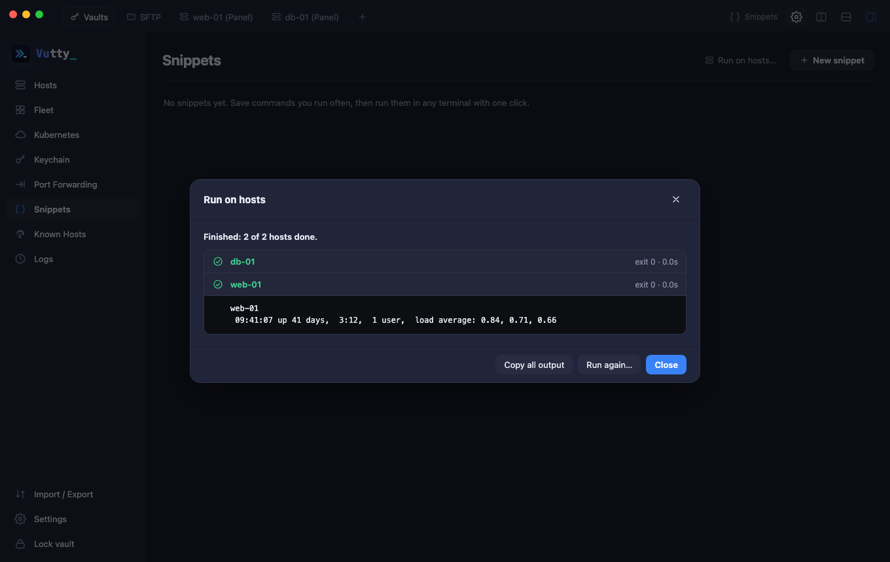
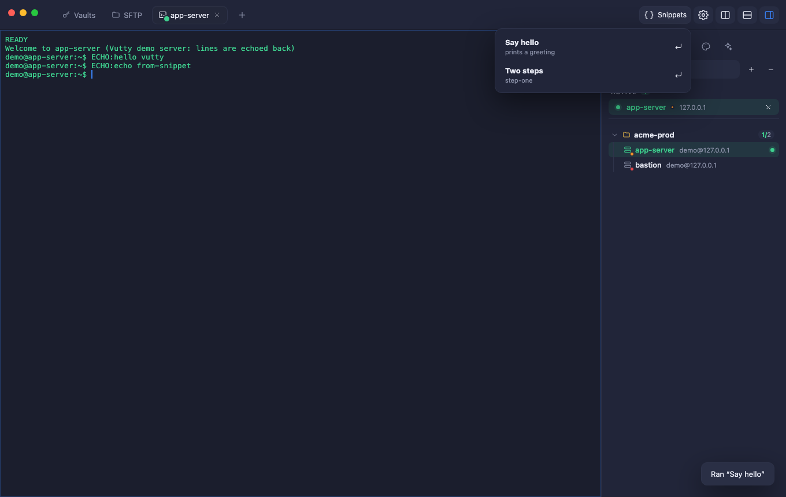

# The terminal: tabs, panes, snippets and sidebar

Working inside a terminal tab: organising tabs and panes, the sidebar, and the commands you reuse.

## Contents

- [Tabs](#tabs)
- [Split panes and search](#split-panes-and-search)
- [The terminal sidebar](#the-terminal-sidebar)
- [Snippets](#snippets)
  - [Blanks](#blanks)
  - [Run on hosts](#run-on-hosts)
  - [Command suggestions](#command-suggestions)

## Tabs

- **The + button** opens a **New Tab**: a search box for hosts and open tabs (⌘/Ctrl + K), **Local Terminal** on its own, and your **Recent connections**. Pick one and the tab becomes that connection.
- **Drag a tab left or right** to put your tabs in order. SFTP always stays first.
- **Drag a tab onto a pane** to split it: the side nearest to the pointer lights up (left / right: side by side, top / bottom: one above the other). The dragged tab joins as a split and its sessions **keep running**, nothing reconnects.
- **Which pane has the keyboard**: in a split the focused pane has a blue frame and a dot by its name; the other panes are dimmed. Click a pane to give it the keyboard.
- **Drag a pane by its header** (the bar with the host name that shows when you hover over a pane of a split): onto a side of another pane to move it there (in the same tab or in another one); **up onto the tab bar** to make it a tab of its own; onto another terminal tab to join that tab. The pane keeps its session: nothing reconnects.
- **Take a pane back out**: hover over a pane of a split and press **Move pane to its own tab**.
- **Right-click a tab**: Duplicate, **Duplicate in new window**, Rename, Split right, Split down, Close. Double-click a tab to rename it.
- **Many tabs** shrink like in a browser; the active tab always shows its whole name, and a hovered one shows its close button.
- **Duplicate in new window** opens the whole app in a second window (Vaults, SFTP, tabs, sidebar) with that host open in its first tab. Both windows share the same data and the same unlocked vault, and the sessions opened in the new window end when you close it. It runs as a second process, so it has its own Dock icon.

## Split panes and search

Use the two buttons at the top right to split the focused pane right or down. Every pane is its own session to the same host. **Ctrl/Cmd+F** searches the scrollback. When a shell exits (`exit`) its pane closes; closing the last pane closes the tab.

## The terminal sidebar

The panel on the right of every terminal (the last button of the title bar shows or hides it):

| Tab | What it does |
| --- | --- |
| Hosts | Your hosts as a tree, like a file manager's: one line per host (its name, then a muted `user@host`), a folder icon and a count on every group, a dot on hosts with an open session, *Expand all* and *Collapse all*, and the arrow keys (right opens a group, left closes it or goes to its parent, Home and End). Open one in a new tab. |
| Snippets | One line each; click one to see the whole script with **Run** and **Paste**. |
| History | The commands you typed **at the host of the focused terminal**, newest first, searchable (each host has its own list). Click to type one again, double-click to run it. Only lines the terminal echoed are kept, so what you type at a password prompt never is. |
| Files | The files of the focused terminal's host, with the same transfer queue as the SFTP tab. See [Files](06-files.md#files-in-the-terminal-sidebar). |
| AI assistant | Ask about what is on the terminal. See [AI assistant](10-ai-assistant.md). |
| Themes and font | Pick the terminal theme from pictures, change the font and the text size. |

## Snippets

Snippets are commands you reuse. **Snippets → New snippet**: a label, an optional description and the script (one or more lines).

### Blanks

Write `{{name}}` in a script where a value changes, or `{{name|default}}` to give it a default. When you Run or Paste the snippet, a box asks for each blank (an empty box uses the default) and the answers are put in as plain text; **Use as written** types the script untouched, for text that only looks like a blank. Go-template text such as `{{.Names}}` is not a blank.

### Run on hosts

**Snippets → Run on hosts…** (or the server button on a snippet) runs one command on several hosts at once.

1. Choose the hosts (search, or **All shown**).
2. Write the command or start from a snippet, and fill in its blanks.
3. Choose how long to wait for each host, then **Run**.

Every host gets its own connection and **no terminal**, five at a time. The page lists each host as it finishes, with its exit code, how long it took and what it printed (a failed host opens by itself; the first 64 KB of the output are kept).

- **Cancel the run** disconnects the hosts that are running and skips the rest. **Copy all output** puts everything on the clipboard. **Run again…** goes back to the form with your command and hosts.
- In the command, `{{host}}`, `{{hostname}}` and `{{user}}` become each host's own label, address and user name (a value with spaces or other shell characters is put in quotes).
- If any chosen host is marked **prod**, you are asked to confirm first.
- Nothing is asked while it runs: a host whose key you never trusted, or that asks for a verification code, fails with a message that says so; open it once in a terminal tab first.
- The command and the output are not written to the Logs (only that a command ran on the host, and its exit code), and a finished run is forgotten when you close the window.

- **Run** (▶) types the script and presses Enter in the focused pane of your terminal and switches to it.
- **Paste** types it *without* Enter, so you can read or edit it first.
- Inside a terminal, the **Snippets** menu in the title bar does the same without going back home.

A terminal must be open and connected. Snippets sync with Git and are included in backups.

### Command suggestions

While you type in a terminal, a **list** of the commands you used before that match appears under the cursor, each row marked *typed*, *snippet* or *host*: **↓ ↑** choose a row, then **Enter** or **Tab** put it on the line (it is never run for you), **Esc** closes the list until the next line. A row is only taken when you chose it with the arrows: until then Enter runs what you typed, **Tab** is the shell's own completion and the arrows go to the shell, as always. **⌘⇧J** (Ctrl+Shift+J on Windows and Linux; changeable in Settings → Shortcuts) opens the list by hand, also for an empty line; with nothing to show it says "No matching commands". **Ctrl/⌘+Shift+G** turns suggestions off and on at once and tells you which. Both are also in the **View** menu (*Command Suggestions* and *Show Suggestions*), which shows their keys.

- The suggestions come from the commands you ran **at the same host** in Vutty (the command that ran, as the screen shows it: a line completed with Tab or finished with the shell's own suggestion is kept whole). Each host has its own list, so a command typed on this computer is never offered at a server, and the other way round, the shell history of this computer (`~/.zsh_history` and `~/.bash_history`) in the **local** terminal, your Snippets of **one line** (a snippet of several lines is never suggested, because its first lines would run at once; a snippet is also found by its name) and, if you turn it on, the shell history of an SSH server.
- **Settings → Terminal → Suggest commands** switches it all off. **Suggest from the host's shell history** is off by default and is about SSH servers: it reads the last 3000 commands of `~/.bash_history` and `~/.zsh_history` over the open SSH connection when the terminal opens, keeps them in memory only, and leaves out any command that holds a secret.
- A suggestion is only offered when Vutty is sure what is on the line and the screen shows it at the cursor: not in vim or htop, not at a password prompt, and not while the shell is changing the line (after Tab or an arrow key the line is read from the screen again). A line that looks like a password, token or key is never suggested.
