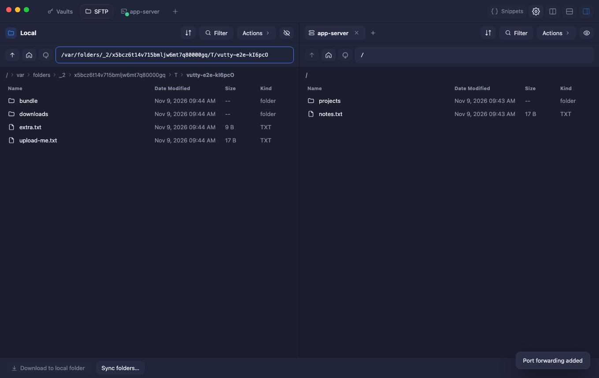
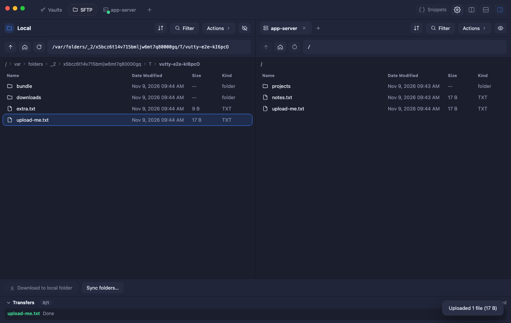
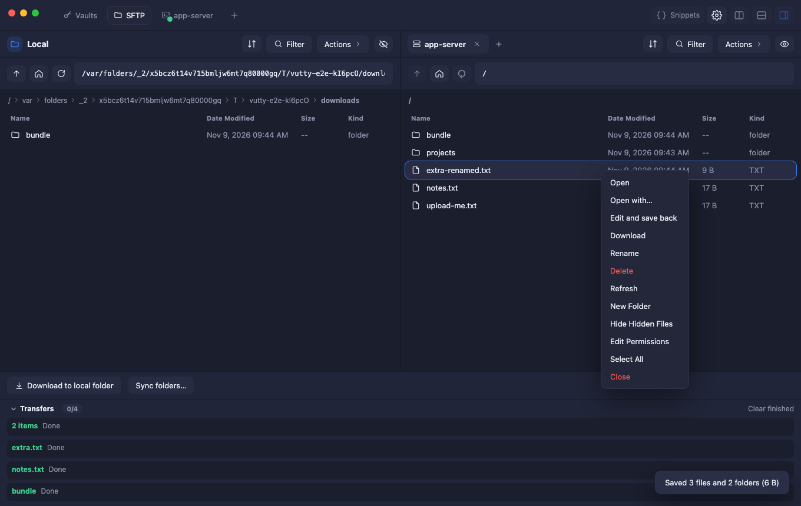
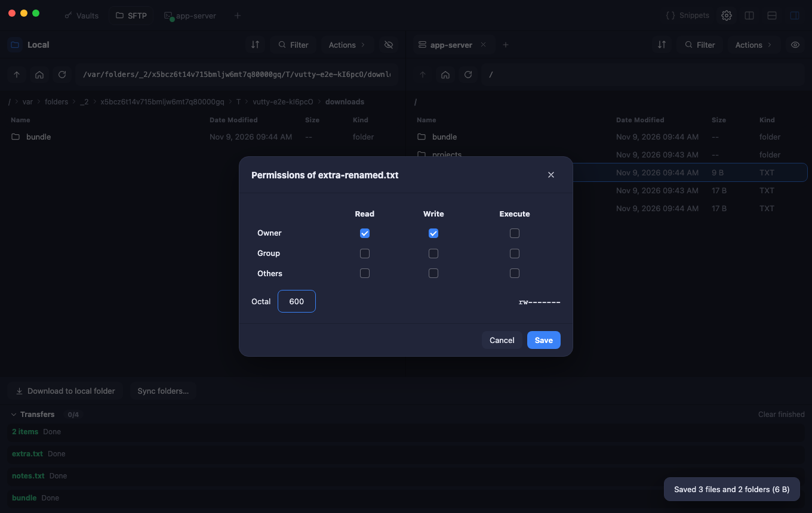

# Files: SFTP and FTP

Browse and move files on a server, in a tab or in the sidebar of a terminal, over SFTP (through your SSH login) or FTP/FTPS.

## Contents

- [Browse and transfer](#browse-and-transfer)
- [The transfer queue](#the-transfer-queue)
- [Sync folders](#sync-folders)
- [Edit a remote file](#edit-a-remote-file)
- [Files in the terminal sidebar](#files-in-the-terminal-sidebar)
- [The right-click menu](#the-right-click-menu)
- [FTP and FTPS](#ftp-and-ftps)

## Browse and transfer

Use the **folder button** on a host card to open a file browser in its own tab (the tab has a folder icon). Vutty opens a separate SSH connection, through the jump hosts if the host has any, so you do not need an open terminal. The first time you connect to an unknown server you are asked to trust its key, exactly as for a terminal.

- **Browse:** double-click a folder (or press Enter), use the arrows, breadcrumbs, *Up*, *Home*, *Refresh* or type a path in the box.
- **Upload** into the current folder, **Download** the selection, **New folder**, **Rename**, **Delete** (folders are deleted with everything inside, after a confirmation). Select several files and folders (Cmd/Ctrl-click, Shift-click) and drag them across, or use the buttons: folders go with everything inside.
- Nothing is overwritten silently. If some of what you send already exists at the other side, you are asked **once** for the whole batch whether to replace those files; answer no and they are left as they were.

## The transfer queue

Transfers run **in the background**, two at a time, and are listed in the **Transfers** panel at the bottom (it collapses to a badge with the overall progress). Keep browsing, or start more transfers, while they run.

- **Pause** stops a transfer where it is and **Resume** continues it **from the bytes already copied**, not from the start. A transfer that fails (the network drops, the disk is full) keeps what it had: **Retry** continues it. The same holds if you close and reopen the connection: send the file again and the partial copy is continued, as long as the file has not changed in between.
- **Cancel** ends a transfer for good and deletes the partial file it left.
- **Clear finished** removes the done, failed and cancelled lines.
- A partial copy is a hidden file next to the target (`.vutty-part-…`) until the transfer is complete; then it is renamed into place, so a half-written file never has the real name.

## Sync folders

**Sync folders…** (at the bottom) compares a folder on this computer with one on the server, in the direction you pick (*Local → Remote* or *Remote → Local*), starting from the folders open in the two panes. **Compare** shows what would be copied: files that are **new**, files that **changed** (another size, or newer at the source), how many are identical, and the files that exist only at the target. **Sync** puts the copies in the queue.

A sync **never deletes anything**: files that only the target has are listed and left alone.

## Edit a remote file

Right-click a file on the server and choose **Edit and save back**. Vutty downloads it, opens it in the program your computer uses for that kind of file, and **uploads it again every time you save**, keeping the permissions the file had. If the file on the server changed since you opened it, nothing is overwritten: you are asked whether to replace the server's copy with yours. (A change is noticed by size and by time to the second, so two edits in the same second that leave the size unchanged are not told apart.)

## Files in the terminal sidebar

The sidebar of a terminal has a **Files (SFTP)** section for the host of the focused pane: browse its folders, upload files or a folder, download, with the same queue. It opens its own connection when you open the section and closes it when you leave. It is not offered for a terminal on this computer, a serial port or Telnet.

- If the connection drops, a banner offers **Reconnect**.
- **A local terminal** shows the files of this computer (no SFTP connection and no queue). A button goes to the folder the terminal is in (the shell's OSC 7 when it reports one, else the shell's process; over SSH, the server's `/proc`). Dot files can be shown or hidden.
- **Go to folder** (right-click) types `cd` into the terminal and runs it: a folder goes to itself, a file to the folder it is in. Paths with quotes, spaces or `[brackets]` are quoted; a Windows path gets PowerShell's `cd -LiteralPath` (not for `cmd.exe`).
- **In a shell in a pod** of a cluster opened with a kubeconfig, the section shows the files inside the pod (read only; see [Kubernetes](09-kubernetes.md)).
- **Limits:** a copy keeps the modification time of its source (best effort: a server may refuse it), and a partial `.vutty-part-…` file that nothing has written to for 7 days is removed the next time its folder is used; there is no drag and drop of files from Finder into the window (use the buttons). Closing an SFTP tab asks first (see *Confirm before closing a tab*).

## The right-click menu

The file lists have a **right-click menu**: Open, Open with…, Copy to target directory, Rename, Delete, Refresh, New Folder and **Edit Permissions** (a grid of read / write / execute, or the octal number).

## FTP and FTPS

A host can also be reached with FTP, for servers that offer files that way and no SSH (shared hosting, a router or a camera).

1. In the host form press **Add FTP**.
2. Choose the mode: **FTPS (explicit TLS)** (the default, port 21), **FTPS (implicit TLS)** (port 990) or **Plain FTP**.
3. Give a user name and password. The password is kept in the vault, like the Telnet one. A host with no user name and no password logs in as `anonymous`.

The host then appears twice in the SFTP tab's **Select host**: over SSH, and as **name (FTP)**; it is also the **FTP** choice of the [protocol screen](04-connecting.md#choose-a-protocol). The browser, the queue, resume, drag and drop and edit-and-save-back work as for SFTP.

- FTPS checks the certificate of the server and refuses one it cannot trust.
- Plain FTP sends the password and every file in the clear, and says so.
- **Not available over FTP:** changing permissions (many servers have no command for it), a jump host (the data connections need a direct route) and the Panel, which needs SSH.
