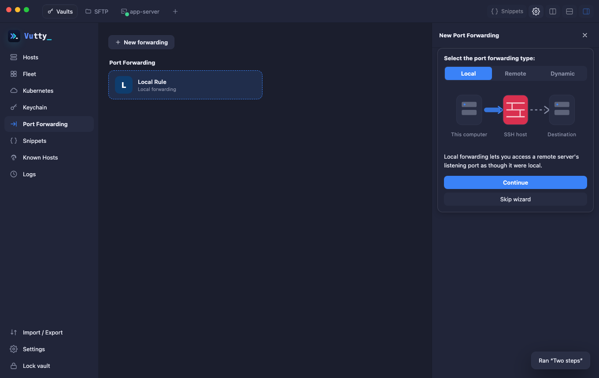
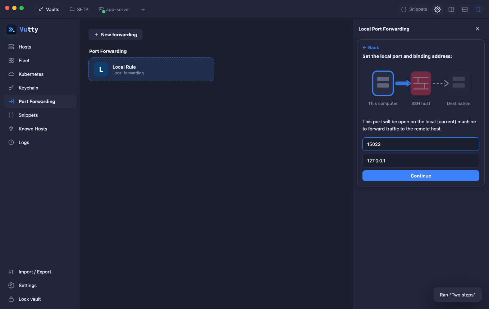
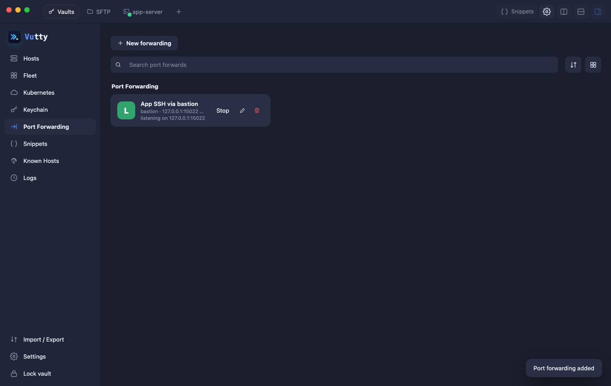

# Port forwarding

Open **Port Forwarding**, pick *New forward for host…*, and add one:

| Type | Meaning |
| --- | --- |
| Local (-L) | listen on your Mac, connect to a destination through the host |
| Remote (-R) | listen on the server, connect back to a destination on your Mac |
| Dynamic (-D) | local SOCKS5 proxy through the host |

Forwards listen on `127.0.0.1`; other addresses need an explicit checkbox. *Start automatically* brings the forward up with the terminal.

The page lists every forward with its host and state.

