# Panel: a server dashboard in a tab

Panel turns a tab into a dashboard of a Linux server, with no terminal: what the machine is doing, what needs attention, and the everyday jobs of someone who runs a server by hand (restart a service, renew a certificate, add a user, open a firewall port). It runs fixed commands over an SSH connection of its own and **installs nothing** on the server.

_The screenshots use sample data, not a real server._

## Contents

- [Open the panel](#open-the-panel)
- [Find your way around](#find-your-way-around)
- [Monitor](#monitor): [Overview](#overview), [Processes](#processes), [Logs](#logs), [Incident](#incident)
- [Run](#run): [Services](#services), [Docker](#docker), [Kubernetes](#kubernetes), [Web](#web), [Schedule](#schedule)
- [Manage](#manage): [Ports and firewall](#ports-and-firewall), [Security](#security), [Users](#users), [Maintenance](#maintenance)
- [Fleet: every host on one page](#fleet-every-host-on-one-page)
- [How Panel keeps your server safe](#how-panel-keeps-your-server-safe)

## Open the panel

When a host asks which protocol to use (the **Ask which protocol to use** setting, or a host that has more than SSH), **Panel** is one of the choices.

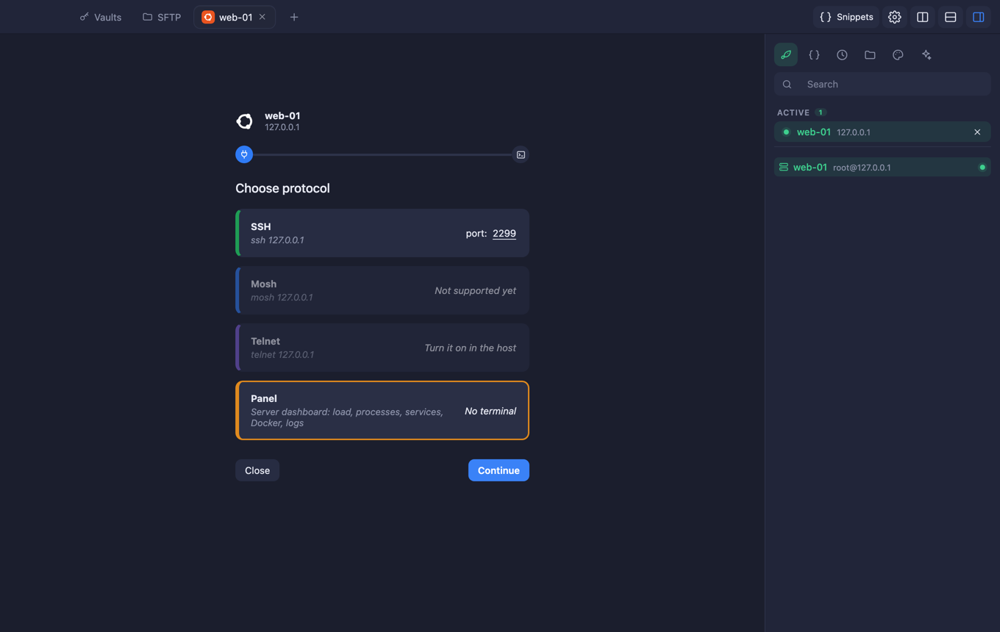

At the top right of the dashboard: **Reboot** (asks first), **Files** (opens the host in the SFTP tab) and **Access host** (opens a terminal on the same host in a new tab, straight away, without asking for the protocol again).

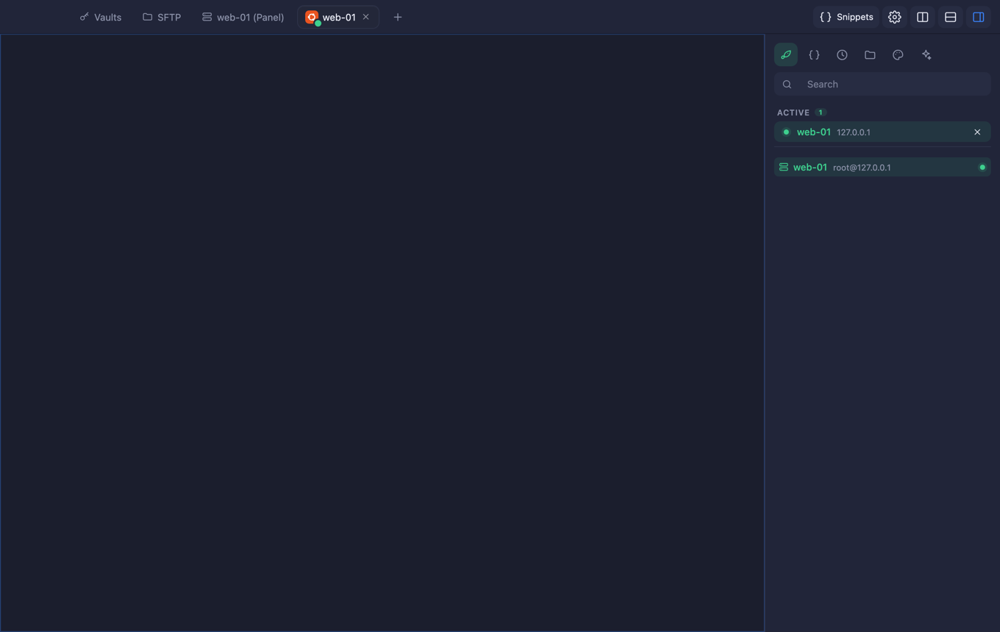

## Find your way around

The sections are listed on the left in three groups:

| Group | Sections |
| --- | --- |
| **Monitor** | Overview, Processes, Logs, Incident |
| **Run** | Services, Docker, Kubernetes, Web, Schedule |
| **Manage** | Ports & firewall, Security, Users, Maintenance |

- A red or yellow number on a section, and a red one on its group, is something the Overview lists under *Needs attention*: a failed service shows on Services, a certificate on Web, updates and a full disk on Maintenance. You see it without opening the Overview.
- The **«** button at the bottom of the list keeps icons only (remembered on this computer). In a window narrower than 760 px the list becomes a row.
- Every box has a head you can click (the arrow, the title or the empty space) to put the box away; what you put away is remembered for next time.
- A row with many actions keeps the main one and puts the others in a **⋮** menu.
- Overview and Processes refresh every 5 seconds while the tab is shown; the other sections when you press refresh.

## Monitor

### Overview

CPU with a short history, load, memory, swap, the root disk, network speed, and **what needs attention** (a failed service, a disk that is filling up, a certificate about to expire, security updates, a reboot, an old backup).

While the tab is open it keeps the last half hour of CPU, memory, disk and network. One point for each minute is also kept on this computer for each host and drawn as **6 and 24 hour** charts next to the live half hour. Nothing is read while the tab is closed, so those times are gaps in the line.

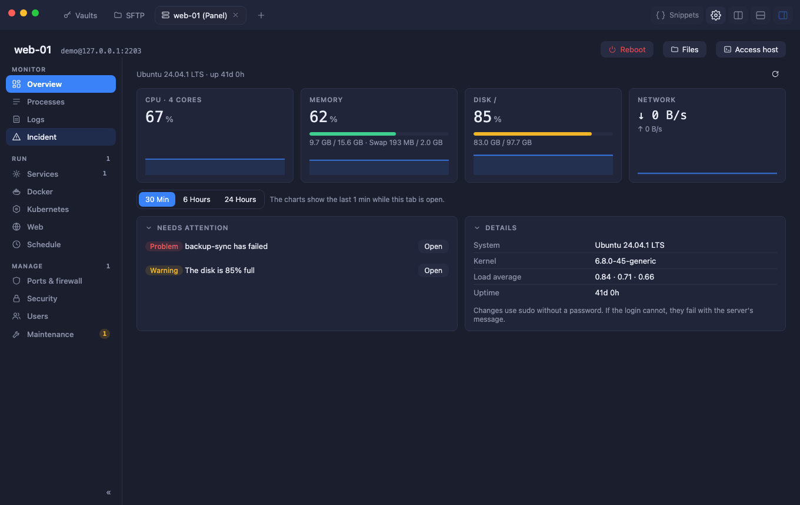

### Processes

The busiest first, sortable, with a filter. Ending a process asks first and is done by process number only.

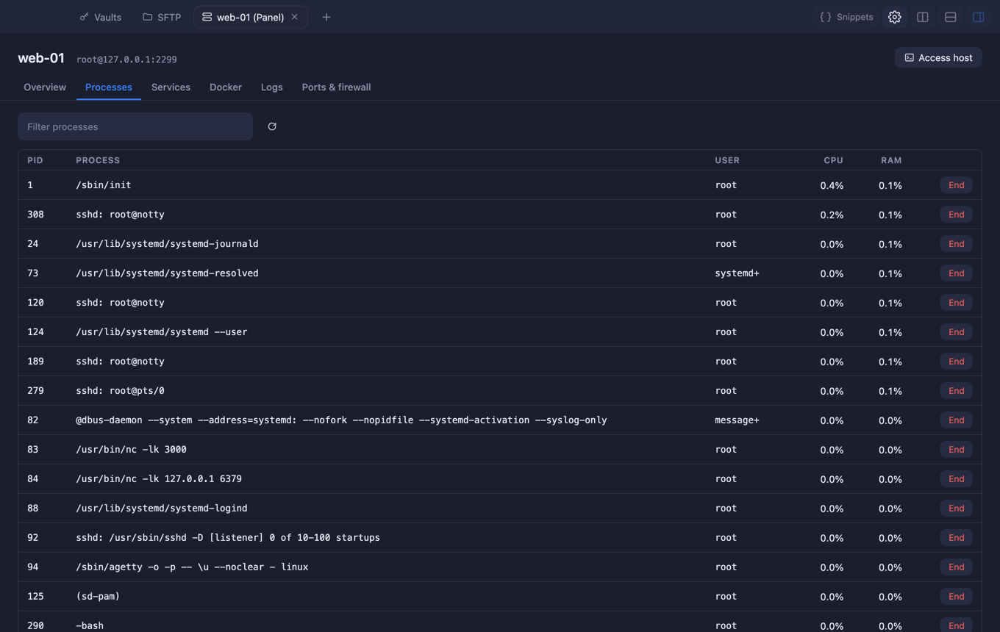

### Logs

The last 300 lines of the system journal, of one service or of one container; filter by text or by errors and warnings.

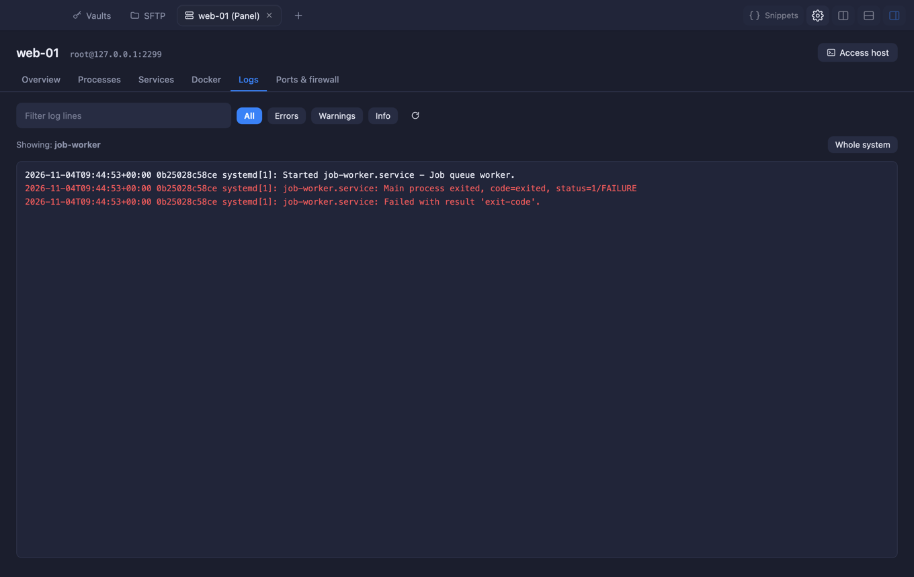

**Follow** starts a command on the host that does not end (`journalctl -f`, `docker logs -f`, `tail -F`) and shows each new line as it arrives, keeping the newest in view until you scroll up.

- Up to three logs can be followed at once on one connection.
- A log that cannot be followed live (the host refuses) is read again every 2 seconds instead, and the panel says so. A pod of the Kubernetes tab is read again every 2 seconds.
- The command on the host stops when you turn Follow off, change source or close the tab, or when the connection drops.

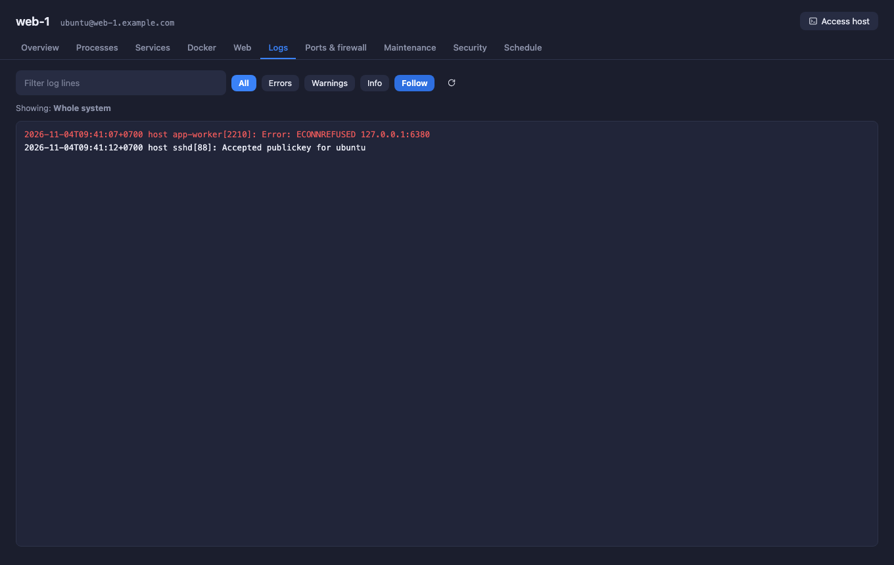

**Looking back at a time that has passed**

- The **Time range** box has *Choose a range…*: two boxes for a start and an end, in the **time of the server** (its zone is written next to them), and the last N lines of that range are shown.
- **Previous boot** (the system, a service, Caddy) shows the log of the boot before this one, to read what led to the last restart.
- Click a line that has a time and *Show ±1, ±5 or ±30 min around it* opens that moment.
- The range stays when you change the source, so you can look at a service and then its container for the same minutes.
- **Context** (with a filter on) keeps 3 lines before and after each match, with `···` where lines are left out.
- A range or a boot is read once and cannot be followed, and the nginx error file has no times to choose from.

### Incident

Answers "what happened at 3 in the morning" the next day, from what the server wrote down itself. Pick the last hour, 6 hours, 24 hours, 3 days or a range of your own; it shows:

- the services that failed or that systemd restarted,
- processes the kernel killed for memory,
- the times the machine started or stopped,
- the error lines for each minute as a strip of bars,
- the containers that started, stopped or restarted.

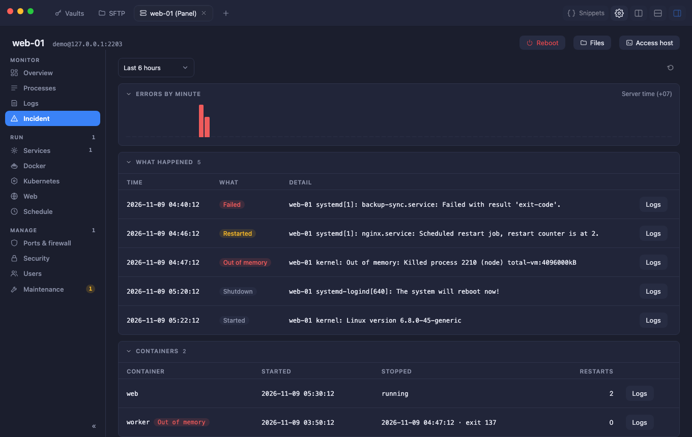

Every row, and every bar, has a *Logs* link that opens the Logs tab on that moment. Nothing is installed or changed.

- It only goes back as far as the journal does. When the journal is kept in memory only (no `/var/log/journal`) a reboot erased what came before, and the tab says so with **Keep it on disk**, which asks first, makes that folder and restarts `systemd-journald`.
- A login that is not root and not in the `systemd-journal` group sees only its own messages, and the tab says that too.
- The resources (CPU, memory) of that night are not recorded when the app is closed, so the strip shows errors, not load.

## Run

### Services

systemd services, failed ones first. A row has *Restart* (or *Start*) and a **⋮** menu with *Stop*, *Disable on boot* or *Enable on boot*, and *Logs*. Every change asks first.

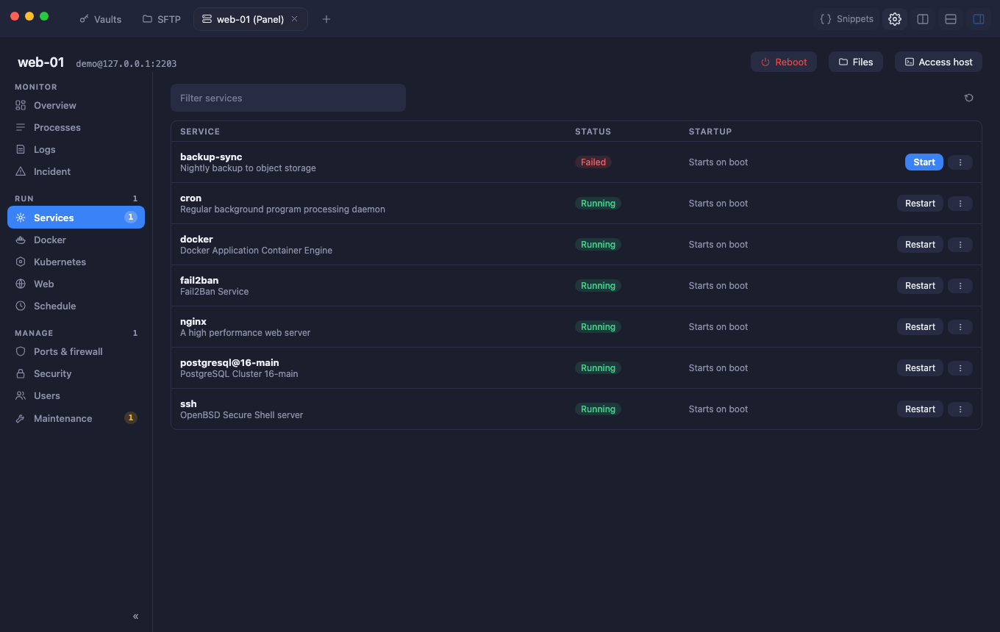

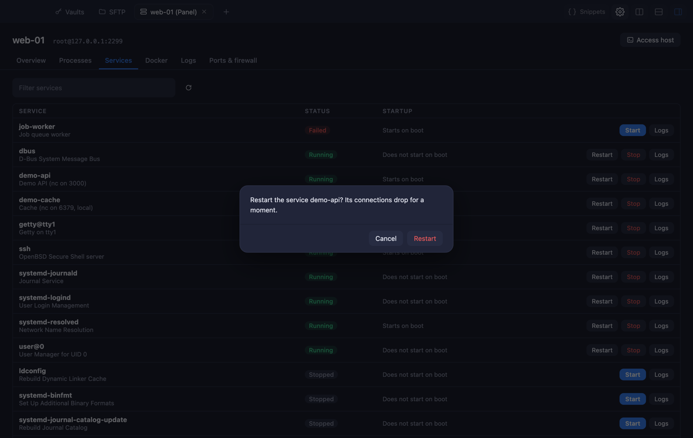

### Docker

Containers grouped by Compose project. Each running container shows its CPU and memory.

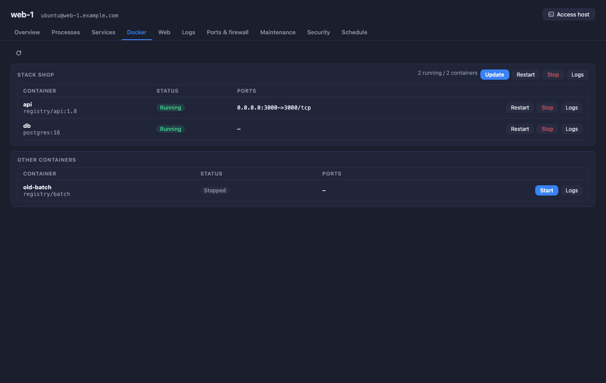

- **A stack** has *Update* (pull the images, then `up -d`), *Restart* and *Stop*/*Start*, and in its **⋮** menu *Up* (`up -d`: create what is missing, recreate what changed), *Logs* and *Down* (removes the containers and the network, keeps the volumes; the panel cannot bring a stack back after that, run `docker compose up` in its folder), all after a question. It needs Docker Compose v2.
- **A container** has *Shell* (types `docker exec`, bash else sh, into a terminal tab on the host) and *Details*: the image, command, restart policy, ports, networks and mounts, and the environment with its values hidden until asked.
- **Images** has *Pull image* (a name such as `nginx:1.27`) and *Pull* on each listed image, which downloads the newest of its tag; containers keep running the old image until they are recreated. An image is deleted only when nothing uses it, after asking.
- **Volumes** can be deleted only when nothing uses them, after asking. **Networks** are read only.

### Kubernetes

The Kubernetes tab runs `kubectl` on the host over the same login. It has its own chapter: [Kubernetes](09-kubernetes.md).

### Web

The Let's Encrypt certificates (green, yellow under 14 days, red under 7) and the sites of nginx or Caddy.

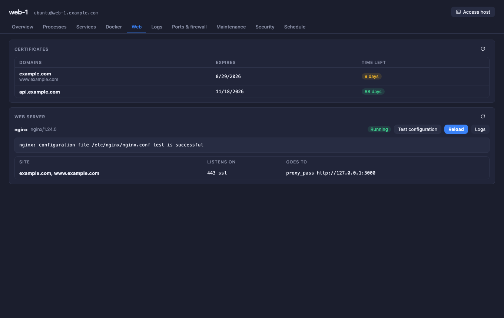

- *Test configuration* changes nothing. *Reload* asks, tests, and reloads only if the test passes. After a renewal the web server is reloaded.
- Per certificate, *Renew* (certbot renews only one within 30 days of its end) and *Renew now* (whatever its age: Let's Encrypt allows only a few of these a week).
- *Test renewal* tries all of them without changing anything.
- *Get certificate* asks Let's Encrypt for new domains with the nginx plug-in of certbot (the domains must already point at the server and an nginx site must serve them on port 80).
- Under **Site files**, *Switch on* and *Switch off* link or unlink a site of `sites-available` (Debian and Ubuntu); the configuration is tested and put back if it fails, and *Reload* applies it.

### Schedule

systemd timers (with *Run now* and Logs), cron jobs, and **Backups**.

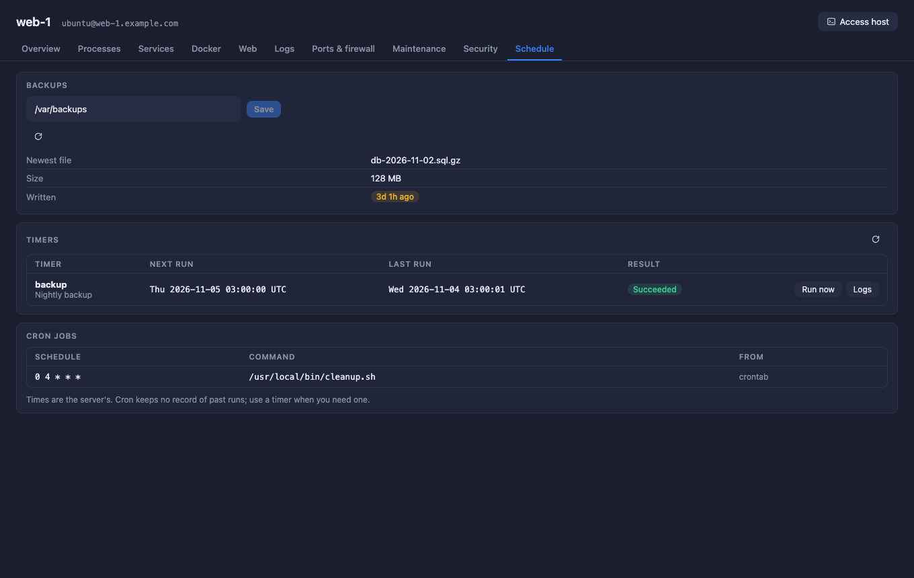

- **Cron:** add, change and delete the cron jobs of the login and of root.
- **Backups:** type the folder where your backups land and the panel shows how old its newest file is. The folder is saved with the host.

## Manage

### Ports and firewall

What listens, and what ufw says about it. It can also change ufw: **Allow** or **Deny** a listening port, **Add rule** (a port, TCP or UDP, for anyone or one address or network), **Delete** a rule, **Turn on** or **Turn off** the firewall.

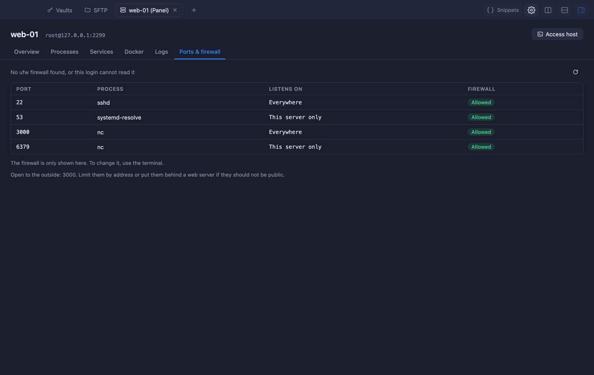

Turning the firewall on allows the SSH port of the connection first, and anything that could cut that connection asks a second time.

### Security

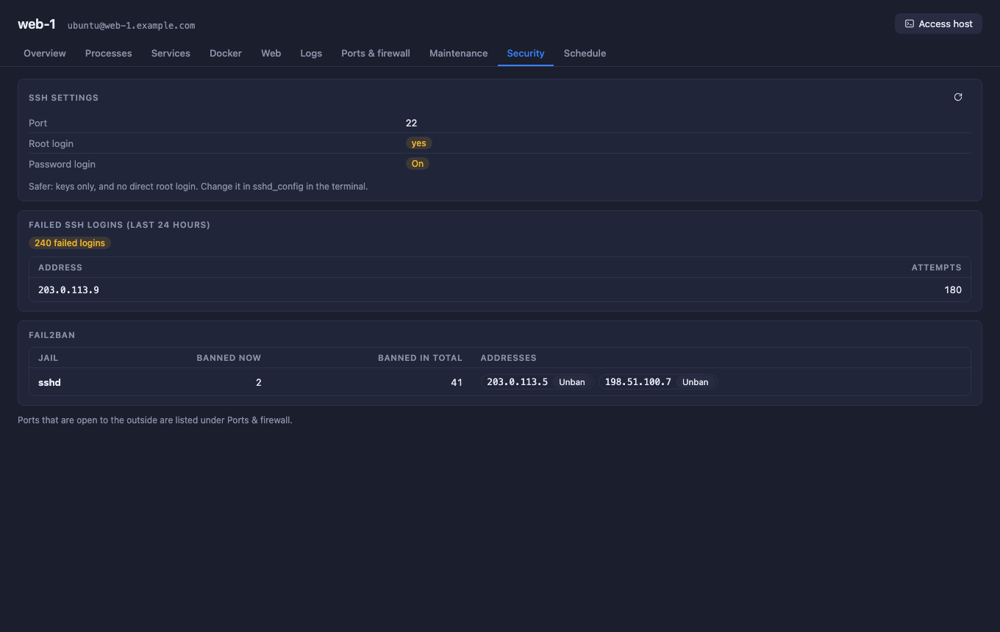

- A **Security check** at the top (root and password login of sshd, fail2ban, a firewall, automatic updates, a reboot waiting, other accounts with user id 0, accounts with an empty password, sudo rules without a password), each marked OK, Look or Fix, with how many pass. A check the login cannot make (it cannot read `/etc/shadow`, for instance) is left out, not shown as fine.
- **SSH settings:** *Turn off* switches root login or password login off (in a file of its own in `sshd_config.d`, tested, undone if it fails, and refused when it could lock you out).
- **Failed SSH logins** in the last 24 hours by address, each with *Ban*.
- **Recent logins** that worked (user, address, time): an address or a user you do not know means someone else has your key or password.
- **fail2ban** jails with *Unban* and *Ban address*.

### Users

Who can log in, who has sudo, how many SSH keys each has, who is logged in now.

- *Add user*, *Keys* (add or remove public keys), and in the **⋮** menu *Give sudo* or *Take sudo* (never from the last account that has it), *Lock* or *Unlock* and *Delete*.
- A locked account (marked *Locked*) cannot log in with its password or its SSH keys; programs it already runs keep running, and an account that is logged in now is not locked.
- Root, system accounts and the account of this connection are never locked or deleted here.

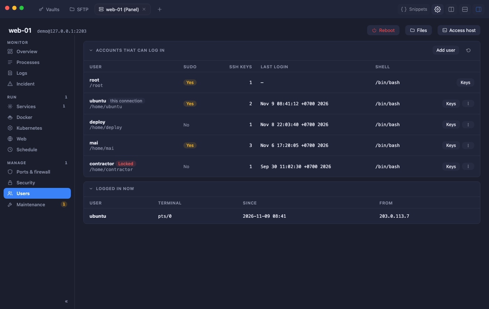

### Maintenance

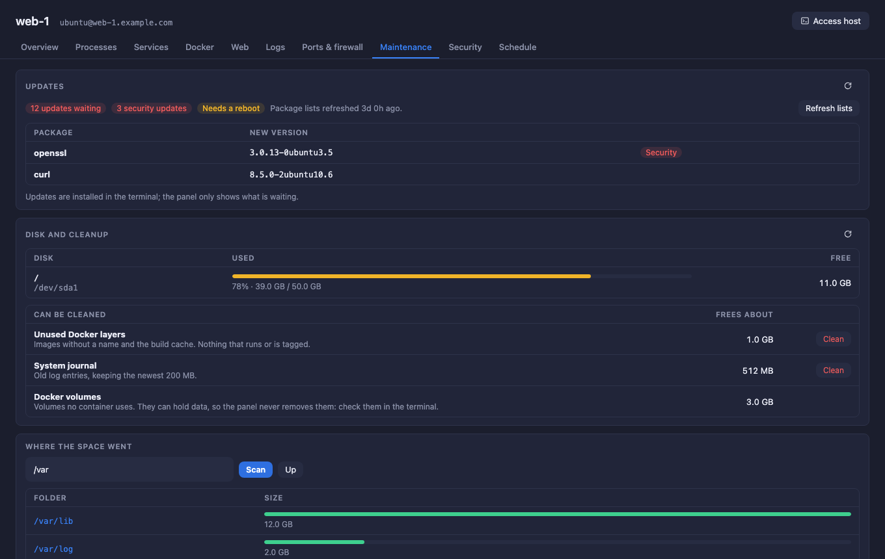

- **System:** rename the server, set its time zone, create or remove the swap file `/swapfile` of 256 MB to 32 GB (it needs 1 GB of disk to stay free; a swap partition is shown and left alone).
- **Updates:** pending package updates (security ones marked, and whether a reboot is needed), with **Install updates** (`apt-get upgrade`, `dnf upgrade` or `yum update`, after a question).
- **Disks**, and a **cleanup** of Docker layers, unused images, the journal and the package cache, each with how much it frees. Docker volumes are listed but never cleaned here.
- **Where the space went** scans one folder at a time.

**Install updates** runs on the server in the background and writes to a log in `~/.cache/vutty` of the login, so it goes on if you hide the window, close the panel or lose the connection (a package upgrade cut half way leaves a broken system). The window shows the log every 2 seconds, and opening Maintenance again picks a running upgrade up. It installs every waiting update (not only the security ones), keeps the configuration files you changed (`--force-confold`) and never reboots by itself: when the Updates box says a reboot is needed, use **Reboot**.

## Fleet: every host on one page

**Fleet** (in the left menu) shows every saved host on one page: up or down, CPU, memory, disk, load and failed services, the hosts with trouble first. Each host gets a short connection of its own that never asks a question, so a host whose key is not trusted yet shows as down: open it once in a terminal. *Open panel* opens its dashboard in a tab.

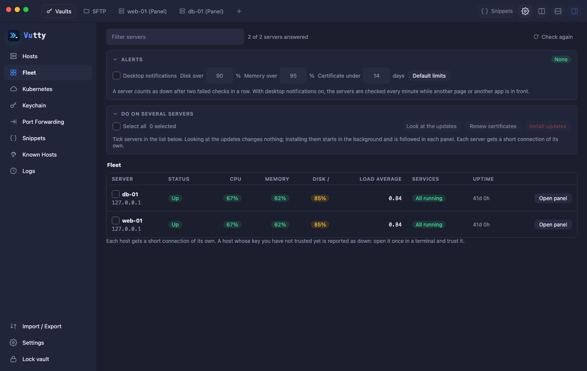

**Alerts.** The box at the top of Fleet lists what needs a look:

- a server that does not answer (after two failed checks in a row),
- a disk or memory over its limit (90% and 95% by default; the limits are boxes you can change, each taken when you leave the box),
- a failed service,
- a Let's Encrypt certificate that ends in under 14 days (or has ended).

Turn on **Desktop notifications** to get a system notification for every new alert (once each, until it clears). While it is on, the hosts are also checked once a minute when another page or another app is in front, which is the only time Vutty connects to your hosts by itself. On macOS the notification comes from Vutty itself and wears its icon; Linux uses `notify-send` and Windows a balloon.

**Do on several servers.** Tick servers in the list (or *Select all*), then:

- *Look at the updates*: how many updates and security updates wait on each, and whether it needs a reboot. Changes nothing.
- *Renew certificates*: asks first; `certbot renew` on each, then its web server is reloaded.
- *Install updates*: asks first, and says how many servers. Starts the installation on each ticked server and returns at once; follow each one in the Maintenance tab of its panel.

Each server answers in its own row, and one that fails does not stop the others.

## How Panel keeps your server safe

- It runs **fixed commands** (`/proc`, `ps`, `systemctl`, `docker`, `journalctl`, `ss`, `ufw`) over a connection of its own and installs nothing on the server. A name from the screen is checked before it goes into a command, and a process is only ever ended by number.
- **Every change asks first**: ending a process, starting, restarting or stopping a service or a container, firewall changes, users, updates. A change that could cut your connection (denying the SSH port, turning off root login while logged in as root) is refused or asked about twice.
- Changes use `sudo -n` unless you log in as root, so a login that needs a password for sudo gets the server's own error. Firewall changes run with `ufw` (through `sudo` when the login is not root).
- Process command lines and logs can hold secrets: take care before sharing a screenshot.
- Linux with systemd is the target; on another system the parts that do not apply show the server's message.
- Panel needs SSH: it is not offered over FTP, and a host reached only with a kubeconfig has its own [Kubernetes](09-kubernetes.md) view.
