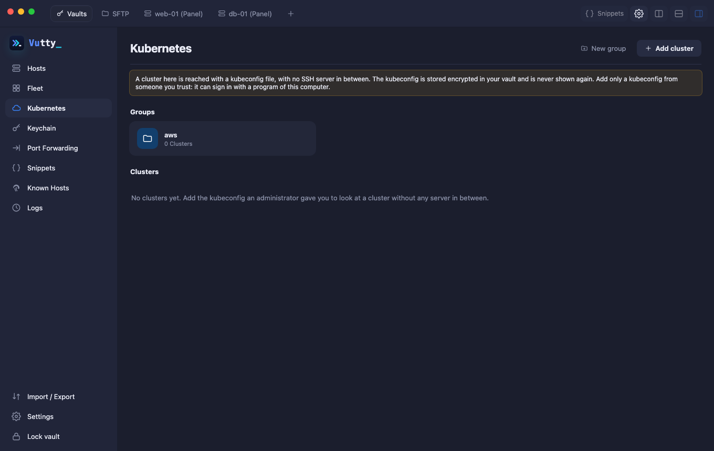
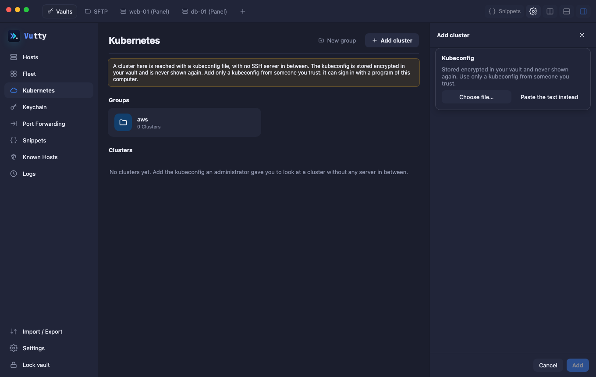

# Kubernetes

Look at and manage a cluster from Vutty, in two ways: through a host that already has `kubectl`, or straight from a kubeconfig file with nothing installed. The full design, with every screen and the command behind every button, is in [Kubernetes panel design](../design/kubernetes-panel.md).

## Contents

- [Two ways in](#two-ways-in)
- [What you can look at](#what-you-can-look-at)
- [What you can change](#what-you-can-change)
- [Workloads: the menu of a Deployment, StatefulSet or DaemonSet](#workloads-the-menu-of-a-deployment-statefulset-or-daemonset)
- [A cluster from a kubeconfig](#a-cluster-from-a-kubeconfig)
- [Namespaces you may not list](#namespaces-you-may-not-list)
- [Managing clusters, groups and sync](#managing-clusters-groups-and-sync)

## Two ways in

| | Through a host | From a kubeconfig |
| --- | --- | --- |
| Where | The **Kubernetes** tab of [Panel](08-panel.md#kubernetes) | **Kubernetes** in the left menu |
| Needs | A host with `kubectl` and a kubeconfig, usually the control-plane node or a bastion | A kubeconfig file from an administrator |
| Runs | `kubectl` on the host, over the SSH login of the Panel | Vutty talks to the cluster's API directly; no `kubectl`, no SSH host |
| Works with | kubeadm, k3s (`k3s kubectl`), MicroK8s, EKS/GKE/AKS (their login plugin runs on the host), kind, minikube | Anything the kubeconfig reaches |

## What you can look at

- **Overview**, **Pods** (with a pod detail), **Workloads**, **Network**, **Config and storage**, **Nodes**, **Events**, **YAML** and the **logs** of a pod. Numbers on the tabs say how many pods, workloads and network objects there are.
- **Resources:** every kind the cluster serves, custom resource definitions included, read only. Pick a kind, read its objects with the columns a CRD asks for, and open one as YAML. Buttons for Namespaces, PersistentVolumes, StorageClasses and HorizontalPodAutoscalers. The Secrets of the core group are never shown here.
- **Apps:** Helm releases, read only. They are read from the Secrets Helm 3 keeps in the cluster, so nothing is installed. A release shows its chart, notes, manifest (the Secrets in it without their data) and its revisions; its **values** ask first and are audited, because they often hold passwords. *Copy rollback* puts the `helm rollback` command on the clipboard for a terminal: Vutty does not change releases.
- **Security:** reads the pods, services and ingresses and lists what is worth a second look: privileged containers, host network or host paths, dangerous capabilities, user 0, a password-like variable written in plain, an image with no tag or `latest`, NodePort and LoadBalancer services, an Ingress with no TLS. No Secret is read and a value of a variable is never shown. It is a hint, not a verdict.
- **Logs of all the pods:** *Logs* on a Deployment, StatefulSet, DaemonSet, Job or Service reads every pod it selects (up to 20), merged by time, each line with its pod in a colour of its own.
- **Pods are grouped by node,** as in Rancher; *Group by* also offers namespace, workload or no groups, and a group can be closed. Menus with many entries (the pod of the Logs tab, the namespace) have a search box.
- **Secrets** show names and keys only. **Revealing a Secret key** asks first and shows one key for 30 seconds.

## What you can change

- **Shell:** a new terminal tab that runs `kubectl exec`.
- **Debug container:** a pod whose image has no shell can be entered by adding an ephemeral container (`nicolaka/netshoot` by default). It asks first and says that the container cannot be removed.
- Port-forward, scale, restart, pause, roll back, delete a pod or job, run or suspend a CronJob, cordon and drain a node.
- **Copy kubectl** puts the `kubectl` line that does what the screen does on the clipboard. Nothing is run and nothing changes.
- Each change **asks first**, locks only its own button while it runs, and is written to the audit log (what was done, never the output). A button for something the login may not do (`kubectl auth can-i`) stays locked, with the reason in the tooltip. A production cluster keeps its red frame.
- Not offered: `apply`, `edit` and `delete` of anything but a pod or job. Use the terminal for those.

## Workloads: the menu of a Deployment, StatefulSet or DaemonSet

The ⋮ of its row and of its page has the menu that Rancher offers, as far as the login's rights go:

- *Execute shell* (choose a pod and a container), *Redeploy*, *Pause orchestration*, *Roll back*,
- *Show configuration*, *Edit config* (image, variables, requests and limits of a container), *Add sidecar*,
- *Edit YAML* (a preview of what changes, asked by the cluster as a dry run, before anything is applied) and *Download YAML*.

The changes work for a host and for a cluster opened with a kubeconfig. A host uses `kubectl replace` with the object on its standard input, so a value of a variable is never in a command line there; a change made by someone else in between is refused either way. Each is asked first and audited by what was done (a variable's name, never its value).

## A cluster from a kubeconfig

If an administrator sent you a kubeconfig file, add it in **Kubernetes** (in the left menu). The same screens open in a tab of their own.

- The kubeconfig is stored **encrypted in the vault** and never shown. Add only a kubeconfig from someone you trust: it names the server your credentials go to.
- A kubeconfig that reads a token from a file of your computer (`tokenFile`), or uses the removed `auth-provider`, is refused with the reason. Ask for one that has the token inside it or uses a login plugin.
- A **login plugin** (`aws eks get-token`, `gke-gcloud-auth-plugin`, `kubelogin`, …) runs on your computer with your own cloud login. The well-known ones run at once; any other program is shown to you and runs only after you approve that exact command.
- **Shell** in a pod works too: it opens a terminal tab that talks to the cluster's API over a WebSocket (no `kubectl` anywhere), tries bash then sh, and keeps the PROD frame of a production cluster. It needs the right to `exec` in that namespace.
- **Files in a pod:** the Files section of the terminal sidebar shows the files inside a pod you opened a shell in (read only; it needs `sh`, `stat` and `cat` in the container).
- Everything else, including every change, is asked first and audited as for a host.

## Namespaces you may not list

A login that may not list the namespaces (a member of one project of a Rancher cluster, for example) cannot ask for *All namespaces*, which is a question about the whole cluster. Add the namespaces you work in with **+** next to the namespace menu: they are remembered for that cluster, each can be chosen, and *All added namespaces* asks them one after the other and puts the answers together. A namespace that is refused is left out as long as another answers.

## Managing clusters, groups and sync

- **Where it is managed:** the *Kubernetes* page of the left menu. Each cluster has *Open*, *Edit*, *Replace kubeconfig* and *Delete*. *Edit* holds the name, group, environment and default context, shows what the stored kubeconfig contains (contexts, addresses, how each signs in; never a secret), has *Replace kubeconfig…* for a new file, and lists the login programs you approved, each with *Revoke*.
- **Groups** work as on the Hosts page, and are the same groups: group cards with a count, open one to see its clusters (with a path to come back), **New group** next to *Add cluster* (also from the Group menu of the cluster form: *New group…*), drag a cluster onto a group card, and a search looks in every group. Deleting a group keeps its clusters, which lose their group.
- **Sync:** *Settings → Sync → What to sync* has its own switch, **Kubernetes clusters**, apart from *Keys and passwords*. A cluster goes with its kubeconfig (an encrypted secret of the vault); the kubeconfigs follow this switch and not the keys, so the two can be chosen separately. A cluster that is not ticked is neither sent nor taken. See [Sync](12-sync-and-backup.md).
- **Backup:** the encrypted backup holds the clusters and their kubeconfigs; the plain export does not (a kubeconfig has no place in a file that is not encrypted).
