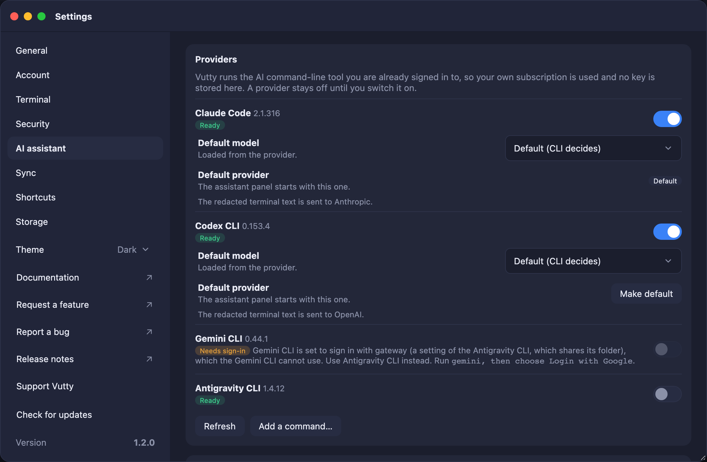
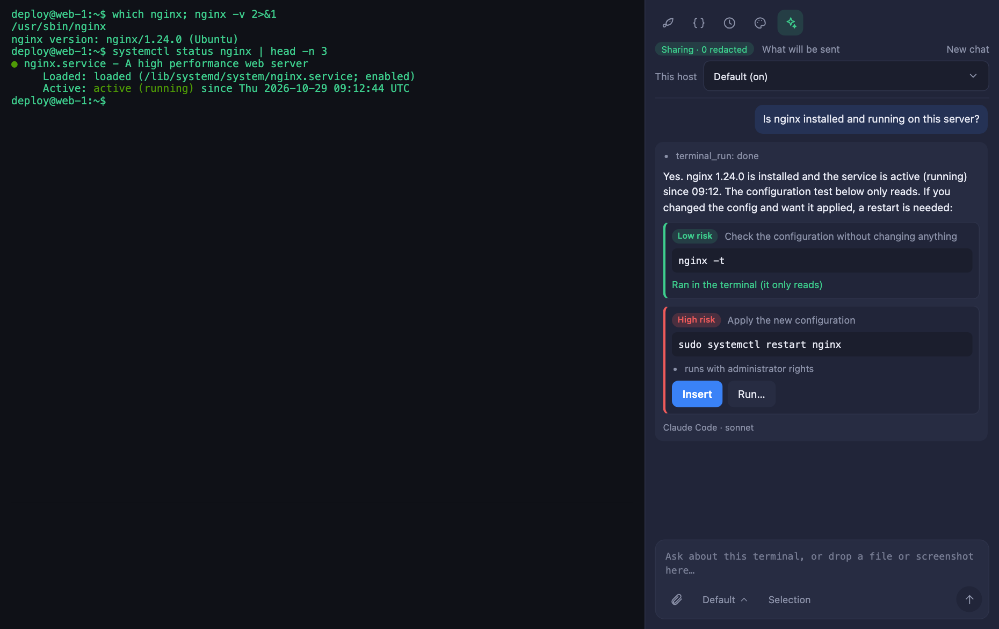
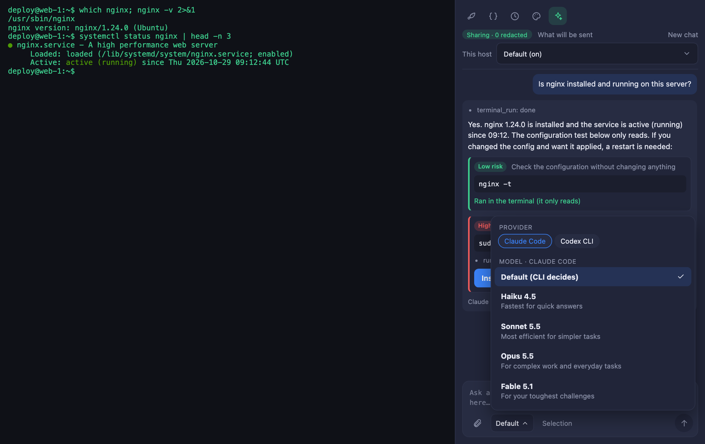
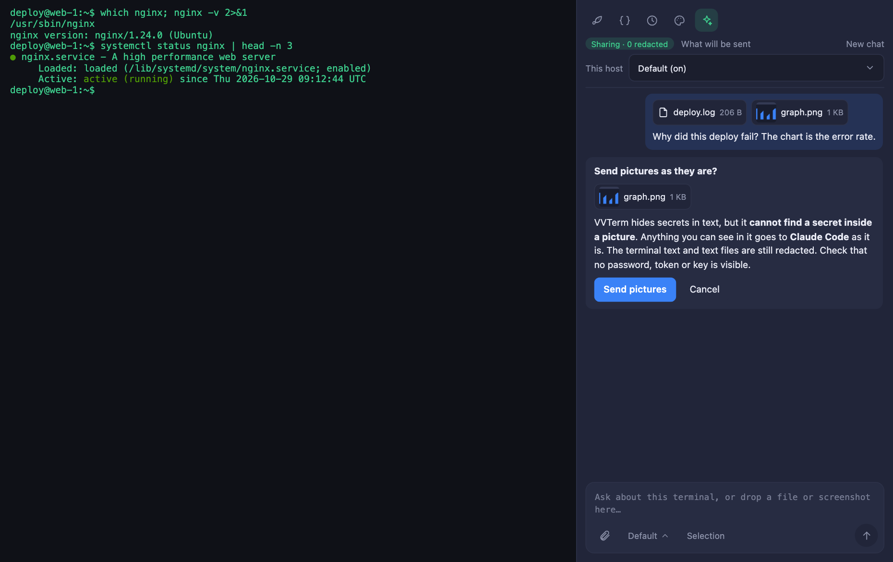
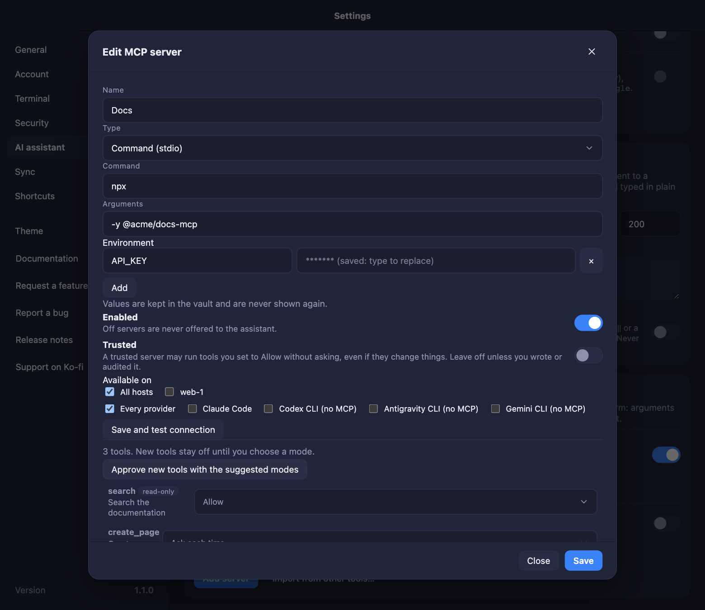

# AI assistant

Ask an AI about what is on a terminal. Vutty runs the official AI command-line tool you installed and signed in to (Claude Code, Codex CLI, Gemini CLI, or a command you add); no key is stored in Vutty. The use of each tool is governed by its provider's terms, and Vutty is not affiliated with Anthropic, OpenAI or Google. **Antigravity CLI** is marked *Experimental*: Google does not document running it from another app, so check Google's terms for your account before you switch it on.

### Claude Code through a gateway

If your `~/.claude/settings.json` points Claude Code at a gateway (`ANTHROPIC_BASE_URL`, for example LiteLLM), Vutty reads the gateway address and the key you set there (or in your environment) (`ANTHROPIC_AUTH_TOKEN` or `ANTHROPIC_API_KEY`) only to ask that same gateway for its model list (`GET /v1/models`). The key is sent nowhere else, never stored by Vutty and never shown. Without a gateway, Vutty reads no Claude credential at all.

## Contents

- [Set up and ask](#set-up-and-ask)
- [Files and screenshots](#files-and-screenshots)
- [Your secrets](#your-secrets)
- [Per host](#per-host)
- [MCP servers](#mcp-servers)
- [Reading needs no confirmation](#reading-needs-no-confirmation)

## Set up and ask

1. **Settings → AI assistant** lists the tools Vutty found. Switch one on. It stays off until you do, and it must pass a short isolation test (the tool is asked to run a command and must be unable to). If a tool says *Needs sign-in*, run the command shown next to it in a terminal first.
2. Pick the model for each tool. The list is read from the tool itself; you choose from that list. A tool that cannot list its models uses its default one.
3. Open a terminal, then the sparkle icon in the sidebar. Choose the provider and model from the chip under the message box, type a question, press Enter. **Ask about selection** sends only the text you selected. To change the model without the mouse, press **⌘ ⇧ M** (Ctrl Shift M elsewhere): it moves to the next model of the provider, wrapping round at the end, and shows the name in a short message.
4. The assistant only *suggests* commands. **Insert** puts one on the prompt without pressing Enter. **Run** sends a command that only reads at once; a command that can change something shows **Run…** and asks in its card first (and the word `run` for a risky one). A command that contains a hidden value cannot be run from the panel.

## Files and screenshots

Drag a log, a config file or a screenshot onto the panel, paste a screenshot, or use the paperclip. Text files are redacted like the screen. A picture cannot be redacted, so Vutty asks you to confirm each time and only sends pictures to tools that take them (Claude Code, Codex CLI).

## Your secrets

Before anything is sent, keys, tokens, passwords and anything saved in your vault are replaced by `*******`; the same happens to every answer before you see it. **What will be sent** shows the exact text first. This cannot be switched off, and it is best-effort: a password written in an ordinary sentence cannot always be recognised.

## Per host

On a host's form, *AI assistant* is Off, Ask first (in the chat), or On. The default is On, and Off on a production host, where the assistant also never runs commands. Reading the screen to answer a question needs no confirmation; the assistant asks you, in the chat, only before something that could change things.

## MCP servers

**Settings → AI assistant** gives the assistant extra tools through MCP servers. Add a server (a command or an HTTP address), test it, then choose a mode for each tool: Allow, Ask each time or Off. New tools stay off until you review them, a secret in a tool's arguments blocks the call, and results are redacted. Environment values and headers are kept in the vault and are never shown again.

## Reading needs no confirmation

The assistant runs commands that only look (`ls`, `df`, `which`, `pgrep`, `brew list`, `systemctl status`, `git status`… also joined with `;`, `&&`, `||` or a pipe) by itself and reads the output; anything that could change something asks first, in the chat. This is **Settings → AI assistant → Run read-only commands by itself** (on by default; never on production hosts).
