# Settings and security

Everything you can change in Vutty, page by page, and how the vault is locked and protected.

## Contents

- [Open Settings](#open-settings)
- [General](#general)
- [Account](#account)
- [Terminal](#terminal)
- [Security](#security)
- [AI assistant and Sync](#ai-assistant-and-sync)
- [Shortcuts](#shortcuts)
- [Storage](#storage)
- [Theme](#theme)
- [Updates](#updates)
- [Forgot your master password](#forgot-your-master-password)

## Open Settings

Open **Settings** from the navigation, the gear in the title bar, or **⌘/Ctrl + ,** (it works from a terminal tab too). It opens as a **popup over the window**, below the top bar so it never covers the macOS window buttons.

- Drag its title bar to move it (it stays inside the window); drag its edges and corners to make it larger or smaller (a double click on an edge restores the default size); or **Maximize** it.
- **Open in a tab** moves it into a Settings tab next to your terminals.
- **Esc**, a click outside it and the **×** close it.

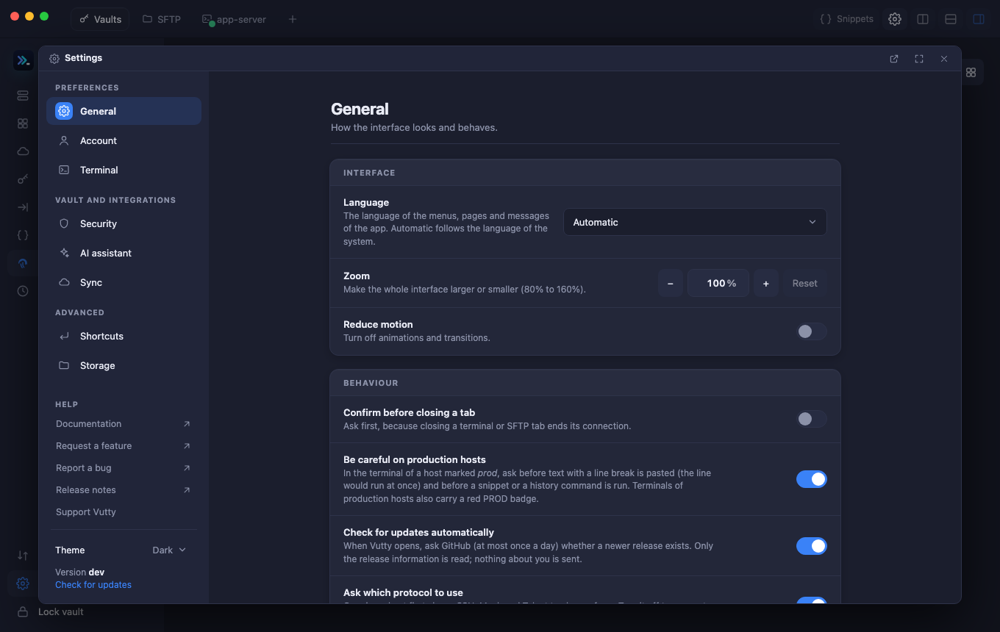

The menu on the left has **General, Account, Terminal, Security, AI assistant, Sync, Shortcuts, Storage**, then **Theme**, help links (documentation, feature requests, bug reports, release notes, Ko-fi) and the **version**. Changes apply immediately.

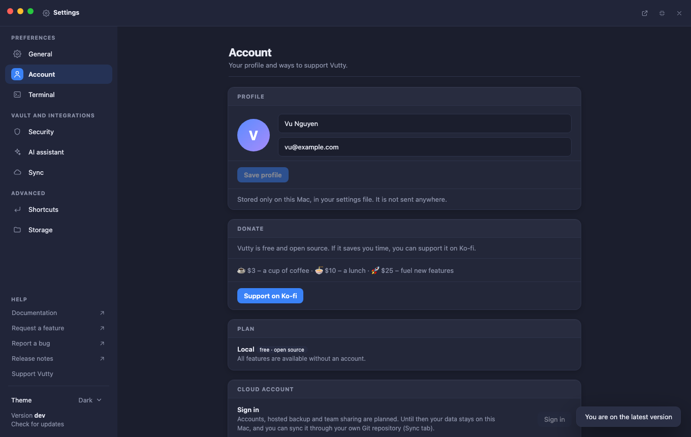

## General

- **Language.** **General → Interface → Language** sets the language of the whole interface, the menus of the title bar included: **Automatic** (the language of the system, English when Vutty has none of it), **English**, **Tiếng Việt**, **日本語** or **中文**. It changes at once, in every window. What a server or the backend itself says (an error message from the connection, for example) and the names of products and protocols stay as they are.
- **Zoom** makes the whole interface larger or smaller (80 % to 160 %, also with the zoom shortcuts); the percentage can be typed.
- **Reduce motion** turns animations off.
- **Confirm before closing a tab** asks before ending a terminal or SFTP connection.
- **Be careful on production hosts** (on by default) is described in [Connecting](04-connecting.md#production-hosts).
- **Check for updates automatically**: see [Updates](#updates).

## Account

A local profile (display name and email, stored only in your settings file), your plan, and a disabled **Sign in** for the cloud features planned for later. Nothing is sent anywhere. The **Donate** card links to Ko-fi if you want to support the project.

<!-- CRYPTO-DONATE: screenshot shows the USDT addresses, hidden for now
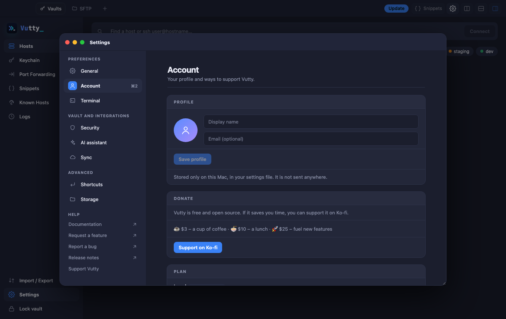
-->

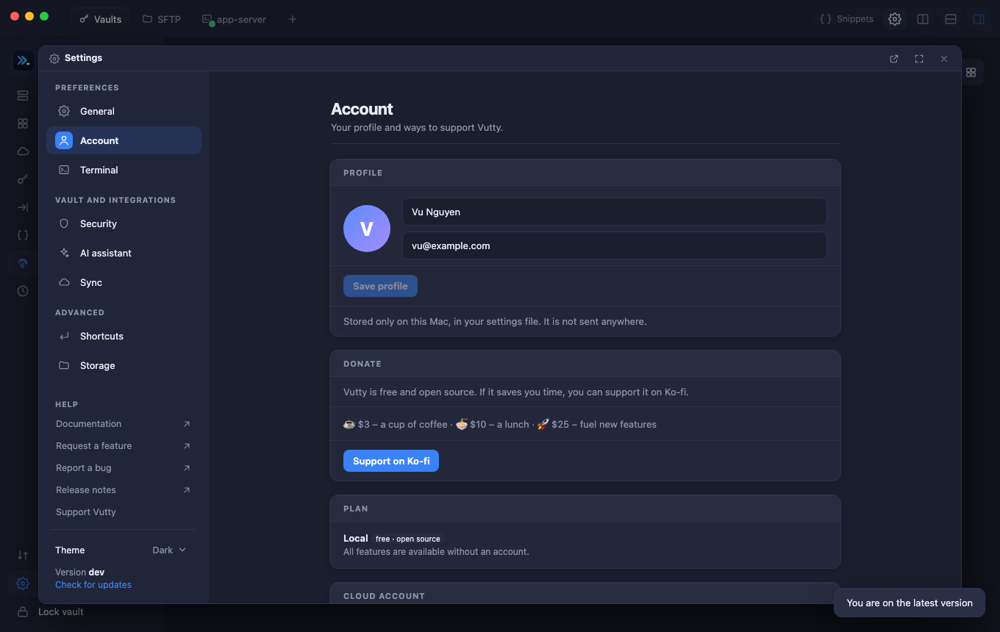

## Terminal

- **Terminal theme:** 26 colour themes with live swatches (Dracula, Nord, Tokyo Night, Solarized, Gruvbox, Kanagawa, Rosé Pine…), filterable by dark/light, or *Match app theme*. A preview shows your font, size, cursor and colours.
- **Font, size, cursor** (block, bar, underline), blinking, **scrollback**.
- **Suggest commands** switches [command suggestions](05-terminal.md#command-suggestions) off; **Suggest from the host's shell history** is off by default.
- **Ask which protocol to use** turns the [protocol question](04-connecting.md#choose-a-protocol) off.
- **Fast drawing** (WebGL) is used for the terminal that has the focus, on by default; it falls back to the default renderer by itself. If text looks wrong (fonts, selection), turn it off.

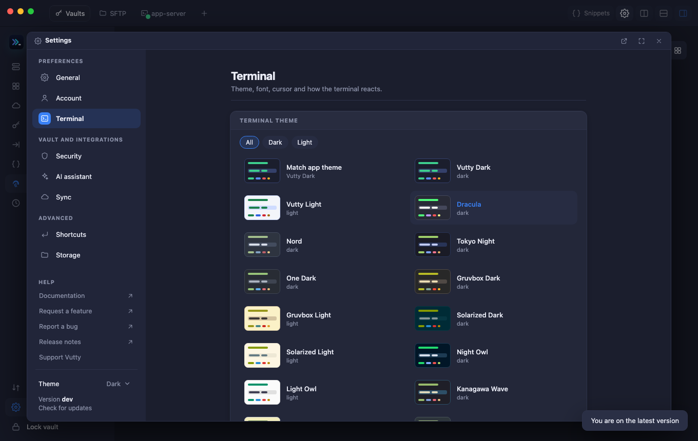

### Session logs

**Off** (the default), **Production hosts only** or **All sessions**. A log is one text file for each session (SSH, Telnet, serial and this computer), written line by line with the time each line ended, in the folder you choose (**Choose…**; **Open** shows it in the Finder; by default `session-logs` inside the data folder). It starts with the host and the time and ends with the time and why the session ended.

- It holds what the host **printed**, with colours, window titles and cursor moves taken out and a redrawn line (a progress bar, a shell prompt) kept as the one line it ended up as.
- What you type is **not** recorded, except what the host echoes back, so a password typed at a hidden prompt never reaches it. But everything that is shown on screen is in it, a password in a file you displayed included: the files are readable only by you, so keep the folder private.
- A file stops at 50 MB, and a connection that never printed anything leaves none.
- The Logs page notes where each log went, and if a file cannot be written the terminal goes on and the Logs say why. Logs are never deleted by Vutty.

## Security

- **Auto-lock** after N idle minutes (default 15; the key is wiped from memory).
- **Lock when the computer sleeps** (on by default): the vault locks as a Mac goes to sleep and when its screen is locked, so whoever opens the lid finds it locked. Open terminals stay connected. Where the system does not announce a sleep, as on Windows and Linux, it locks when the computer wakes up, and only after a sleep of more than about 40 seconds. The Logs say *Vault locked: the computer went to sleep*.
- **Password hint:** a reminder shown on the lock screen, never the password itself.
- **Quick unlock:** with **Touch ID** on a Mac that has it (the vault key stays in a Keychain item guarded by Touch ID, and each unlock asks for your fingerprint, Apple Watch or Mac password), with **Windows Hello** on Windows (fingerprint, face or PIN; the key stays in Windows Credential Manager), or with the plain system keychain where neither exists.
- **Change the master password.**

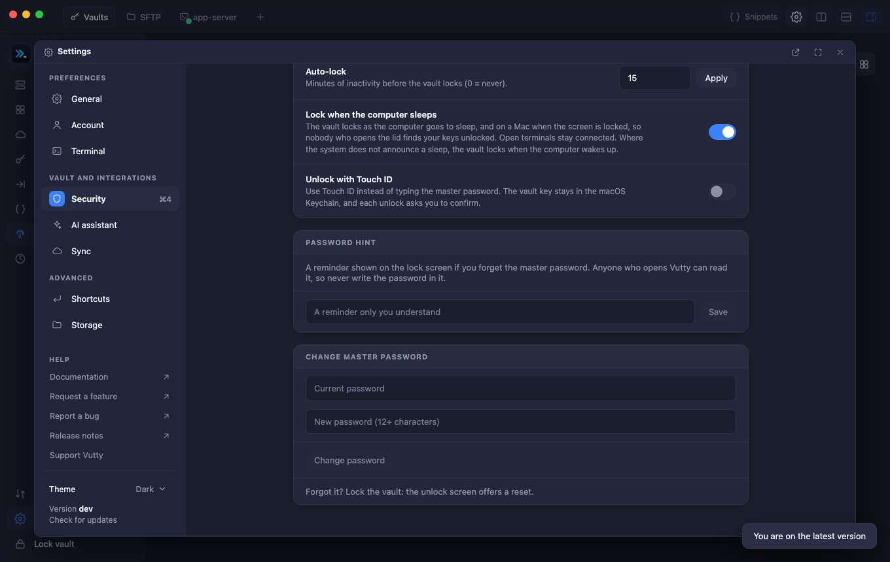

## AI assistant and Sync

These two pages have chapters of their own: [AI assistant](10-ai-assistant.md) and [Sync and backup](12-sync-and-backup.md).

## Shortcuts

Every action has a default, shown as key caps (⇧ ⌘ T). Click it, press the new combination and it is saved.

- To make a **two-step shortcut** such as ⌘K then M, press the first combination and, within about a second, the second key (it needs no modifier); wait instead and it stays a one-step shortcut. While a two-step shortcut is running, a small note at the bottom says it is waiting for the next key; Esc cancels it. Two-step shortcuts have no key hint in the menu bar. One shortcut cannot be both a one-step shortcut and the first step of another.
- A combination already in use is refused and tells you which action owns it; plain keys are refused (add Ctrl, Alt or ⌘; F-keys are allowed).
- *Reset* returns one action to its default, *Reset all* all of them. Esc and a few terminal keys are fixed and listed below the table.

The default keys are listed in [Keyboard shortcuts](14-shortcuts.md).

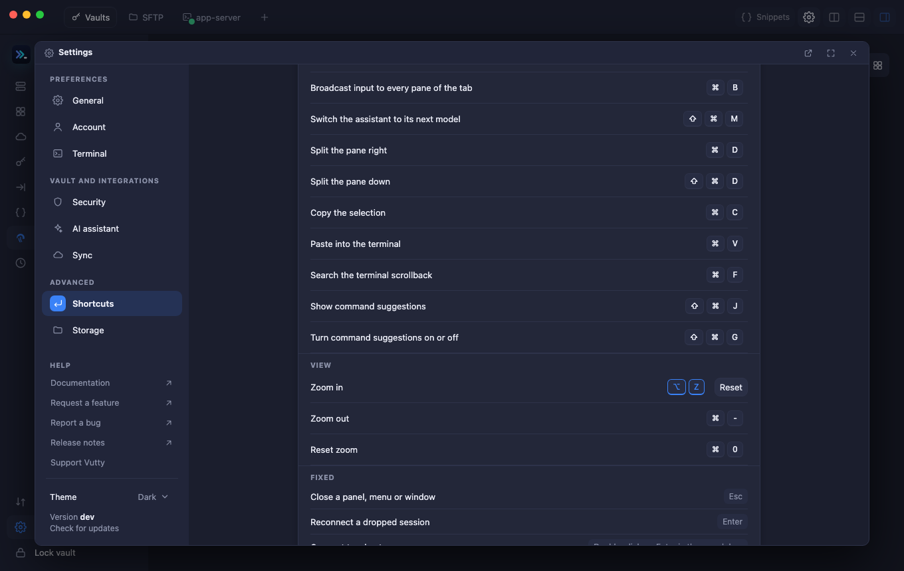

## Storage

- **Clear cache** removes files Vutty can make again and what it remembers about your AI tools (they are looked up again; it reports what it removed).
- **Reset settings** puts appearance, terminal, general options, shortcuts and auto-lock back to their defaults after you confirm. Your profile, sync target, hosts, keys and the vault are never touched.

## Theme

*Auto* follows your Mac's light/dark mode, or force *Light* or *Dark*. The choice is at the bottom of the Settings menu.

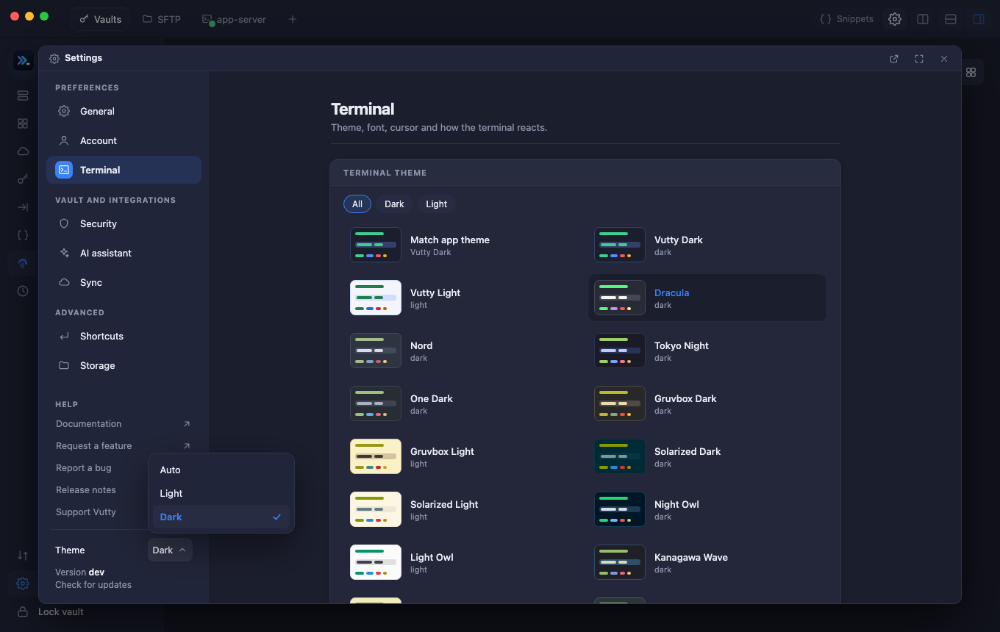

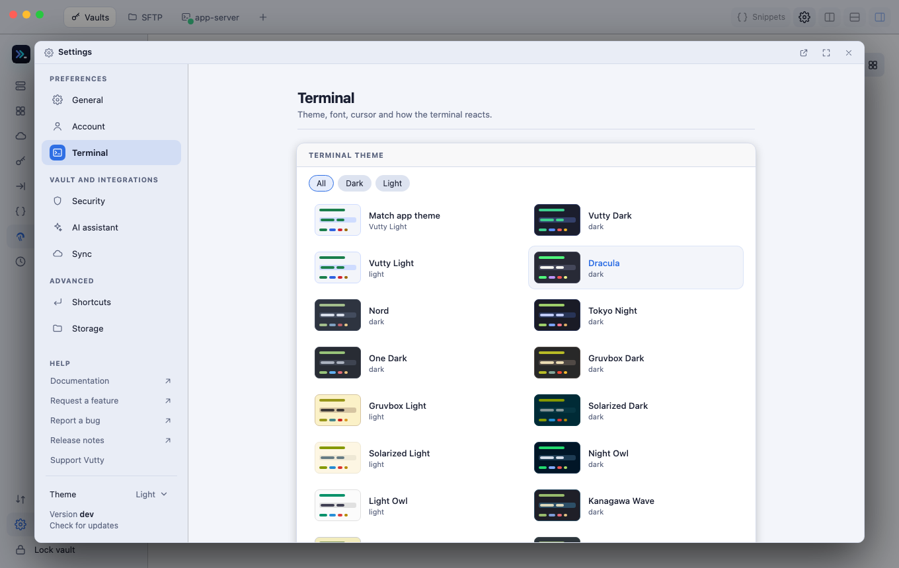

## Updates

**Check for updates** (under the help links) asks GitHub for the latest release and compares it with your version. If there is a newer one, **Version X is available** appears: click it to open the release page and download the build for your system (macOS `.dmg` or `.zip`, Windows `.exe`, Linux `.tar.gz`). To update by hand, quit Vutty and replace the old app with the new one; your data is kept outside the app, so nothing is lost.

**On a Mac with Apple silicon, Vutty can install the update for you:** open **Help → About → Check for updates**, and when a newer version is found choose **Install and restart**.

- It downloads the update itself, checks that its checksum list is signed with the project's key and that the download matches it (an update that fails either check is not installed, and says so), puts the new copy in place and starts it. The old copy stays next to it as `vutty.app.previous` for the first half minute.
- It needs Vutty to be in a folder you can write to (your Applications folder), not running from the disk image; if it is not, About says why.
- Releases that were not signed, and Windows and Linux copies, use the release page as before. How releases are signed is in [Release signing](../development/release-signing.md).
- The check only runs when you click it, and only the release information is read: nothing about you is sent. A pre-release is not offered as an update.

When Vutty opens it also looks by itself, at most once a day (switch it off with **Check for updates automatically** in General). If a newer release exists, an **Update** chip appears in the top right corner; click it to see the news.

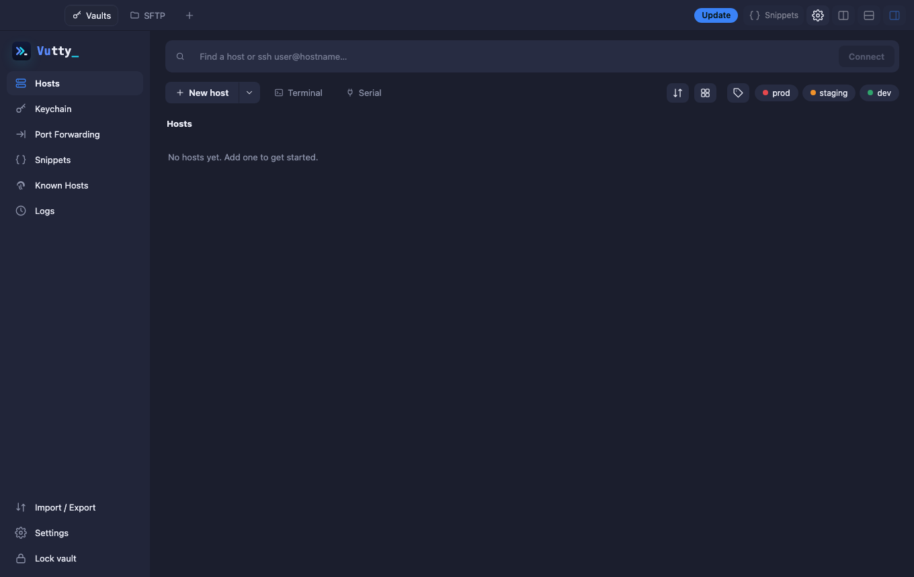

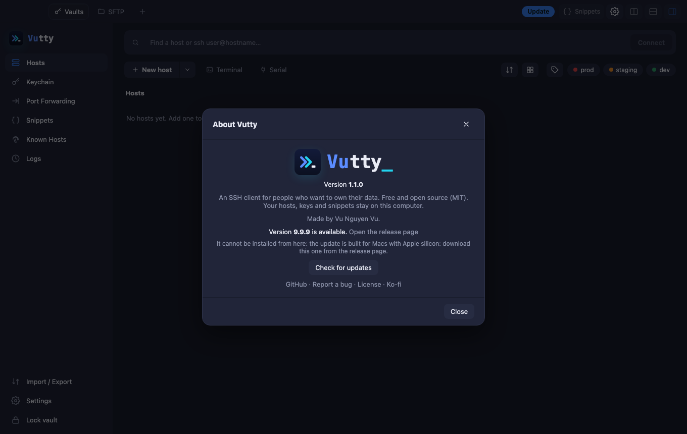

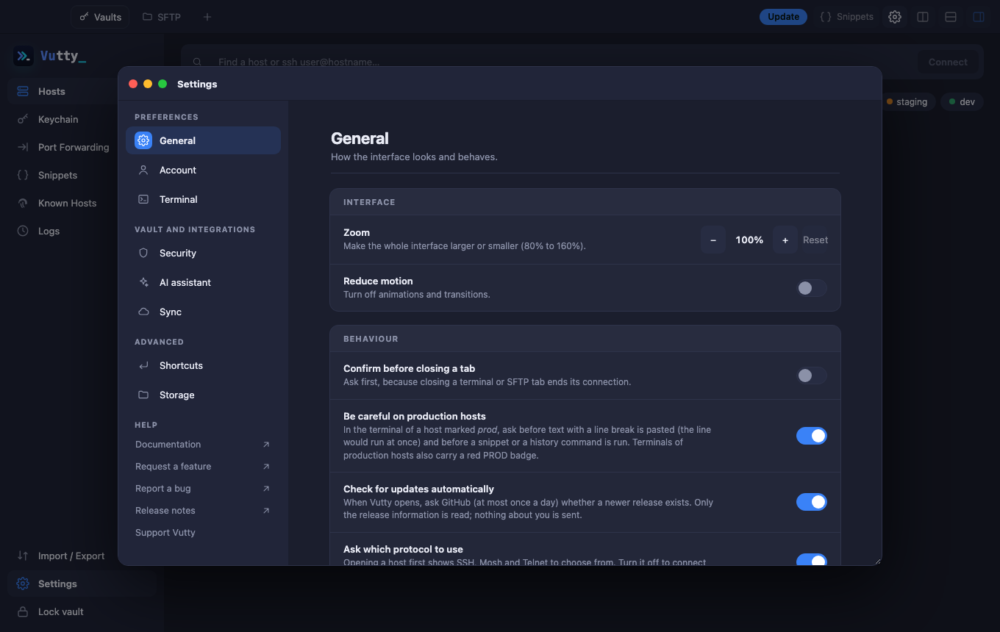

**Help → About Vutty** and **Help → Check for Updates…** open the same window, also while the vault is locked.

## Forgot your master password

**It cannot be recovered.** The password never leaves your Mac, so nobody can reset it for you. On the unlock screen choose **Forgot password?**:

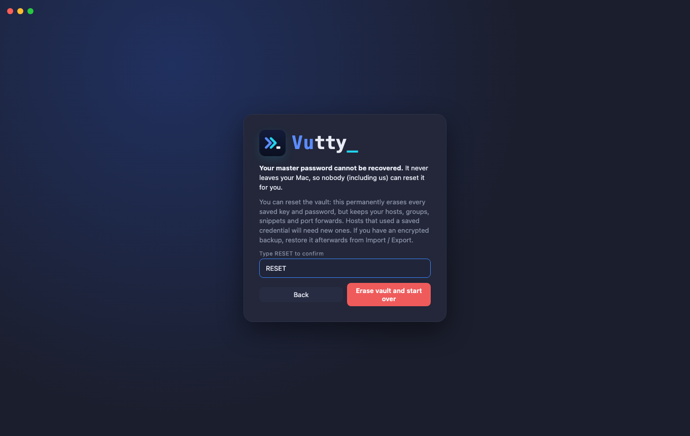

You can **reset the vault**. Type `RESET` to confirm. This permanently erases every saved key and password, and **keeps** your hosts, groups, snippets and port forwards. Hosts that used a saved credential need new ones. Then create a new master password:

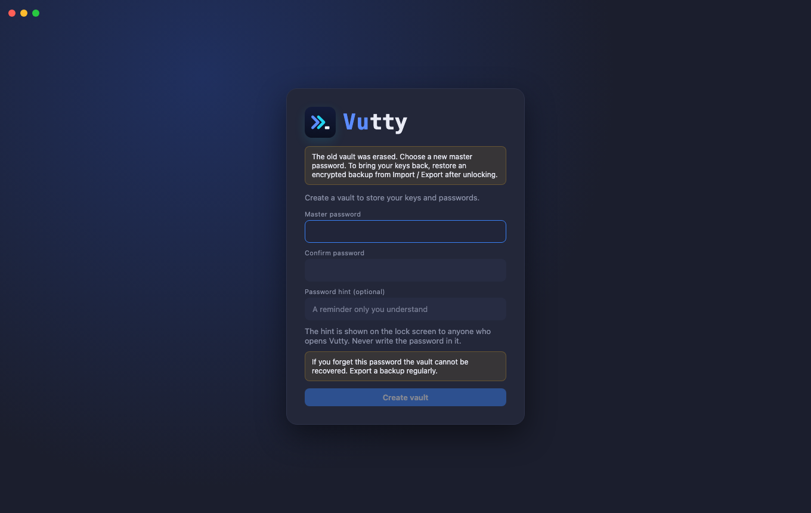

If you have an **encrypted backup**, restore it from **Import / Export** after unlocking the new vault to bring your keys back. If you synced with Git, the repository still holds the *old* vault: use a new repository for the new vault.
