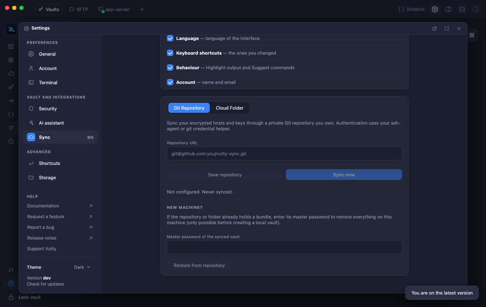

# Sync and backup

Keep your hosts, keys and settings in step between your machines through a private Git repository or a cloud folder, always encrypted, and back everything up to a file.

## Contents

- [Set up sync](#set-up-sync)
- [What is synced](#what-is-synced)
- [Use a cloud folder instead of Git](#use-a-cloud-folder-instead-of-git)
- [Joining and replacing: when the vaults differ](#joining-and-replacing-when-the-vaults-differ)
- [Backup](#backup)

Open **Settings → Sync**.

## Set up sync

1. Create an empty **private** Git repository and make sure `git` can push to it (ssh-agent or a credential helper).
2. **Repository URL → Save repository → Sync now.**
3. On a new Mac open **Settings → Sync**, enter the URL, and choose **Restore from repository** with the master password of the synced vault (only before a local vault exists).

## What is synced

Under **What to sync** (the same page, folded or opened with its header) you tick what is kept in step between your machines. Under **Data**: **Hosts and groups**, **Keys and passwords**, **Port forwards** (they point at hosts, so they need Hosts and groups) and **Snippets**. Under **Preferences**: **Appearance** (theme and terminal theme), **Terminal** (font, cursor, scrollback), **Language**, **Keyboard shortcuts** (the ones you changed), **Behaviour** (Highlight output, Suggest commands) and **Account** (name and email). Everything is ticked by default. It all goes inside the same encrypted bundle and the newest change of each item wins. **What you untick is neither sent nor taken:** this machine keeps what it has, and the repository keeps what the other machines put there. Take care with *Keys and passwords* alone: a host that uses a saved key will not find it on a machine that does not sync keys (the page says so). A group of preferences that was never changed, and a new Mac that joins, do not outvote the others with their defaults. Zoom, folders, auto-lock, Touch ID, *Fast drawing* and the other settings of one machine never leave it. A copy of Vutty from before this feature ignores the preferences and, when it syncs, drops them from the repository until a newer copy puts them back.

## Use a cloud folder instead of Git

Choose **Cloud folder**, then **Browse…** and pick a folder that Google Drive for Desktop, iCloud Drive, Dropbox or OneDrive keeps in step (for example `~/Google Drive/Vutty`), then **Use this folder → Sync now**. There is no sign-in and no token: Vutty only writes `bundle.enc` and `vault-header.json` into that folder and the cloud client uploads them. On a new Mac, pick the same folder, wait until the files have downloaded, and choose **Restore from folder**. If two Macs save at the same moment, the cloud client may keep an extra copy such as `bundle (1).enc`; the next sync merges every copy per record and deletes the extra ones. A copy that is still downloading or belongs to another vault is left alone.

## Joining and replacing: when the vaults differ

### A new Mac with an empty vault

A new Mac where you already created a vault, but put nothing in it? Then there is nothing to merge: the box that appears after a plain **Sync now** says *Use the vault of this repository*. Enter the master password of the synced vault and choose **Use the repository's vault**: its hosts, keys and snippets come here and that master password is the one to use from now on.

### A vault that sends nothing it cannot open

Before each sync Vutty checks that the vault is open with its own key. If it is not (a key left over from another vault), the sync stops with *nothing was sent* and the repository is not touched: lock the vault, unlock it with the master password, and try again.

### This Mac has its own vault and the repository belongs to another

The two vaults have different keys, so a plain **Sync now** stops with *encrypted with a different vault key*. A box then appears under the status line: enter the **master password of the vault that made the repository** and choose **Join this vault and sync**. This Mac keeps its own hosts, groups, snippets and saved keys, merges them with what the repository holds, and syncs. From then on this Mac uses that vault's master password (the old one no longer opens it). A copy of what this Mac had is saved first in the `backups/before-joining-…` folder of the app's data folder. A wrong password changes nothing.

### Nobody can open the repository any more

Its vault's password is lost, or its bundle was written with a key that does not match its header (*that repository cannot be joined*)? Open *The password does not work…* in the same box, type `REPLACE` and choose **Replace the repository with this Mac's data**. The repository then holds only this vault's data; the two files that were there are first copied to the `backups/replaced-remote-…` folder of the app's data folder. Other machines then use **Restore from repository** with this vault's master password. Vutty refuses to replace a repository that this vault can read.

The repository (or folder) only holds `bundle.enc` and `vault-header.json`, both encrypted: hostnames and IPs are not visible. Conflicts are merged per record (newest edit wins; a newer edit beats an older delete and the reverse).

## Backup

Sync is not a backup: a deleted host is deleted everywhere. For a copy you keep, use **Import / Export → Encrypted backup**: everything (hosts, groups, snippets, keys and passwords, Kubernetes clusters with their kubeconfigs), protected by a *separate* password of 8 characters or more. See [Hosts, groups and import](03-hosts.md#export-and-backup). Losing the master password without a backup means losing the vault.
