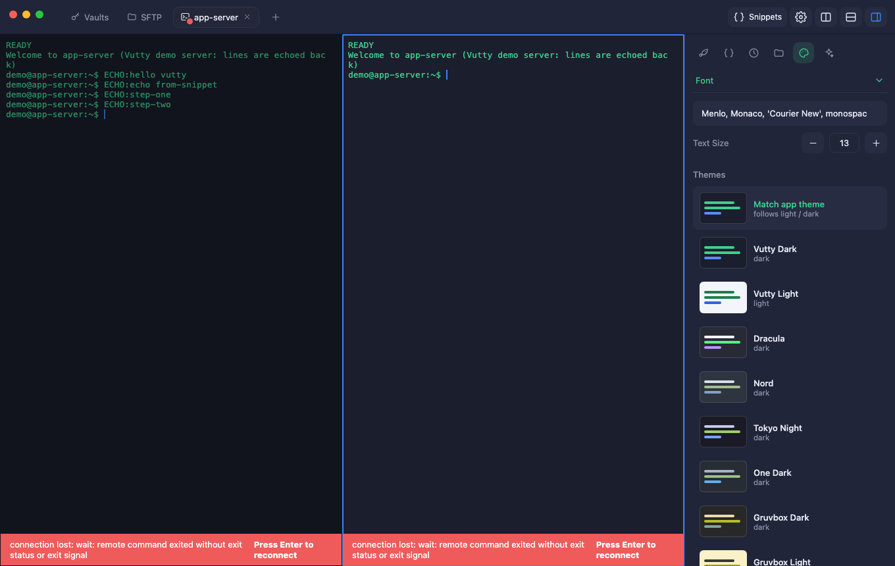
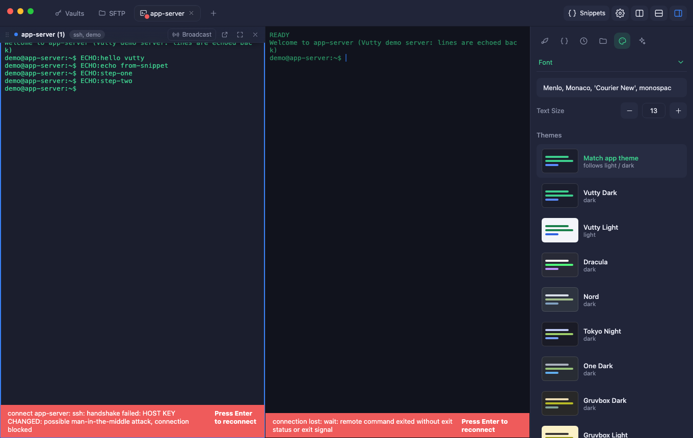
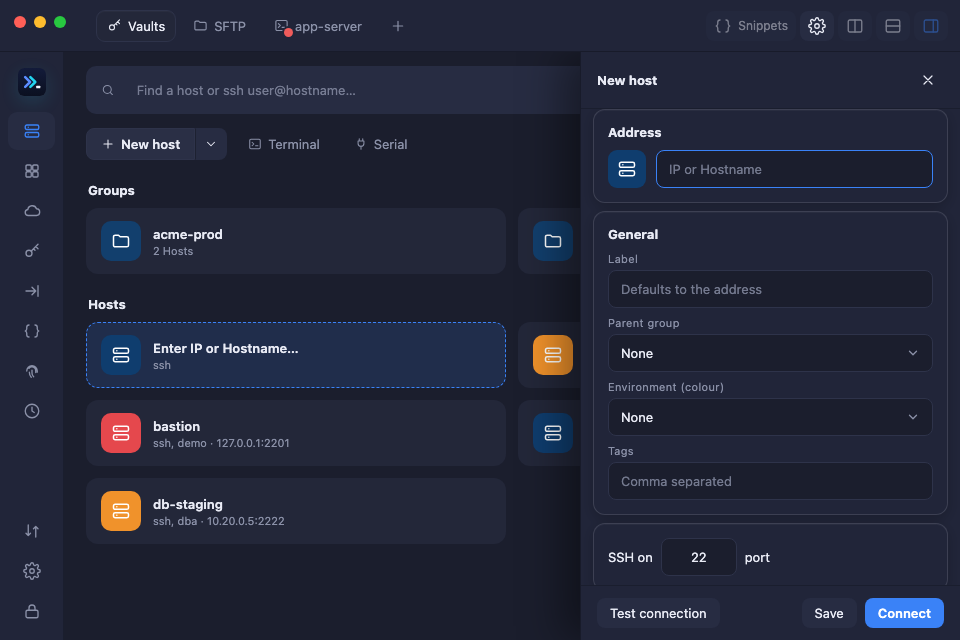
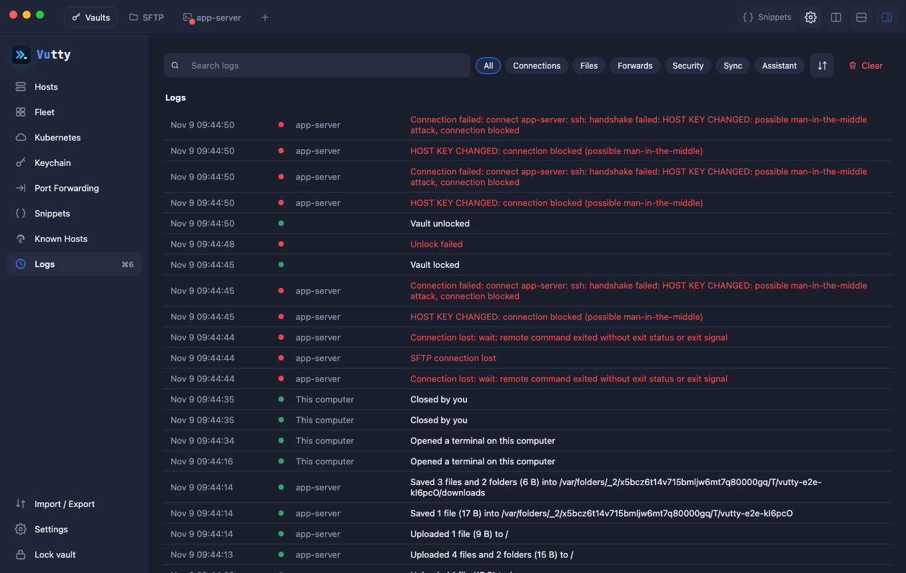

# Troubleshooting and reference

What the common messages mean, where Vutty keeps a record of what it did, and where your data lives.

## Contents

- [When something goes wrong](#when-something-goes-wrong)
- [Known Hosts and Logs](#known-hosts-and-logs)
- [Where your data lives](#where-your-data-lives)

## When something goes wrong

| Symptom | What it means / what to do |
| --- | --- |
| Red banner *connection lost… Press Enter to reconnect* | The link dropped. Vutty never reconnects by itself so commands are not replayed by surprise: press Enter in the pane. |
| *HOST KEY CHANGED* | The server shows a different key than the one you trusted. The connection is blocked with no override. Check with the server's owner; if the change is legitimate, remove the old line from `known_hosts` by hand. |
| *vault is locked* | Unlock the vault and retry. |
| *identity is used by host …* | Detach the identity from its hosts before deleting it. |
| Snippet: *Open a terminal first* / *not connected yet* | Open a host, wait for the prompt, then run the snippet. |
| *Test connection* fails with *Authentication failed* | Wrong password, key not accepted, or the user does not exist on the server. |
| Sync error *encrypted with a different vault key* | The repository was made by another vault (this Mac has its own). In **Settings → Sync** a box appears: enter the master password of the vault that made the repository and choose **Join this vault and sync**. See [Sync and backup](12-sync-and-backup.md). |
| Old icon in the Dock | macOS caches icons. Restart the Dock (`killall Dock`) or move the app to refresh it. |

In a narrow window the layout adapts: the navigation becomes icons and the New host panel floats over the list instead of squeezing it.

## Known Hosts and Logs

- **Known Hosts** lists every server key you trusted (type and fingerprint) and lets you **forget** one so the next connection asks again. Keys stored hashed in an existing `known_hosts` cannot be forgotten from here.
- **Logs** is a filterable, searchable list of what happened, newest first: connections, transfers, forwards, host-key decisions, unlocks, sync. It never contains a password or key.

## Where your data lives

| Item | macOS path (`~/Library/Application Support/vutty/`) |
| --- | --- |
| Hosts, groups, identities (metadata), forwards, snippets, encrypted vault | `data/vutty.db` (SQLite) |
| Trusted host keys | `data/known_hosts` |
| Appearance, terminal theme, auto-lock, sync URL | `data/settings.json` |
| Git working copy (ciphertext only) | `sync/` |

Set `VUTTY_DATA_DIR` to relocate everything. Back up with **Import / Export → Encrypted backup**; losing the master password without a backup means losing the vault.
